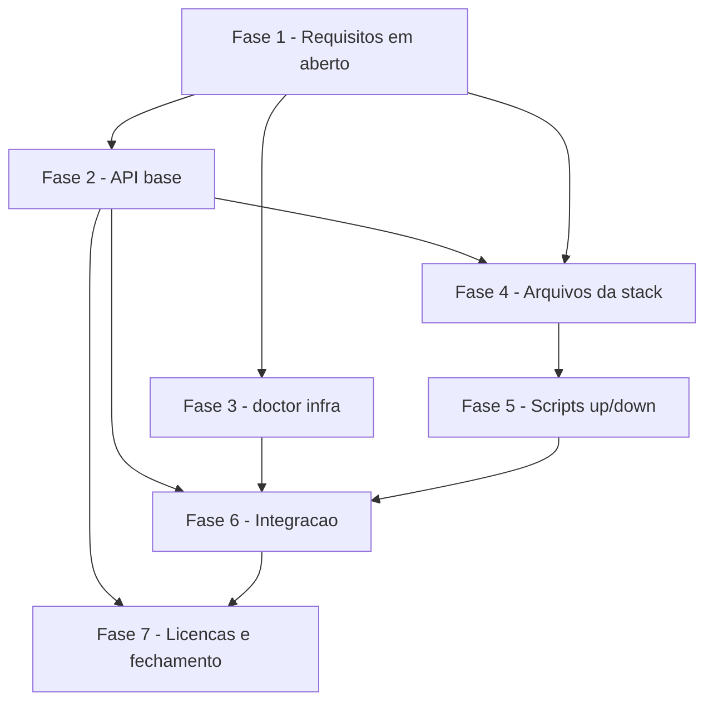

# Tarefas artigo2md - container-stack

Escopo: entregar a base de infraestrutura local da versão desktop (roadmap item 1): `stack/compose.yaml` com Postgres, RabbitMQ com painel e API base (`GET /health`), portas só em `127.0.0.1`, healthchecks, volumes nomeados, `stack/.env.example`, scripts `up.sh`/`down.sh` em português, seção de infraestrutura no `artigo2md doctor`, registro de licenças e testes (sem Docker + integração atrás de `ARTIGO2MD_STACK=1`). Fecha também os itens abertos dos checklists de requisitos. Origem: [spec.md](spec.md), [plan.md](plan.md), [research.md](research.md), [data-model.md](data-model.md), [contracts/](contracts/), [checklists/](checklists/).

Gate de testes de cada tarefa de código: `uv run pytest` (Princípio IV). Valores marcados [PROPOSTA] no research/contracts são validados por teste na implementação; nenhum dado factual novo (digest, versão, licença) entra sem fonte oficial citada.

**Legenda de status:**
- `[ ]` Pendente
- `[~]` Em andamento
- `[x]` Concluido
- `[!]` Bloqueado

**Legenda de criticidade:**
- `[C]` Critico - Impacto financeiro direto ou bloqueante
- `[A]` Alto - Funcionalidade essencial
- `[M]` Medio - Necessario mas sem urgencia imediata

---

## FASE 1 - Requisitos em aberto

### 1.1 Reconciliar spec e contratos com o plan (conflitos e ambiguidades) `[A]`

Ref: checklists/security.md CHK010, CHK018; checklists/api.md CHK005, CHK015, CHK021, CHK022

- [x] 1.1.1 Refletir na spec FR-004 a política de senha do plan (12+ caracteres, sem `$`) ou registrar por que fica só no contrato (security CHK010)
- [x] 1.1.2 Resolver o conflito entre o edge case "baixar imagens só por pedido explícito" e o `--pull missing` da primeira execução: ajustar a redação do edge case ou do contrato de `up.sh`, coerente com a aprovação do plan em block-003 (security CHK018)
- [x] 1.1.3 Definir no `contracts/doctor-infra.md` o estado reportado quando o Postgres responde ErrorResponse durante a inicialização, coerente com o edge case "serviços ainda subindo → inacessível" — só com base em fonte oficial; sem fonte, registrar como hipótese a validar no teste de integração (api CHK015)
- [x] 1.1.4 Registrar no `contracts/api-health.md` a regra de `Host` com porta (`127.0.0.1:<porta>`) e cobri-la com teste de contrato (api CHK005)
- [x] 1.1.5 Definir no `contracts/stack-scripts.md` o que acontece com a saída original do Docker Compose (exibida, suprimida ou explicada em português) (api CHK021)
- [x] 1.1.6 Definir em SC-001 se a medição de 2 min pressupõe a imagem `artigo2md-api:local` já construída (api CHK022)
- [x] 1.1.7 Atualizar os checklists marcando os itens resolvidos com a citação nova

### 1.2 Completar requisitos ausentes `[M]`

Ref: checklists/security.md CHK013, CHK014, CHK017; checklists/api.md CHK004, CHK020, CHK025

- [x] 1.2.1 Especificar o tratamento de contas padrão do broker/painel quando o usuário fornece credenciais próprias, a partir da documentação oficial da imagem/servidor; sem fonte, bloqueio humano (security CHK013)
- [x] 1.2.2 Especificar que testes e logs de CI não imprimem credenciais (ex.: saída de `docker compose config` no teste de integração mascarada ou não exibida) (security CHK014)
- [x] 1.2.3 Especificar o método de observação de SC-003 (ferramenta, ponto de captura, quem executa), só com ferramentas de fonte verificada (security CHK017)
- [x] 1.2.4 Especificar a resposta de `/health` a métodos diferentes de GET (api CHK004)
- [x] 1.2.5 Especificar o comportamento de `up.sh`/`down.sh` quando `docker` existe mas `docker compose` não (api CHK020)
- [x] 1.2.6 Especificar combinações de opções não previstas: `--sim` sem `--apagar-dados`, opção desconhecida, `--atualizar-imagens` com stack no ar (api CHK025)

### 1.3 Decisões do operador (block-004) `[M]`

Ref: checklists/security.md CHK006, CHK021, CHK030; checklists/api.md CHK008; research.md Decision 11 itens 11 e 12 e "Riscos aceitos"

- [x] 1.3.1 Painel do RabbitMQ x DNS rebinding (security CHK006): ADIADO como risco aceito, responsável futuro `desktop-stack-control` (já registrado em research Decision 11 "Riscos aceitos"); conferir que nenhum artefato afirma que o painel "exige login" (sem fonte oficial consultada) e citar o risco no README (tarefa 7.2.2)
- [x] 1.3.2 Endurecimento do Postgres e do RabbitMQ (security CHK021): aplicar APENAS `no-new-privileges` nesses dois serviços (tarefa 4.1.6); demais endurecimentos (usuário, FS somente leitura, `cap_drop`, limites) são risco aceito registrado (research Decision 11 "Riscos aceitos"; citar no README, tarefa 7.2.2)
- [x] 1.3.3 Ratificação de dec-013 (security CHK030): pendência EXTERNA do operador; a feature NÃO edita a `docs/constitution.md`; manter a nota de pendência no plan e listá-la no relatório final de fechamento
- [x] 1.3.4 Versionamento do contrato `/health` (api CHK008): estratégia definida agora em `contracts/api-health.md` §Versionamento e compatibilidade; implementar o teste de contrato correspondente na tarefa 2.2.6

---

## FASE 2 - API base

### 2.1 Grupo de dependências `api` `[A]`

Ref: plan.md §Project Structure (`pyproject.toml`, `uv.lock`); research.md Decision 3

- [x] 2.1.1 Acrescentar `[dependency-groups] api = ["fastapi>=0.115", "uvicorn>=0.30"]` ao `pyproject.toml`
- [x] 2.1.2 Regenerar `uv.lock` com `uv lock` (o CI usa `--locked`)
- [x] 2.1.3 Conferir `uv sync --locked --extra dev` e `uv run pytest` verdes

### 2.2 Aplicação `artigo2md.api` com `GET /health` `[A]`

Ref: spec.md FR-008, US4; contracts/api-health.md; research.md Decision 11 item 7

- [x] 2.2.1 Criar `src/artigo2md/api/__init__.py` e `src/artigo2md/api/app.py` com `FastAPI(docs_url=None, redoc_url=None, openapi_url=None)`
- [x] 2.2.2 Implementar `GET /health` com `status`, `service`, `version` (`artigo2md.__version__`)
- [x] 2.2.3 Adicionar `TrustedHostMiddleware` com `allowed_hosts=["127.0.0.1", "localhost"]`
- [x] 2.2.4 Escrever `tests/test_api_base.py`: 200 + payload, 404 em rota desconhecida e em `/docs`, `/redoc`, `/openapi.json`, 400 com `Host` fora da lista, `Host` com porta (regra de 1.1.4)
- [x] 2.2.5 Teste em subprocesso: importar `artigo2md.api.app` não coloca `docling` nem `pymupdf4llm` em `sys.modules`
- [x] 2.2.6 Teste de contrato de compatibilidade (api CHK008, `contracts/api-health.md` §Versionamento): `/health` contém ao menos `status == "ok"`, `service == "artigo2md-api"` e `version` string igual a `artigo2md.__version__`; o teste tolera chaves adicionais; o `doctor` (tarefa 3.2.3) é testado com um servidor falso que devolve chave extra e continua `reachable` — metade da API feita em `tests/test_api_base.py::test_health_contract_fields`; a metade do `doctor` em `tests/test_infra.py::test_api_tolerates_extra_keys_in_health_payload` (3.2.5)

---

## FASE 3 - Seção de infraestrutura do `doctor`

### 3.1 Resolução de portas e leitura segura do `.env` `[A]`

Ref: contracts/doctor-infra.md; research.md Decision 11 itens 1 e 2; data-model.md §Parameters

- [x] 3.1.1 Criar `src/artigo2md/infra.py` com parser de `.env` só leitura (remove `export `, espaços e aspas envolventes; ignora comentários e linhas vazias; sem execução)
- [x] 3.1.2 Resolver cada porta na ordem ambiente → `ARTIGO2MD_STACK_ENV` → `./stack/.env` → padrão, guardando a origem
- [x] 3.1.3 Tratar porta inválida (não numérica, fora de 1–65535) como estado `invalid_port`, sem exceção
- [x] 3.1.4 Testes em `tests/test_infra.py` para a ordem de resolução, a origem e a porta inválida

### 3.2 Checagens por handshake de protocolo `[A]`

Ref: spec.md FR-009, Clarifications dec-014; contracts/doctor-infra.md §Checagens; research.md Decision 7, Decision 11 item 6

- [x] 3.2.1 Postgres: SSLRequest e classificação da resposta conforme o contrato (com o ajuste de 1.1.3), sem exibir o texto do erro
- [x] 3.2.2 RabbitMQ: cabeçalho AMQP 0-9-1 e classificação `reachable` / `protocol_mismatch` conforme o contrato
- [x] 3.2.3 API: `http.client.HTTPConnection("127.0.0.1", porta)` direto, sem proxy, exigindo 200 e `status == "ok"`
- [x] 3.2.4 Tempo limite 1 s conexão + 1 s leitura e execução das três checagens em paralelo
- [x] 3.2.5 Testes com servidores falsos em `127.0.0.1` porta efêmera: acessível, inacessível, parcial, versão incompatível, servidor que não responde (teto < 5 s), proxy inválido em `HTTP_PROXY`/`HTTPS_PROXY`

### 3.3 Integração no `cmd_doctor` `[A]`

Ref: spec.md FR-009, FR-010, SC-005; contracts/doctor-infra.md §Command, §Exit codes, §Não-regressão

- [x] 3.3.1 Formatar a seção em português (estados, origem das portas, linha de instrução só quando algum serviço está inacessível)
- [x] 3.3.2 Chamar a seção em `cmd_doctor` com import local de `.infra`, sem alterar o código de saída
- [x] 3.3.3 Testes: exit code inalterado com infraestrutura fora; seção presente; `convert` não importa `artigo2md.infra` nem abre socket para a stack
- [x] 3.3.4 Conferir que os testes existentes de `tests/test_cli.py` continuam verdes (não-regressão)

---

## FASE 4 - Arquivos da stack

### 4.1 `stack/compose.yaml` `[C]`

Ref: spec.md FR-001, FR-003, FR-005, FR-006, FR-007; contracts/stack-scripts.md §compose.yaml; research.md Decisions 1, 2, 4, 5, 11 itens 3 e 5

- [x] 4.1.1 Definir `name: artigo2md` e os serviços `postgres` (`postgres:18-trixie`), `rabbitmq` (`rabbitmq:4.4-management`, `hostname: rabbitmq`) e `api` (`image: artigo2md-api:local` + `build`)
- [x] 4.1.2 Publicar todas as portas na forma `"127.0.0.1:${ARTIGO2MD_…_PORT:?…}:<porta>"`, sem publicar epmd nem a distribuição Erlang
- [x] 4.1.3 Definir os healthchecks da research Decision 4 e os volumes nomeados `pgdata` e `rabbitmqdata`
- [x] 4.1.4 Aplicar ao serviço `api`: `user: "10001:10001"`, `read_only: true`, `tmpfs: [/tmp]`, `cap_drop: [ALL]`, `security_opt: ["no-new-privileges:true"]`, `depends_on` com `service_healthy`
- [x] 4.1.5 Usar `${VAR:?…}` para credenciais obrigatórias (incluindo `POSTGRES_DB`) e não definir `restart`
- [x] 4.1.6 Aplicar `security_opt: ["no-new-privileges:true"]` aos serviços `postgres` e `rabbitmq` e NENHUM outro endurecimento além dos padrões das imagens (decisão do operador, block-004; research Decision 11 item 11)

### 4.2 `stack/.env.example` e `.gitignore` `[C]`

Ref: spec.md FR-004, FR-006; contracts/stack-scripts.md §Arquivo `stack/.env.example`

- [x] 4.2.1 Criar `stack/.env.example` com as variáveis e padrões do contrato e comentários em português (senha 12+ caracteres sem `$`, `docker inspect`, credenciais só na 1ª inicialização do volume)
- [x] 4.2.2 Acrescentar `stack/.env` ao `.gitignore`
- [x] 4.2.3 Conferir que nenhuma variável controla o endereço de publicação

### 4.3 Imagem da API `[A]`

Ref: plan.md §Structure Decision; research.md Decision 3, Decision 11 itens 3 e 4

- [x] 4.3.1 Criar `stack/api/Dockerfile` sobre `python:3.13-slim-trixie` com uv 0.13.9, copiando `pyproject.toml` + `uv.lock` e rodando `uv sync --frozen --only-group api` antes de copiar `src/`
- [x] 4.3.2 Avaliar fixar a imagem do uv por digest, só com digest observado na implementação (risco aceito em block-003)
- [x] 4.3.3 Rodar como usuário `10001`, `PYTHONPATH=/app/src`, `uvicorn artigo2md.api.app:app --host 0.0.0.0 --port 8000`
- [x] 4.3.4 Criar `.dockerignore` na raiz em modo allowlist (`*`, `!pyproject.toml`, `!uv.lock`, `!src/artigo2md/`)

### 4.4 Teste estático dos arquivos da stack `[C]`

Ref: research.md Decision 10, Decision 11 item 8; spec.md SC-002

- [x] 4.4.1 Criar `tests/test_stack_files.py`: toda entrada de `ports` começa com `127.0.0.1:`; forma longa sem `host_ip: 127.0.0.1` recusada
- [x] 4.4.2 Recusar `privileged`, `network_mode` e montagem de `docker.sock` em qualquer serviço
- [x] 4.4.2b Exigir `no-new-privileges:true` em `security_opt` de `postgres`, `rabbitmq` e `api`
- [x] 4.4.3 Conferir `.env.example` sem credencial real, `stack/.env` no `.gitignore` e `.dockerignore` em allowlist

---

## FASE 5 - Scripts de subir e derrubar

### 5.1 `stack/up.sh` `[A]`

Ref: spec.md FR-002, FR-004, FR-012, FR-013, FR-015, US1; contracts/stack-scripts.md §up.sh; research.md Decision 8, Decision 11 itens 1, 3, 9

- [x] 5.1.1 Resolver o próprio caminho e montar `docker compose --project-directory stack --env-file stack/.env -f stack/compose.yaml`
- [x] 5.1.2 Validar `.env` (existência, chave duplicada, `$`, `POSTGRES_HOST_AUTH_METHOD`, credenciais vazias/de exemplo/curtas, portas) citando só o nome da variável (exit 2)
- [x] 5.1.3 Checar `docker info` (exit 3) e o caso de `docker compose` ausente definido em 1.2.5
- [x] 5.1.4 Detectar "já estava no ar" e porta ocupada (`nc -z -w 1`) só para serviços ainda não rodando (exit 4)
- [x] 5.1.5 Subir com `--detach --wait --wait-timeout 120 --pull missing` e `--build`/`--no-build` conforme `docker image inspect`; `--atualizar-imagens` troca por `--pull always` + `--build`
- [x] 5.1.6 Reportar em português o estado de cada serviço, a URL do painel e, em falha, o serviço e o comando de logs (exit 5)

### 5.2 `stack/down.sh` `[A]`

Ref: spec.md FR-002, FR-003, US1 cenários 2 e 6; contracts/stack-scripts.md §down.sh; research.md Decision 11 item 10

- [x] 5.2.1 `down` sem opção mantendo os volumes; usar `.env.example` para interpolação quando `.env` faltar
- [x] 5.2.2 `--apagar-dados` com confirmação digitada `apagar`; sem terminal interativo, fail-closed (exit 1) salvo `--sim` explícito
- [x] 5.2.3 Docker indisponível com mensagem em português (exit 3) e opções não previstas conforme 1.2.6

### 5.3 Testes dos scripts sem Docker `[A]`

Ref: spec.md FR-014, SC-007; research.md Decision 10, Decision 11 item 9

- [x] 5.3.1 Criar `tests/test_stack_scripts.py` com `docker` e `nc` falsos no `PATH`
- [x] 5.3.2 Cobrir os exits 2, 3, 4 e 5 do `up.sh` sem chamar o Docker real e sem vazar valores de credencial nas mensagens
- [x] 5.3.3 Cobrir "já estava no ar", `--atualizar-imagens` e a escolha `--build`/`--no-build`
- [x] 5.3.4 Cobrir `down.sh` sem opção, `--apagar-dados` confirmado, recusado e sem terminal

---

## FASE 6 - Integração com a stack real

### 6.1 `tests/test_stack_integration.py` (`ARTIGO2MD_STACK=1`) `[A]`

Ref: spec.md US1–US4, SC-001, SC-002, SC-004; research.md Decision 10, Decision 11 item 8

- [x] 6.1.1 Pular todo o módulo sem `ARTIGO2MD_STACK=1` (mesmo padrão do `ARTIGO2MD_SLOW`)
- [x] 6.1.2 Subir do zero e conferir todos os serviços saudáveis dentro de 2 min, já com `no-new-privileges` em `postgres` e `rabbitmq` (hipótese de compatibilidade a validar; se um serviço falhar por causa da opção, bloqueio humano — não remover a opção sozinho)
- [x] 6.1.3 Conferir portas só em loopback via `docker compose port` e via `docker compose config`, sem imprimir credenciais (regra de 1.2.2)
- [x] 6.1.4 Idempotência: reexecutar `up.sh` sem recriar containers nem volumes
- [x] 6.1.5 Persistência: gravar dado, derrubar e subir 3 vezes, dado presente
- [x] 6.1.6 `doctor` com a stack no ar reporta os três serviços acessíveis; `/health` responde pelo host

### 6.2 Validar hipóteses marcadas no research `[M]`

Ref: plan.md §Riscos e pontos a validar; research.md Decision 4, Decision 8, Decision 11 item 9

- [x] 6.2.1 Observar se `pg_isready -h 127.0.0.1` fica não saudável durante o init e registrar o resultado no research
- [x] 6.2.2 Observar o estado do `doctor` com serviços ainda subindo e confirmar a regra de 1.1.3
- [x] 6.2.3 Conferir `nc -z -w` no runner Linux do CI e registrar o resultado — RESSALVA: observado só em container `ubuntu:24.04` + `netcat-openbsd` (saída 0 porta aberta, 1 fechada); o runner real do CI fica para a 1ª execução do CI (research, Observações da integração real, item 4)
- [x] 6.2.4 Conferir o nome real dos volumes criados e atualizar o data-model se divergir

---

## FASE 7 - Licenças, documentação e fechamento

### 7.1 Registro de licenças `stack/THIRD_PARTY_LICENSES.md` `[C]`

Ref: spec.md FR-011, US5, SC-006; research.md §Registro de licenças; data-model.md §LicenseRecord; checklists/security.md CHK029

- [x] 7.1.1 Transpor para o registro as linhas confirmadas do research com fonte oficial e data de consulta
- [x] 7.1.2 Listar as dependências transitivas do grupo `api` a partir do `uv.lock` e citar a licença de cada uma da página oficial do pacote (security CHK029); sem fonte, bloqueio humano
- [x] 7.1.3 Marcar o SO base como "documentado (SO base, dec-013)" e rejeitar qualquer GPL/AGPL obrigatório com bloqueio humano
- [x] 7.1.4 Teste estático: nenhuma linha com licença vazia ou "presumida"

### 7.2 README `[M]`

Ref: plan.md §Project Structure (`README.md`); quickstart.md

- [x] 7.2.1 Acrescentar a seção "Infraestrutura local (versão desktop)" com cópia do `.env.example`, `up.sh`, `down.sh` e `doctor`
- [x] 7.2.2 Documentar os riscos aceitos (credenciais em `docker inspect`, tags sem digest, painel do RabbitMQ sem proteção contra DNS rebinding, endurecimento limitado de Postgres/RabbitMQ) e o log de conexão encerrada causado pelo `doctor`; sem afirmar que o painel exige login
- [x] 7.2.3 Conferir os comandos do README contra os contratos

### 7.3 Gate final `[A]`

Ref: docs/constitution.md Princípio IV; spec.md SC-007

- [x] 7.3.1 `uv run pytest` verde sem Docker
- [x] 7.3.2 `ARTIGO2MD_STACK=1 uv run pytest -k stack_integration` verde com Docker antes do merge
- [x] 7.3.3 `uv sync --locked` verde com o `uv.lock` regenerado

---

## Matriz de Dependencias

## Resumo Quantitativo

| Fase | Tarefas | Subtarefas | Criticidade |
|------|---------|------------|-------------|
| 1 - Requisitos em aberto | 3 | 17 | A/M |
| 2 - API base | 2 | 9 | A |
| 3 - doctor infra | 3 | 13 | A |
| 4 - Arquivos da stack | 4 | 17 | C/A |
| 5 - Scripts up/down | 3 | 13 | A |
| 6 - Integração | 2 | 10 | A/M |
| 7 - Licenças e fechamento | 3 | 10 | C/A/M |
| **Total** | **20** | **89** | - |

## Escopo Coberto

| Item | Descricao | Fase |
|------|-----------|------|
| FR-001, FR-003, FR-005, FR-006, FR-007 | Composição da stack, volumes, healthchecks, loopback, sem telemetria | 4 |
| FR-002, FR-004, FR-012, FR-013, FR-015 | Scripts de subir/derrubar, parâmetros, mensagens, porta ocupada, idempotência | 4, 5 |
| FR-008 | API base com `GET /health` | 2, 4 |
| FR-009, FR-010 | Seção de infraestrutura do `doctor`; `convert` intacto | 3 |
| FR-011 | Registro de licenças | 7 |
| FR-014 | Testes sem Docker e integração atrás de `ARTIGO2MD_STACK=1` | 2–6 |
| Checklists | Gaps/Conflitos/Ambiguidades abertos e decisões do operador (block-004) | 1, 2, 4 |

## Escopo Excluido

| Item | Descricao | Motivo |
|------|-----------|--------|
| Schema do banco e topologia da fila | Tabelas e filas | Pertencem a `job-store` e `conversion-queue` (data-model.md) |
| Rotas de negócio da API | Qualquer rota além de `/health` | Pertencem à `project-api` (spec US4) |
| Geração automática de credenciais e controle da stack pelo app | Chamadas do app desktop | Pertencem à `desktop-stack-control` (spec FR-004) |
| Trava contra `up.sh` concorrente e limite de memória | Endurecimento operacional | Riscos aceitos pelo operador em block-003 (research Decision 11) |
| Edição da `docs/constitution.md` | Ratificação de dec-013 | Cabe ao operador (spec Clarifications); pendência externa (tarefa 1.3.3) |
| Proteção do painel do RabbitMQ contra DNS rebinding; endurecimento além de `no-new-privileges` em Postgres/RabbitMQ | Decisão do operador em block-004 | Riscos aceitos; responsável futuro `desktop-stack-control` |
| MinerU | Motor opcional | Fora do escopo desta feature |

---

## FASE 8 - Convergência

> Fase gerada automaticamente pela skill `converge` (reconciliação
> spec-vs-código). Cada tarefa abaixo corresponde a um achado (`Gap`)
> entre o que `spec.md`/`plan.md`/`tasks.md` descreveram e o estado
> presente do código. Tarefas sem o prefixo `[Revisar]` são acionáveis
> (`missing`/`partial`/`contradicts`); tarefas com `[Revisar]` são item de
> revisão (`unrequested`, FR-013) — nunca "implementar", o código já
> existe. Append-only: esta fase nunca reescreve fases/tarefas anteriores
> do arquivo (FR-009).

### 8.1 Validar a conta padrão `guest` do RabbitMQ no teste de integração `[C]`

Ref: 6.1 (research.md Decision 11 item 13; checklists/security.md CHK013; spec.md FR-004, FR-006) · tipo: `partial` · severidade: `HIGH`

A research Decision 11 item 13 exige que o teste de integração (tarefa 6.1) liste os usuários do broker dentro do container e registre na research o resultado sobre a conta `guest`; se o `guest` existir E puder autenticar por rede, bloqueio humano (não corrigir sozinho). O código presente em `tests/test_stack_integration.py` cobre 6.1.2–6.1.6, mas não tem nenhuma checagem sobre o `guest`, e a seção "Observações da integração real" da research não registra resultado sobre ele. Completar exige só ADICIONAR um teste e o registro.

- [x] 8.1.1 Acrescentar a `tests/test_stack_integration.py` (atrás de `ARTIGO2MD_STACK=1`) a listagem dos usuários do broker dentro do container (`rabbitmqctl list_users`) e a tentativa de autenticação do `guest` pela porta publicada em `127.0.0.1` (painel), sem imprimir credenciais
- [x] 8.1.2 Rodar a integração e registrar o resultado observado na research ("Observações da integração real"); se o `guest` existir E autenticar por rede, bloqueio humano

<!-- converge-key: e1fd23cade16 -->
