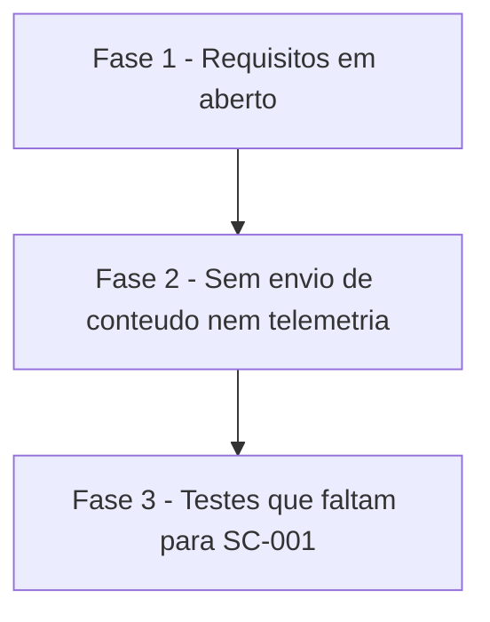

# Tarefas artigo2md - conversion-engines

Escopo: atender FR-013 (nenhum motor envia conteúdo a serviços externos; telemetria desativada quando o motor oferece a opção), criar os testes que faltam para FR-002, FR-005 a FR-009, FR-012 e FR-013 (meta SC-001) e fechar os itens abertos do checklist de requisitos. Origem: [spec.md](spec.md) e [plan.md](plan.md).

**Legenda de status:**
- `[ ]` Pendente
- `[~]` Em andamento
- `[x]` Concluido
- `[!]` Bloqueado

**Legenda de criticidade:**
- `[C]` Critico - Impacto financeiro direto ou bloqueante
- `[A]` Alto - Funcionalidade essencial
- `[M]` Medio - Necessario mas sem urgencia imediata

---

## FASE 1 - Requisitos em aberto

### 1.1 Fechar ambiguidades e gaps do checklist `[M]`

Ref: checklists/requirements.md CHK002, CHK003, CHK006, CHK007; research.md Decision 2 (pergunta em aberto)

- [ ] 1.1.1 Registrar na spec o tempo limite de execução do MinerU observado em `src/artigo2md/engines.py` (CHK002)
- [ ] 1.1.2 Obter do operador a decisão sobre o comportamento quando um motor obrigatório não está instalado e registrá-la na spec (CHK003)
- [ ] 1.1.3 Definir na spec o "modo preciso" da estrutura de tabelas, a partir de `src/artigo2md/engines.py` (CHK006)
- [ ] 1.1.4 Quantificar na spec o trecho final da saída do MinerU usado na mensagem de falha, a partir de `src/artigo2md/engines.py` (CHK007)
- [ ] 1.1.5 Obter do operador a decisão sobre o acesso à rede para baixar modelos depois que eles já estão em cache (research.md Decision 2)
- [ ] 1.1.6 Atualizar o checklist com os itens resolvidos

---

## FASE 2 - Sem envio de conteúdo nem telemetria em todos os motores

### 2.1 Docling e Hugging Face Hub `[A]`

Ref: spec.md FR-013; research.md Decisions 1 e 2; quickstart.md Scenario 3

- [ ] 2.1.1 Escrever o teste, inicialmente falhando, de que as opções de pipeline montadas pelo adaptador têm serviços remotos desligados de forma explícita
- [ ] 2.1.2 Escrever o teste, inicialmente falhando, de que a variável de telemetria do hub está definida depois de importar o módulo de motores
- [ ] 2.1.3 Implementar em `src/artigo2md/engines.py` os serviços remotos desligados nas opções do Docling
- [ ] 2.1.4 Implementar a definição da variável de telemetria do hub antes de qualquer import do Docling
- [ ] 2.1.5 Rodar o teste lento do Docling e confirmar que a conversão continua funcionando

### 2.2 Motores leves sem acesso à rede `[A]`

Ref: spec.md FR-013; research.md Decisions 3, 4 e 6; quickstart.md Scenario 2

- [ ] 2.2.1 Reaproveitar ou criar a fixture de teste que bloqueia a criação de sockets (a mesma prevista no backlog de pdf-inspection, tarefa 3.2)
- [ ] 2.2.2 Escrever o teste da conversão com MarkItDown com sockets bloqueados
- [ ] 2.2.3 Escrever o teste da conversão com pymupdf4llm com sockets bloqueados, pulado quando o pacote não está instalado
- [ ] 2.2.4 Atualizar a spec: FR-013 e o edge case pendente passam a citar as fontes no código e nos testes

---

## FASE 3 - Testes que faltam para SC-001

### 3.1 MinerU simulado `[A]`

Ref: spec.md FR-006, FR-007, FR-008, FR-009; research.md Decisions 5 e 7; quickstart.md Scenarios 4 a 6

- [ ] 3.1.1 Criar a fixture que simula a localização do executável e a execução do subprocesso e limpa o cache de verificação de versão
- [ ] 3.1.2 Escrever o teste da localização pelo PATH e pela variável de ambiente (FR-006)
- [ ] 3.1.3 Escrever os testes de versão da linha 3.x aceita e de outra versão recusada com o detalhe de incompatibilidade (FR-007)
- [ ] 3.1.4 Escrever o teste de que o ambiente do subprocesso leva a telemetria desativada e de que o maior Markdown gerado é o devolvido (FR-008)
- [ ] 3.1.5 Escrever os testes de falha: processo com erro e processo sem Markdown gerado (FR-009)

### 3.2 pymupdf4llm ausente, OCR e reuso do conversor `[M]`

Ref: spec.md FR-005, FR-002, FR-012; research.md Decision 8; quickstart.md Scenarios 7 e 8

- [ ] 3.2.1 Escrever o teste do erro de motor indisponível, com a instrução de instalação, simulando a ausência do pymupdf4llm (FR-005)
- [ ] 3.2.2 Escrever o teste das opções de OCR para macOS e para outra plataforma (FR-002)
- [ ] 3.2.3 Medir se criar o conversor do Docling carrega modelos e decidir entre teste rápido com substituição ou teste lento (research.md Decision 8)
- [ ] 3.2.4 Escrever o teste de que duas chamadas para o mesmo modo devolvem o mesmo conversor (FR-012)

### 3.3 Fechamento `[M]`

Ref: spec.md SC-001; checklists/requirements.md CHK012

- [ ] 3.3.1 Substituir na spec os cenários e edge cases pendentes pelas fontes dos testes
- [ ] 3.3.2 Atualizar o checklist: CHK012 resolvido com as fontes dos testes
- [ ] 3.3.3 Rodar `uv run pytest` e, com o teste lento habilitado, a suíte completa

---

## Matriz de Dependencias

A fase 2 depende da decisão 1.1.5 da fase 1 (acesso à rede para modelos). A fase 3 fecha a spec e o checklist depois das mudanças da fase 2.

## Resumo Quantitativo

| Fase | Tarefas | Subtarefas | Criticidade |
|------|---------|------------|-------------|
| 1 - Requisitos em aberto | 1 | 6 | M |
| 2 - Sem envio de conteúdo nem telemetria em todos os motores | 2 | 9 | A |
| 3 - Testes que faltam para SC-001 | 3 | 12 | A, M |
| **Total** | **6** | **27** | - |

## Escopo Coberto

| Item | Descricao | Fase |
|------|-----------|------|
| FR-013 | Serviços remotos do Docling desligados de forma explícita, telemetria do hub desativada e testes de rede dos motores leves | 2 |
| FR-006, FR-007, FR-008, FR-009 | Testes do MinerU por simulação | 3 |
| FR-002, FR-005, FR-012 | Testes de OCR, de pymupdf4llm ausente e de reuso do conversor | 3 |
| CHK002, CHK003, CHK006, CHK007 | Itens abertos do checklist de requisitos | 1 |
| CHK012 | Requisitos sem teste como origem | 3 |

## Escopo Excluido

| Item | Descricao | Motivo |
|------|-----------|--------|
| FR-001, FR-003, FR-004, FR-010, FR-011 | Requisitos já observados no código e com teste existente | Sem mudança prevista (plan.md, Summary) |
| Instalação do MinerU | Testar com o MinerU real instalado | O projeto orienta a não instalá-lo sem pedido; os testes usam simulação (research.md, Decision 7) |
| Modo offline do hub | Proibir download de modelos | Depende da decisão do operador na tarefa 1.1.5; não é requisito hoje |
| Suporte ao MinerU 4.x | Aceitar a linha 4.x | Política de só 3.x mantida na clarificação |
