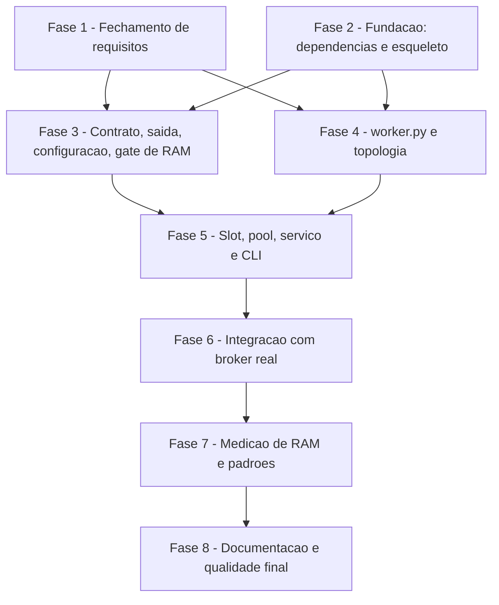

# Tarefas artigo2md - Fila de conversão e worker nativo

Escopo: backlog da feature `conversion-queue` (subcomando `artigo2md worker`, topologia RabbitMQ, contrato de mensagens v1, proteção de RAM, medição de RAM, retry/mensagens mortas, encerramento e reconexão). Origem: `docs/specs/conversion-queue/spec.md`, `plan.md`, `research.md`, `data-model.md`, `contracts/` e os gaps abertos de `checklists/` (api, security, performance). Tier de entrega usado na geração deste backlog: não informado nos `args` (backlog completo, sem omissão de fases).

**Legenda de status:**
- `[ ]` Pendente
- `[~]` Em andamento
- `[x]` Concluido
- `[!]` Bloqueado

**Legenda de criticidade:**
- `[C]` Critico - Impacto financeiro direto ou bloqueante
- `[A]` Alto - Funcionalidade essencial
- `[M]` Medio - Necessario mas sem urgencia imediata

---

## Premissas e riscos aceitos (revisão do operador)

Itens `{humano}` dos checklists. Não geram tarefa de implementação: valem como **premissa ou risco aceito** até o operador discordar. Recusar qualquer linha abre uma tarefa nova (coluna "Se recusada"). Os itens seguem `[ ]` nos checklists até a revisão do operador (tarefa 1.9).

| ID | Item (checklist) | Premissa / risco aceito | Se recusada |
|----|------------------|--------------------------|-------------|
| P-01 | api CHK007 | O contrato v1 e os nomes de exchanges/filas (marcados PROPOSTA) ainda não foram aceitos pelos consumidores futuros (`project-api`, app desktop). Aceito como v1; mudança incompatível posterior vira `schema_version` 2. Risco: retrabalho se os consumidores pedirem outros nomes. | Antes de `execute-task`, validar o contrato com os donos das features futuras e revisar `contracts/queue-messages.md`. |
| P-02 | security CHK004 | Quem tem as credenciais do broker (loopback `127.0.0.1`, usuário único) é confiável: pode pedir ao worker que leia qualquer PDF absoluto legível pelo usuário e grave o Markdown no diretório de dados. Sem allowlist de pastas de PDF. | Acrescentar opção de linha de comando com pastas permitidas para `pdf_path` e código de erro novo. |
| P-03 | security CHK012 | Além das credenciais (proibidas), caminhos de PDF e trechos de mensagens de exceção de bibliotecas de terceiros podem aparecer em `reason`, em eventos e em logs. Aceito por ser máquina local de um só usuário. | Definir filtragem/truncamento de `reason` e dos logs. |
| P-04 | security CHK013 | Os Markdown gravados e as mensagens mortas (que guardam o corpo original) herdam a `umask` do usuário; nenhuma permissão especial é imposta. | Definir modo de arquivo/diretório (por exemplo, só o dono) em `output.py` e na documentação. |
| P-05 | security CHK014 e performance CHK015 | A fila `artigo2md.events.all` (sem consumidor até a `project-api`) e a fila de mortas não têm limite nem retenção; podem crescer no disco do broker. A limpeza é manual (painel de gestão, que exige subir a stack com `sh stack/up.sh --management-panel`: o painel não é publicado por padrão). | Definir `x-max-length`/TTL por fila na topologia (muda os argumentos declarados e exige nova decisão de compatibilidade). |
| P-06 | security CHK016 | O `pika==1.5.0` foi avaliado só quanto à licença (BSD-3-Clause, informada pelo operador no `block-001`), não quanto a vulnerabilidades conhecidas. Risco aceito até revisão pelo operador. | Consultar o histórico de advisories oficial do projeto e registrar o resultado antes de `execute-task` 2.1. |
| P-07 | performance CHK002 | Não há meta de vazão ou latência por PDF; o único alvo mensurável é "no máximo N conversões simultâneas" (SC-001). | Definir meta (por exemplo, lote de 10 PDFs) e acrescentar à medição da tarefa 7.2. |
| P-08 | performance CHK011 | Os PDFs da medição de RAM são sintéticos ou versionáveis, de origem conhecida; nenhum PDF de usuário é usado nem versionado. O relatório registra nome, páginas, perfil e SHA-256. | Operador indica a origem dos PDFs de medição (e se podem ser versionados). |

---

## FASE 1 - Fechamento de requisitos abertos dos checklists

### 1.1 Evolução do contrato e ordem dos eventos `[A]`

Ref: checklists/api.md CHK005, CHK006; contracts/queue-messages.md §Evolução, §Eventos; spec.md FR-008, FR-009

- [x] 1.1.1 Decidir e documentar em `queue-messages.md` §Evolução: acrescentar campo opcional a um evento é mudança compatível (mesma `schema_version`) e consumidores MUST ignorar campos desconhecidos em eventos; o `job` continua rejeitando campos extras; remover/renomear/mudar tipo de campo exige `schema_version` nova
- [x] 1.1.2 Documentar a ordem de entrega dos eventos: os eventos de um mesmo job e tentativa saem em sequência de um único slot, com confirmação do broker; `progress` antes de `result`/`error`; o consumidor não pode presumir ordem entre jobs nem entre tentativas; há um único evento terminal por (`job_id`, `attempt`)
- [x] 1.1.3 Registrar as duas regras na `spec.md` (Clarifications, com data) e registrar a Decisão
- [x] 1.1.4 Garantir que a tarefa 3.1 lista os casos de teste correspondentes (evento com campo extra aceito; job com campo extra rejeitado)
- [x] 1.1.5 Atualizar `checklists/api.md` CHK005 e CHK006 para `[x]` com citação do trecho que os resolve

### 1.2 Entrega duplicada e significado de "resultado não perdido" `[A]`

Ref: checklists/api.md CHK012, CHK013; spec.md FR-003, FR-012, US5-4; contracts/queue-messages.md §Garantias de entrega

- [x] 1.2.1 Analisar a janela de falha: cópia de retry confirmada em `artigo2md.retry` e `ack` do original perdido; o original volta com `attempt` antigo e existe também a cópia `attempt+1`
- [x] 1.2.2 Decidir e documentar em §Garantias de entrega o tratamento (aceitar como limitação de at-least-once com cadeia duplicada limitada, deduplicação do consumidor por `job_id`+`attempt`, ou mitigação por flag de reentrega); registrar a Decisão com a alternativa rejeitada
- [x] 1.2.3 Reescrever US5-4/FR-012 (Clarifications): "resultado não perdido" = Markdown atômico já no destino e job reentregue e reprocessado de forma idempotente, sem estado persistente próprio do worker
- [x] 1.2.4 Acrescentar ao `quickstart.md` o cenário "ack perdido após a cópia de retry" e garantir que a tarefa 5.1 o testa
- [x] 1.2.5 Atualizar `checklists/api.md` CHK012 e CHK013 para `[x]` com citação

### 1.3 Conciliar FR-001 com as opções obrigatórias até a medição `[A]`

Ref: checklists/api.md CHK018, CHK019; spec.md FR-001, FR-004, FR-005, FR-015, US4-2; contracts/worker-cli.md §opções

- [x] 1.3.1 Ajustar FR-001 na `spec.md`: exceção explícita de que `--workers` e `--min-free-memory` não têm padrão até existir o relatório de FR-015
- [x] 1.3.2 Definir o comportamento de US4-2 ("worker iniciado sem informar o pool") como recusa de início com a mensagem "medição pendente" de `worker-cli.md` e código de saída 2
- [x] 1.3.3 Atribuir a transição "obrigatório → padrão do relatório" à tarefa 7.3 (referência cruzada em `worker-cli.md` e no `plan.md` Decision 7)
- [x] 1.3.4 Garantir que a tarefa 5.3 testa a recusa sem as duas opções
- [x] 1.3.5 Atualizar `checklists/api.md` CHK018 e CHK019 para `[x]` com citação

### 1.4 Credenciais não chegam aos conversores filhos `[C]`

Ref: checklists/security.md CHK007; spec.md FR-016, FR-006, FR-023; research.md Decision 9

- [x] 1.4.1 Acrescentar requisito à `spec.md` (FR-024): depois de lidas, as credenciais ficam só em `WorkerSettings` (com `repr` mascarado) e `RABBITMQ_DEFAULT_USER`/`RABBITMQ_DEFAULT_PASS` são removidas de `os.environ` do processo principal antes de qualquer processo filho `spawn` iniciar (o filho herda o ambiente)
- [x] 1.4.2 Documentar a regra em `research.md` Decision 9 e em `data-model.md` (`WorkerSettings.credentials`)
- [x] 1.4.3 Definir o teste de aceite: um filho iniciado por `ConversionWorker` não enxerga as duas variáveis (sonda em subprocesso); implementação em 3.3 e teste em 5.2
- [x] 1.4.4 Atualizar `checklists/security.md` CHK007 para `[x]` com citação

### 1.5 Limites de entrada e arquivos especiais `[C]`

Ref: checklists/security.md CHK010, CHK011; spec.md FR-009, FR-010, FR-011; contracts/queue-messages.md §job, §Códigos de erro; research.md Decision 10

- [x] 1.5.1 Definir no contrato o limite de tamanho do corpo da mensagem de job e a profundidade máxima do JSON, como valores de política PROPOSTA com justificativa (derivada do tamanho do job de exemplo e do tamanho máximo de caminho), sem número presumido de fonte externa
- [x] 1.5.2 Definir o resultado ao exceder (`invalid_message`, definitiva) e o que a fila de mortas guarda para corpo acima do limite (integral ou prefixo + tamanho); registrar a exceção a FR-011 se houver
- [x] 1.5.3 Definir o tratamento de `pdf_path` symlink e arquivo especial: segue symlink só se resolver para arquivo regular (verificação por `stat`, sem abrir); FIFO, dispositivo, diretório e socket resultam em `pdf_not_found`; documentar em `queue-messages.md`
- [x] 1.5.4 Garantir que as tarefas 3.1 e 3.2 testam: corpo acima do limite, JSON aninhado demais, symlink para arquivo regular, symlink para fora/pendente, FIFO
- [x] 1.5.5 Atualizar `checklists/security.md` CHK010 e CHK011 para `[x]` com citação

### 1.6 Limite de tempo por conversão `[A]`

Ref: checklists/performance.md CHK003; spec.md FR-003, FR-010; research.md §heartbeat

- [x] 1.6.1 Ler a documentação oficial do RabbitMQ 4.4 sobre o prazo de entrega ao consumidor (delivery acknowledgement timeout) e registrar em `research.md` o valor/semântica com fonte e data; sem acesso à fonte, registrar bloqueio humano em vez de supor
- [x] 1.6.2 Decidir e documentar a opção opcional `--conversion-timeout` (segundos; padrão `0` = sem limite, para não fixar número sem medição) em `worker-cli.md` e na `spec.md` (FR-025)
- [x] 1.6.3 Acrescentar o código de erro `conversion_timeout` (passageira, mesmo tratamento de retry) em `queue-messages.md` §Códigos de erro e a mensagem em português em `worker-cli.md`
- [x] 1.6.4 Documentar a relação entre o limite, o heartbeat e o prazo do broker (o slot mantém o heartbeat por `tick`; o limite do worker deve ser menor que o prazo do broker quando este existir)
- [x] 1.6.5 Atualizar `checklists/performance.md` CHK003 para `[x]` com citação

### 1.7 Gate de RAM entre slots e durante reconexão `[A]`

Ref: checklists/performance.md CHK006, CHK014; spec.md FR-005, FR-014; data-model.md §Slot

- [x] 1.7.1 Especificar que o gate é único por processo e serializado por lock; um slot que passa no gate reserva memória (valor de `--min-free-memory`) até o conversor terminar de carregar ou falhar, e os demais slots frios descontam essa reserva da memória livre
- [x] 1.7.2 Especificar a interação com `reconnecting`: o slot em reconexão não avalia o gate; ao reconectar vai a `cold` e aplica o gate normalmente; conversor já vivo não reavalia
- [x] 1.7.3 Atualizar `data-model.md` (§Slot) e a `spec.md` (FR-005, Clarifications) com as duas regras
- [x] 1.7.4 Acrescentar ao `quickstart.md` cenário 7 o caso "N slots frios simultâneos com memória para só um" e garantir que as tarefas 3.4 e 5.1 o testam
- [x] 1.7.5 Atualizar `checklists/performance.md` CHK006 e CHK014 para `[x]` com citação

### 1.8 Critério verificável de ociosidade sem espera ativa `[M]`

Ref: checklists/performance.md CHK007; spec.md Edge Cases (fila vazia)

- [x] 1.8.1 Definir o critério: slot ocioso bloqueia em espera do broker (`process_data_events` com `time_limit` positivo) e não executa laço sem espera; verificável por contagem de iterações do laço num intervalo com canal falso
- [x] 1.8.2 Definir a verificação complementar com o broker real: CPU do processo do worker ocioso próxima de zero, medida com `psutil` por uma janela fixa
- [x] 1.8.3 Registrar o critério na `spec.md` (Edge Cases) e no `quickstart.md`; garantir que 5.1 e 6.2 o testam
- [x] 1.8.4 Atualizar `checklists/performance.md` CHK007 para `[x]` com citação

### 1.9 Registrar e expor as premissas aceitas (itens humano) `[A]`

Ref: checklists/api.md CHK007; checklists/security.md CHK004, CHK012, CHK013, CHK014, CHK016; checklists/performance.md CHK002, CHK011, CHK015

- [x] 1.9.1 Conferir que a seção "Premissas e riscos aceitos" deste arquivo cobre os 9 itens `{humano}` (api CHK007; security CHK004/012/013/014/016; performance CHK002/011/015) sem omissão
- [x] 1.9.2 Copiar a seção para `plan.md` (§Premissas e riscos aceitos) com ponteiro para este arquivo, para que o risco fique visível também no plano
- [x] 1.9.3 Manter esses itens `[ ]` nos checklists, anotando "premissa em tasks.md (P-0x)", e só marcá-los após revisão do operador
- [x] 1.9.4 Incluir o resumo das premissas no relatório final da execução (revisão do operador antes do merge)

---

## FASE 2 - Fundação: dependências, licenças e esqueleto

### 2.1 Adotar `pika==1.5.0` e `psutil` no extra `queue` `[A]`

Ref: spec.md FR-017, FR-020, US6-5; plan.md §Technical Context; research.md Decision 1, Decision 2, L12, L15, L16; stack/THIRD_PARTY_LICENSES.md

- [x] 2.1.1 Reconferir, se houver acesso, a licença do `pika` 1.5.0 na fonte oficial (`https://pypi.org/pypi/pika/json` e `LICENSE` do repositório oficial); sem acesso, usar a informada pelo operador no `block-001` (BSD-3-Clause, consulta de 2026-11-24) e registrar essa procedência
- [x] 2.1.2 Acrescentar ao `pyproject.toml` o extra `queue = ["pika==1.5.0", "psutil"]` em `[project.optional-dependencies]`, com comentário de que a versão do `pika` é fixa para casar com a licença verificada (upgrade exige nova verificação)
- [x] 2.1.3 Rodar `uv lock` e conferir que o `uv.lock` resolve `pika` 1.5.0 e mantém `psutil` já resolvido (7.2.x); o diff do lock deve só acrescentar o `pika`
- [x] 2.1.4 Confirmar nos metadados do `pika` 1.5.0 que `requires-python` cobre `>=3.10` do projeto e que o pacote não declara dependências de runtime (research A VERIFICAR); se declarar, auditar a licença de cada uma antes de seguir
- [x] 2.1.5 Confirmar por `uv run --extra queue python -c "import pika, psutil"` que as duas importam no Python do projeto
- [x] 2.1.6 Registrar em `stack/THIRD_PARTY_LICENSES.md` nova seção "Dependências Python do worker nativo (extra `queue`)" com linhas no formato de 6 colunas (componente, licença como na fonte, `permissiva`, fonte oficial, data)
- [x] 2.1.7 Teste: `uv run pytest tests/test_stack_files.py` valida o registro; acrescentar teste de que o `pyproject.toml` fixa `pika==1.5.0` no extra `queue` e de que o extra não vaza para as dependências base

### 2.2 Verificar a API do `pika` que será usada `[A]`

Ref: research.md Decision 1 (pontos de API [A VERIFICAR]), Decision 3, Decision 5; spec.md FR-002, FR-003, FR-014

- [x] 2.2.1 Ler o código/documentação do `pika` 1.5.0 instalado para cada ponto de API usado: `BlockingConnection`, `ConnectionParameters`, `PlainCredentials`, `basic_qos`, `confirm_delivery`, `basic_publish(mandatory=True)`, `process_data_events(time_limit=...)`, `basic_ack`/`basic_nack`/`basic_cancel`
- [x] 2.2.2 Identificar as exceções reais para broker inacessível, credenciais recusadas e erro de pré-condição de topologia divergente (códigos de saída 4 e 5) e para publicação não confirmada/não roteável
- [x] 2.2.3 Confirmar a regra de uso de uma conexão por thread (research Decision 3, A VERIFICAR) na fonte do `pika`
- [x] 2.2.4 Registrar em `research.md` o que foi confirmado, com o caminho do arquivo lido e a versão; corrigir `plan.md`/`data-model.md` onde divergir
- [x] 2.2.5 Teste: caracterização que garante que as assinaturas imitadas por `tests/fake_amqp.py` existem no `pika` real (comparação por `inspect.signature`, só com o extra instalado; ignorado sem ele)

### 2.3 Esqueleto do subpacote `jobqueue` e canal AMQP falso `[A]`

Ref: plan.md §Project Structure, §Plano de testes; spec.md FR-017, FR-019

- [x] 2.3.1 Criar `src/artigo2md/jobqueue/__init__.py` sem imports de `pika`/`psutil`/motores (comentários em português, nomes em inglês)
- [x] 2.3.2 Conferir que o empacotamento do `pyproject.toml` inclui o subpacote `jobqueue` (build/wheel) sem alterar o comportamento de `convert`/`doctor`/`serve`
- [x] 2.3.3 Criar `tests/fake_amqp.py`: broker/canal falso em memória com exchanges `direct`/`topic`, filas duráveis, `prefetch`, confirms, `nack`/`requeue`, `cancel`, `redelivered`, expiração por mensagem com DLX (relógio injetável) e perda de conexão
- [x] 2.3.4 Teste: `tests/test_fake_amqp.py` cobre prefetch 1, devolução à fila na perda de conexão, confirm negado e expiração + DLX
- [x] 2.3.5 Garantir em `tests/conftest.py` que nenhum teste da suíte sem Docker abre conexão de rede real

---

## FASE 3 - Contrato, saída em disco, configuração e gate de RAM

### 3.1 `jobqueue/contract.py`: validação e construção das mensagens v1 `[A]`

Ref: spec.md FR-009, FR-021; contracts/queue-messages.md; research.md Decision 10; checklists/api.md CHK005, CHK006; checklists/security.md CHK010

- [x] 3.1.1 Implementar a validação do `job` (bytes → objeto tipado ou erro com `code`/`reason` em português): JSON, objeto na raiz, campos e tipos, `job_id` por regex, `engine` em `router.ENGINES`, `attempt >= 1`, campos extras rejeitados, versões suportadas `[1]`, limites de corpo e profundidade (1.5)
- [x] 3.1.2 Implementar os construtores de `progress`, `result` e `error` com `emitted_at` ISO 8601 UTC com `Z` e `attempt`, e a validação de eventos (campos extras permitidos, conforme 1.1)
- [x] 3.1.3 Validar o `report` de `result` derivando o shape dos dataclasses reais (`ConversionResult.report()`, `Analysis.to_dict()`, `Attempt`, `Quality`), sem campo inventado
- [x] 3.1.4 Teste: exemplos válidos e inválidos (não JSON, não objeto, falta de campo, tipo errado, campo extra no job, versão 2 citando a recebida e as suportadas, motor inválido listando os válidos, `job_id` inválido, corpo acima do limite, JSON aninhado demais)
- [x] 3.1.5 Teste: toda mensagem construída pelo módulo passa na validação (SC-006); evento com campo extra é aceito e job com campo extra é rejeitado
- [x] 3.1.6 Teste: extrair os exemplos JSON de `contracts/queue-messages.md` e validá-los (documento e código não divergem)
- [x] 3.1.7 Teste: importar `jobqueue.contract` não carrega `pika`, `psutil`, `docling` nem `pymupdf4llm` (inspeção de `sys.modules` em subprocesso)

### 3.2 `jobqueue/output.py`: destino confinado e gravação atômica `[C]`

Ref: spec.md FR-007, FR-012, FR-022; research.md Decision 6; plan.md §Plano de testes; checklists/security.md CHK008, CHK011

- [x] 3.2.1 Implementar a validação de `job_id` (allowlist) e a derivação do nome (`Path(pdf_path).stem`; rejeitar vazio, iniciado por `.`, NUL, `/`, `\` e nome longo demais)
- [x] 3.2.2 Implementar o destino `<data_dir>/<job_id>/<stem>.md` com `resolve()` do diretório criado e verificação de que o pai resolvido é o `data_dir` resolvido (bloqueia symlink plantado)
- [x] 3.2.3 Implementar a gravação atômica (temporário oculto no mesmo diretório, `flush` + `fsync`, `os.replace`, remoção do temporário em qualquer erro)
- [x] 3.2.4 Mapear erros: violação de confinamento e `ENAMETOOLONG` → `invalid_path` (definitiva); outro `OSError` de E/S → `write_failed` (passageira)
- [x] 3.2.5 Implementar a checagem de `pdf_path` conforme 1.5.3 (absoluto, arquivo regular ao final do symlink, sem abrir FIFO/dispositivo)
- [x] 3.2.6 Teste: travessia (`..`, `/`, `\`, caminho absoluto, NUL, nome oculto, symlink plantado em `<job_id>`, nome longo) sem nada gravado fora do `data_dir`
- [x] 3.2.7 Teste: atomicidade com falha simulada no meio (nenhum arquivo parcial nem temporário restante) e idempotência (mesmo destino regravado, último vence; quickstart cenário 6)
- [x] 3.2.8 Teste: `pdf_path` relativo, inexistente, diretório, FIFO e symlink (para regular e pendente)

### 3.3 `jobqueue/settings.py`: configuração, porta e credenciais `[C]`

Ref: spec.md FR-016, FR-022, FR-023; research.md Decision 9; data-model.md §WorkerSettings; checklists/security.md CHK005, CHK006, CHK007

- [x] 3.3.1 Implementar `WorkerSettings` com `repr` que mascara a senha e host fixo `infra.HOST` (sem opção)
- [x] 3.3.2 Resolver a porta por `infra.resolve_ports()["rabbitmq"]` (mesma ordem do `doctor`)
- [x] 3.3.3 Resolver as credenciais: ambiente primeiro; na ausência, `ARTIGO2MD_STACK_ENV` e depois `stack/.env` via `infra.parse_env_file`; registrar a origem (`ambiente`/`arquivo`) sem registrar o valor
- [x] 3.3.4 Remover `RABBITMQ_DEFAULT_USER`/`RABBITMQ_DEFAULT_PASS` de `os.environ` depois de lidas (regra de 1.4)
- [x] 3.3.5 Validar `--data-dir` (existe, diretório, gravável; `resolve(strict=True)`) com mensagens em português; validar os intervalos de `worker-cli.md`
- [x] 3.3.6 Teste: ordem de resolução, credenciais ausentes citam só os nomes das variáveis, `repr`/`str`/logs sem a senha, `os.environ` limpo após o carregamento, `data_dir` inválido recusado
- [x] 3.3.7 Teste: o módulo importa `infra` e nada de motores; o host não é configurável por nenhuma opção ou variável

### 3.4 `jobqueue/memory.py`: gate de RAM compartilhado `[A]`

Ref: spec.md FR-005, US4-3, US4-5; research.md Decision 2, Decision 7; checklists/performance.md CHK005, CHK006, CHK014

- [x] 3.4.1 Implementar a leitura de `psutil.virtual_memory().available` (e `total`) injetável para teste
- [x] 3.4.2 Implementar o gate único por processo, serializado por lock, com reserva compartilhada conforme 1.7 (reserva liberada quando o conversor termina de carregar ou falha)
- [x] 3.4.3 Implementar as mensagens em português: memória insuficiente (livre, mínimo, nova verificação em 10 s) e aviso de pool acima da RAM (compara `workers × min_free_memory` com a memória total) sem recusar o valor
- [x] 3.4.4 Teste: abaixo do limite 0 conversores iniciam e o aviso em português aparece (SC-005); com memória suficiente o gate libera
- [x] 3.4.5 Teste: N slots frios simultâneos com memória para apenas um (só um passa) e liberação da reserva após falha de carga
- [x] 3.4.6 Teste: pool com N = 1 e aviso de N acima da RAM

---

## FASE 4 - Adaptação do `worker.py` e topologia

### 4.1 `worker.py`: classificação de erro, `tick`, `kill` e limite de tempo `[A]`

Ref: plan.md §Arquitetura (mudanças em código existente); research.md Decision 3, Decision 4; spec.md FR-006, FR-010, FR-013; 1.6

- [x] 4.1.1 Fazer o filho enviar `("invalid_pdf", msg)` quando a exceção é `InvalidPdfError` (mantendo `("error", msg)` para as demais)
- [x] 4.1.2 Criar `ConversionError(RuntimeError)` com atributo `kind` e `WorkerCrashed(RuntimeError)` preservando a mensagem atual de falta de memória; `web.py` não pode precisar de mudança
- [x] 4.1.3 Acrescentar `tick` opcional a `convert` (espera por `conn.poll(intervalo)` chamando `tick()` entre esperas)
- [x] 4.1.4 Implementar `kill()` que encerra o filho sem esperar o lock (encerramento por prazo, FR-013)
- [x] 4.1.5 Implementar o limite opcional por conversão (1.6): ao estourar, encerrar o filho e levantar `ConversionTimeout` (passageira); `0` = sem limite
- [x] 4.1.6 Teste: `tests/test_worker.py` cobre `tick` chamado durante a espera, `invalid_pdf`, `WorkerCrashed`, `kill` e o limite de tempo (com filho falso)
- [x] 4.1.7 Teste: `uv run pytest tests/test_web.py tests/test_core.py` continua verde (interface web e motores inalterados); `worker.py` segue sem importar Docling/pymupdf4llm no processo principal

### 4.2 `jobqueue/topology.py`: nomes e declaração idempotente `[A]`

Ref: spec.md FR-002; research.md Decision 5; contracts/queue-messages.md §Mensagens mortas; contracts/worker-cli.md código 5

- [x] 4.2.1 Definir as constantes únicas dos 8 objetos (`artigo2md.jobs`, `.jobs.convert`, `.retry`, `.jobs.retry`, `.dead`, `.jobs.dead`, `.events`, `.events.all`) com os argumentos do research Decision 5 (fila clássica, `x-dead-letter-*` na fila de retry)
- [x] 4.2.2 Implementar `declare(channel)` idempotente e sem expiração por fila (a expiração é por mensagem, para que `--retry-delay` não gere topologia incompatível)
- [x] 4.2.3 Mapear o erro de pré-condição do broker (exceção confirmada em 2.2) para `TopologyMismatch` com a mensagem em português de `worker-cli.md`, sem apagar nem sobrescrever objetos
- [x] 4.2.4 Teste: com o canal falso, declara os 8 objetos com os argumentos corretos, é idempotente e a incompatibilidade vira a mensagem em português
- [x] 4.2.5 Teste: os nomes e argumentos de `topology.py` coincidem com `contracts/queue-messages.md` e `research.md` (verificação do documento contra as constantes)

---

## FASE 5 - Slot, pool, serviço e CLI

### 5.1 `jobqueue/slot.py`: máquina de estados e tratamento de jobs `[A]`

Ref: spec.md FR-003, FR-005, FR-008, FR-010, FR-011, FR-012; data-model.md §Job, §Slot; contracts/queue-messages.md §Garantias de entrega; quickstart.md cenários 2-7

- [x] 5.1.1 Implementar os estados `cold`/`ready`/`busy`/`reconnecting`/`draining`/`stopped`: `basic_consume` só em `ready`, `prefetch_count=1`, `confirm_delivery` ativo
- [x] 5.1.2 Implementar o fluxo do job: validar no processo principal → gate de RAM se o conversor está frio → converter (`tick` mantém o heartbeat; mensagens de progresso viram eventos) → gravar atômico → publicar `result` com confirmação → `ack`
- [x] 5.1.3 Falha definitiva (validação, `invalid_pdf`, `invalid_path`, `pdf_not_found`, versão/motor inválido): publicar em `artigo2md.dead` o corpo original byte a byte com os cabeçalhos `x-artigo2md-*`, evento `error` com `retryable=false` (exceto sem `job_id` válido) e `ack`
- [x] 5.1.4 Falha passageira: cópia com `attempt+1` em `artigo2md.retry` com `expiration` = `retry_delay`, confirmação, evento `error` com `retryable=true` e só então `ack`; na última tentativa, mensagens mortas e `error` com `retryable=false`
- [x] 5.1.5 Sem confirmação do broker ou mensagem não roteável: não dar `ack` (job reentregue); memória caiu entre a checagem e a entrega: `nack(requeue=True)` sem incrementar `attempt`, cancelar o consumidor e voltar a `cold`
- [x] 5.1.6 Descarregar o conversor por ociosidade (`--idle-timeout`) voltando a `cold`; espera bloqueante sem laço sem espera (critério de 1.8)
- [x] 5.1.7 Teste: `tests/test_jobqueue_slot.py` cobre os cenários 2 a 7 do quickstart (concorrência ≤ N e ≤ 1 sem ack por slot, retry, mortas, esgotamento, idempotência, gate de RAM) e a ordem gravar → publicar → `ack`
- [x] 5.1.8 Teste: cenário de `ack` perdido após a cópia de retry (regra de 1.2) e confirm negado sem `ack`
- [x] 5.1.9 Teste: toda mensagem publicada passa no validador do contrato (SC-006) e nenhuma contém credencial

### 5.2 `jobqueue/service.py`: pool, sinais e reconexão `[A]`

Ref: spec.md FR-004, FR-013, FR-014, FR-016, FR-018; research.md Decision 3, Decision 7; contracts/worker-cli.md §Códigos de saída, §Mensagens; checklists/performance.md CHK012, CHK013

- [x] 5.2.1 Criar o pool de N slots (thread + conexão + canal + `ConversionWorker`), no máximo N conversões simultâneas
- [x] 5.2.2 Tratar SIGINT/SIGTERM: parar de consumir, aguardar o job em andamento até `--shutdown-timeout`; esgotado o prazo, `kill()` do filho e devolução do job sem `ack`; encerrar todos os filhos antes de sair com código 0
- [x] 5.2.3 Implementar a reconexão com backoff de 1 s dobrando até 15 s, redeclarando a topologia, com avisos em português sem pilha de erro e sem credencial; broker fora na inicialização não é erro de saída
- [x] 5.2.4 Credenciais recusadas → código 4 sem laço agressivo; topologia incompatível → código 5; mensagens de `worker-cli.md`
- [x] 5.2.5 Teste: `tests/test_jobqueue_service.py` cobre SIGTERM com e sem prazo, 0 filhos vivos após a saída (SC-008), backoff 1→15 s, pool N = 1, credenciais ausentes/recusadas sem o valor no log
- [x] 5.2.6 Teste: um processo filho `spawn` do `ConversionWorker` não enxerga `RABBITMQ_DEFAULT_USER`/`RABBITMQ_DEFAULT_PASS` (regra de 1.4)
- [x] 5.2.7 Teste: slot em `reconnecting` com memória baixa segue a regra de 1.7 e o conversor ocioso é descarregado após o limite

### 5.3 CLI: subcomando `artigo2md worker` `[A]`

Ref: spec.md FR-001, FR-017, FR-018, FR-022; contracts/worker-cli.md; plan.md §Arquitetura; checklists/api.md CHK016, CHK017

- [x] 5.3.1 Acrescentar o subparser `worker` em `cli.py` com as opções de `worker-cli.md` (`--data-dir`, `--workers`, `--min-free-memory` obrigatórias; `--retry-delay`, `--max-attempts`, `--idle-timeout`, `--shutdown-timeout`, `--conversion-timeout`), validações e mensagens de erro em português
- [x] 5.3.2 Importar `artigo2md.jobqueue` somente dentro do ramo `worker` (como `doctor` faz com `infra`); extra `queue` ausente → mensagem de `worker-cli.md` e código 3
- [x] 5.3.3 Recusar início sem `--workers`/`--min-free-memory` com a mensagem "medição pendente" (regra de 1.3, código 2)
- [x] 5.3.4 Teste: opções obrigatórias, valores inválidos, extra ausente (código 3) e códigos de saída 0/2/3/4/5 em `tests/test_cli.py`
- [x] 5.3.5 Teste: `artigo2md convert`, `doctor` e `serve` não carregam `pika` nem `artigo2md.jobqueue` (subprocesso + `sys.modules`; `psutil` fora da checagem) e `convert` produz o mesmo resultado de antes (FR-017, SC-009)
- [x] 5.3.6 Teste: o processo principal do worker não importa `docling` nem `pymupdf4llm` (US6-3)
- [x] 5.3.7 Rodar `uv run pytest` completo sem Docker e sem RabbitMQ e confirmar verde

---

## FASE 6 - Integração com o broker real (ARTIGO2MD_STACK=1)

### 6.1 Testes de integração: fluxo feliz, retry e verificação do broker `[A]`

Ref: spec.md FR-019, SC-001, SC-003, SC-006; quickstart.md cenários 1, 3, 4; research.md Decision 5, Decision 9 ([A VERIFICAR]); tests/test_stack_integration.py:36-38

- [x] 6.1.1 Criar `tests/test_jobqueue_integration.py` habilitado só por `ARTIGO2MD_STACK=1` (mesmo padrão de `tests/test_stack_integration.py`), usando as credenciais da stack
- [x] 6.1.2 Cenário 1 (fluxo feliz): job válido gera o Markdown em `<data_dir>/<job_id>/<stem>.md` e eventos `progress`/`result` reais validados contra o contrato (roundtrip) 
- [x] 6.1.3 Cenário 3: a falha passageira volta a `artigo2md.jobs.convert` só depois do atraso e termina com `result`, comprovando expiração por mensagem + DLX no RabbitMQ 4.4
- [x] 6.1.4 Verificar no broker real o vhost padrão `/` e o erro de pré-condição com topologia divergente; registrar os achados em `research.md` (itens [A VERIFICAR] resolvidos ou corrigidos)
- [x] 6.1.5 Cenário 4 e esgotamento: falhas definitivas vão à fila de mortas com corpo e cabeçalhos preservados, sem retry (SC-003)
- [x] 6.1.6 Executar com `ARTIGO2MD_STACK=1` e registrar o resultado; sem Docker disponível, registrar bloqueio humano e não marcar a tarefa como concluída

### 6.2 Testes de integração: resiliência, encerramento e isolamento `[A]`

Ref: spec.md SC-002, SC-007, SC-008, SC-010, FR-013, FR-014, FR-016; quickstart.md cenários 8, 9, 11; checklists/performance.md CHK007

- [x] 6.2.1 Cenário 8: SIGTERM no meio de uma conversão (com e sem prazo) deixa 0 processos filhos e o job termina ou volta à fila (SC-008)
- [x] 6.2.2 Cenário 9: reiniciar o RabbitMQ com o worker ocioso e com job em andamento; consumo retomado em até 1 minuto, sem traceback nem credencial no log, sem mensagem confirmada perdida (SC-007)
- [x] 6.2.3 10 repetições de encerramento forçado (`kill -9`) no meio de uma conversão: 100% dos jobs reprocessados após o reinício, nenhum Markdown incompleto (SC-002)
- [x] 6.2.4 Cenário 11: durante um lote completo, `lsof -a -i -p <pid>` mostra só `127.0.0.1:<porta>` e nenhuma credencial em logs/eventos (SC-010)
- [x] 6.2.5 Medir a CPU do worker ocioso com `psutil` numa janela fixa e conferir o critério de 1.8
- [x] 6.2.6 Executar com `ARTIGO2MD_STACK=1` e registrar o resultado; sem Docker, registrar bloqueio humano

---

## FASE 7 - Medição de RAM e fixação dos padrões

### 7.1 `tools/measure_worker_ram.py`: ferramenta de medição `[A]`

Ref: spec.md FR-015, SC-004; research.md Decision 8; data-model.md §RamMeasurementReport

- [x] 7.1.1 Criar o script fora do pacote instalado: publica o lote de PDFs, inicia `artigo2md worker --workers N ...` por subprocesso e amostra a cada 0,5 s, com `psutil`, RSS e USS de cada filho (`Process.children()`), `available` e `total`
- [x] 7.1.2 Registrar por processo o consumo ocioso (após `spawn`, antes do 1º job), carregado (após o 1º job) e o pico, mais as vezes em que o gate adiou iniciar conversor
- [x] 7.1.3 Coletar máquina e memória por `sysctl -n hw.model hw.memsize` e `sw_vers` (confirmar as chaves no Mac da medição; research A VERIFICAR)
- [x] 7.1.4 Montar o lote com PDFs de perfis texto nativo, escaneado e com tabelas, sintéticos ou versionáveis (premissa P-08), registrando nome, páginas, perfil e SHA-256; nenhum PDF de usuário
- [x] 7.1.5 Emitir a saída bruta (números por amostra e agregados) em formato conferível
- [x] 7.1.6 Teste: funções puras de agregação e de derivação (`min_free_memory`, `workers_padrão`) cobertas por testes sem Docker; o script não é importado pelo pacote

### 7.2 Executar a medição num Mac real e gerar o relatório `[A]`

Ref: spec.md FR-015, SC-004, US4-1; research.md Decision 8; plan.md §Project Structure (`ram-measurement.md`); depende de 5.x, 6.x e 7.1

- [x] 7.2.1 Pré-requisitos: stack no ar (`sh stack/up.sh`), worker funcional (FASE 5) e integração verde (FASE 6); sem Docker/Mac disponível, registrar bloqueio humano em vez de estimar
- [x] 7.2.2 Executar o lote para pelo menos três tamanhos de pool distintos ({1, 2, 3}; acrescentar 4 se a memória permitir)
- [x] 7.2.3 Exercitar a proteção de RAM (FR-005): `--min-free-memory` alto o bastante para forçar adiamentos e registrar o comportamento do gate
- [x] 7.2.4 Gerar `docs/specs/conversion-queue/ram-measurement.md` com máquina e memória total, PDFs (nome, páginas, perfil, SHA-256), tamanhos de pool, USS/RSS ocioso/carregado/pico por processo, memória disponível ao longo do lote e adiamentos do gate
- [x] 7.2.5 Double-check de veracidade: cada número do relatório vem da saída bruta da execução; nenhum valor extrapolado ou presumido
- [x] 7.2.6 Teste: validar a estrutura do relatório (seções exigidas por FR-015 e ao menos 3 tamanhos de pool) em `tests/` sem Docker

### 7.3 Fixar os padrões de `--workers` e `--min-free-memory` `[A]`

Ref: spec.md FR-004, FR-005, FR-015, SC-004, US4-1, US4-2; checklists/api.md CHK018, CHK019; research.md Decision 8 (regra de derivação); depende de 7.2 (NÃO executar antes de o relatório existir)

- [x] 7.3.1 Aplicar a regra de derivação da Decision 8 aos números de `ram-measurement.md`, justificando `margem` e `reserva_do_sistema` e citando os valores medidos
- [x] 7.3.2 Implementar os padrões em `settings.py`/`cli.py` com referência ao relatório; a recusa "medição pendente" (5.3.3) deixa de valer
- [x] 7.3.3 Atualizar `worker-cli.md`, `spec.md` (FR-004/FR-005), `plan.md` Decision 7 e a ajuda do comando com os padrões e a citação do relatório
- [x] 7.3.4 Teste: o padrão do código coincide com o derivado do relatório e nenhum padrão existe sem o relatório (SC-004)
- [x] 7.3.5 Registrar a Decisão e fechar a rastreabilidade de `checklists/api.md` CHK018 e CHK019

---

## FASE 8 - Documentação e qualidade final

### 8.1 Documentação de usuário e do projeto `[M]`

Ref: spec.md FR-018; README.md; CLAUDE.md; quickstart.md

- [x] 8.1.1 Documentar no `README.md` (em português) a instalação do extra (`uv sync --extra queue`), a subida da stack, o comando `artigo2md worker` com as opções, os códigos de saída e o cuidado com RAM
- [x] 8.1.2 Atualizar `CLAUDE.md` com o subpacote `jobqueue/` e a regra de nunca importar motores pesados no processo principal do worker
- [x] 8.1.3 Revisar `quickstart.md` para refletir os comandos e padrões finais
- [x] 8.1.4 Validar renderização e links dos documentos alterados (`validate-docs-rendered`)

### 8.2 Qualidade final e conformidade `[A]`

Ref: spec.md FR-017, FR-019, FR-020, SC-009; docs/constitution.md Princípios I, II, III, IV, V

- [x] 8.2.1 Rodar `uv run pytest` sem Docker e confirmar verde; rodar com `ARTIGO2MD_STACK=1` e confirmar verde
- [x] 8.2.2 Conferir que nenhuma dependência GPL/AGPL foi introduzida (`pyproject.toml`, `uv.lock`) e que o registro de licenças está completo
- [x] 8.2.3 Conferir que não há conexão fora de `127.0.0.1`, telemetria nem credencial em mensagens/logs (revisão de código + resultado de 6.2.4)
- [x] 8.2.4 Conferir que todos os CHK `{auto}` abertos dos três checklists foram fechados e que os itens `{humano}` seguem listados em "Premissas e riscos aceitos"
- [x] 8.2.5 Rodar `converge` (spec/plan/tasks × código) e `review-task` na etapa seguinte da pipeline

---

## Matriz de Dependencias

Ordem crítica dentro da FASE 7: 7.1 → 7.2 → 7.3 (a medição precede a fixação dos padrões; 7.3 não pode ser executada antes de `ram-measurement.md` existir).

## Resumo Quantitativo

| Fase | Tarefas | Subtarefas | Criticidade |
|------|---------|------------|-------------|
| 1 - Fechamento de requisitos abertos | 9 | 42 | C/A/M |
| 2 - Fundacao | 3 | 17 | A |
| 3 - Contrato, saida, configuracao e gate de RAM | 4 | 28 | C/A |
| 4 - worker.py e topologia | 2 | 12 | A |
| 5 - Slot, pool, servico e CLI | 3 | 23 | A |
| 6 - Integracao com broker real | 2 | 12 | A |
| 7 - Medicao de RAM e padroes | 3 | 17 | A |
| 8 - Documentacao e qualidade final | 2 | 9 | A/M |
| **Total** | **28** | **160** | - |

## Escopo Coberto

| Item | Descricao | Fase |
|------|-----------|------|
| FR-001, FR-018, FR-022 | Subcomando `artigo2md worker`, opções, mensagens em português, `--data-dir` obrigatório | 5 |
| FR-002 | Topologia idempotente e erro de incompatibilidade | 4 |
| FR-003, FR-010, FR-011, FR-012 | Prefetch 1, ack tardio, retry com atraso, mensagens mortas, idempotência | 5 |
| FR-004, FR-005 | Pool de N, proteção de RAM, ociosidade | 3, 5 |
| FR-006 | Reuso de `pdfscan`/`router`/`ConversionWorker`; sem motores pesados no processo principal | 4, 5 |
| FR-007, FR-008 | Leitura do disco, gravação atômica, eventos, sem banco | 3, 5 |
| FR-009, FR-021 | Contrato v1 versionado, sem cancelamento | 3 |
| FR-013, FR-014 | Encerramento sem órfãos e reconexão | 5, 6 |
| FR-015, SC-004 | Medição de RAM e padrões derivados | 7 |
| FR-016, FR-023 | Só loopback, credenciais por ambiente/arquivo, sem vazamento | 1, 3, 6 |
| FR-017 | `convert`/`doctor`/`serve` inalterados | 2, 5 |
| FR-019 | Suíte sem Docker e integração por `ARTIGO2MD_STACK=1` | 2-6 |
| FR-020 | Licença de `pika`/`psutil`, `uv.lock`, registro de licenças | 2 |
| Gaps dos checklists | api CHK005/006/012/013/018/019; security CHK007/010/011; performance CHK003/006/007/014 | 1 |
| SC-001 a SC-010 | Critérios de sucesso verificados por testes e integração | 3-8 |

## Escopo Excluido

| Item | Descricao | Motivo |
|------|-----------|--------|
| Cancelamento de job | Tipo de mensagem, descarte e interrupção | Fora do escopo por FR-021; fica para `project-api`/`desktop-processing` por nova versão do esquema |
| Assets (imagens, arquivos auxiliares) | Gravação junto do Markdown | Fora do escopo por FR-022; `ConversionResult` não tem assets; registrado para a `project-api` |
| `project-api` e `job-store` | API que enfileira jobs, consome eventos e grava no Postgres | Features futuras; o worker não acessa banco (FR-008) |
| Itens `{humano}` dos checklists | api CHK007; security CHK004/012/013/014/016; performance CHK002/011/015 | Tratados como premissas/riscos aceitos (seção própria), sem tarefa de implementação |
| Retenção/limite das filas de eventos e de mortas | `x-max-length`/TTL por fila | Risco aceito P-05 |
| Meta de vazão/latência por PDF | Alvo além de "N simultâneas" | Premissa P-07 |
| Padrões de `--workers`/`--min-free-memory` antes da medição | Valores fixos | Proibidos por FR-004/FR-015 até o relatório (tarefas 7.2 e 7.3) |

## FASE 9 - Convergência

> Fase gerada automaticamente pela skill `converge` (reconciliação
> spec-vs-código). Cada tarefa abaixo corresponde a um achado (`Gap`)
> entre o que `spec.md`/`plan.md`/`tasks.md` descreveram e o estado
> presente do código. Tarefas sem o prefixo `[Revisar]` são acionáveis
> (`missing`/`partial`/`contradicts`); tarefas com `[Revisar]` são item de
> revisão (`unrequested`, FR-013) — nunca "implementar", o código já
> existe. Append-only: esta fase nunca reescreve fases/tarefas anteriores
> do arquivo (FR-009).

### 9.1 Ctrl+C no terminal derruba o conversor filho e o job vira falha passageira `[A]`

Ref: FR-013 · tipo: `partial` · severidade: `MEDIUM`

A spec (US5, "interrompe o worker com Ctrl+C"; US5-1; FR-013) exige que, ao receber SIGINT, o worker conclua o job em andamento dentro de `--shutdown-timeout` ou o devolva à fila sem `ack`. Em `src/artigo2md/worker.py`, `_child_main` (processo `spawn`) mantém o tratamento padrão de SIGINT do Python: o Ctrl+C do terminal chega a todo o grupo de processos, o filho morre com `KeyboardInterrupt` (não capturado por `except Exception`), o pai recebe `EOFError` → `WorkerCrashed`, e `jobqueue/slot.py` trata como `worker_crashed` (cópia de retry `attempt+1` + evento `error` passageiro + `ack`) em vez de concluir ou devolver o job. Sonda empírica nesta etapa: filho `spawn` em `time.sleep`, `os.killpg(..., SIGINT)` → pai com handler próprio recebeu `EOFError`, filho saiu com `exitcode=1` e `KeyboardInterrupt`. Os testes atuais (`tests/test_jobqueue_service.py`, `tests/test_jobqueue_integration.py`) enviam o sinal só ao PID do worker, por isso não pegam o caso.

- [x] 9.1.1 Fazer o processo de conversão filho ignorar SIGINT (o encerramento do filho é sempre do pai: `_stop`/`kill`), sem mudar o comportamento de `convert`/`serve` além disso; conferir que `web.py` continua encerrando o filho ao sair
- [x] 9.1.2 Teste sem Docker: SIGINT enviado ao grupo de processos durante uma conversão (filho falso ou `ConversionWorker` com alvo leve) não mata o filho; o job termina dentro do prazo ou volta à fila sem `ack`, sem evento `worker_crashed`
- [x] 9.1.3 Rodar `uv run pytest` e confirmar verde

<!-- converge-key: d728da4659d5 -->

### 9.2 `--conversion-timeout` aceita valores acima do prazo do broker `[A]`

Ref: FR-025 · tipo: `partial` · severidade: `MEDIUM`

FR-025: "Quando usado, o limite MUST ser menor que o prazo do broker para o `ack` (30 min no RabbitMQ 4.4.1 da stack; `research.md` Decision 11)". Em `src/artigo2md/jobqueue/settings.py`, `validate_limits` só exige `--conversion-timeout >= 0`; um valor como 3600 s é aceito sem aviso, e o broker fecha o canal aos 30 min antes de o limite do worker agir. Hoje a regra existe só como texto (`README.md`, `contracts/worker-cli.md`).

- [x] 9.2.1 Aplicar a regra de FR-025 em `settings.py` (valor diferente de 0 e maior ou igual a 1800 s, o `consumer_timeout` padrão de `research.md` Decision 11: recusar com mensagem em português e código de saída 2), citando a fonte do número no código
- [x] 9.2.2 Atualizar a coluna "Validação" de `--conversion-timeout` em `contracts/worker-cli.md` e a ajuda do comando em `cli.py`
- [x] 9.2.3 Testes em `tests/test_jobqueue_settings.py` (limite exato, 0 aceito, valor abaixo aceito) e `uv run pytest` verde

<!-- converge-key: bc58402b514e -->
