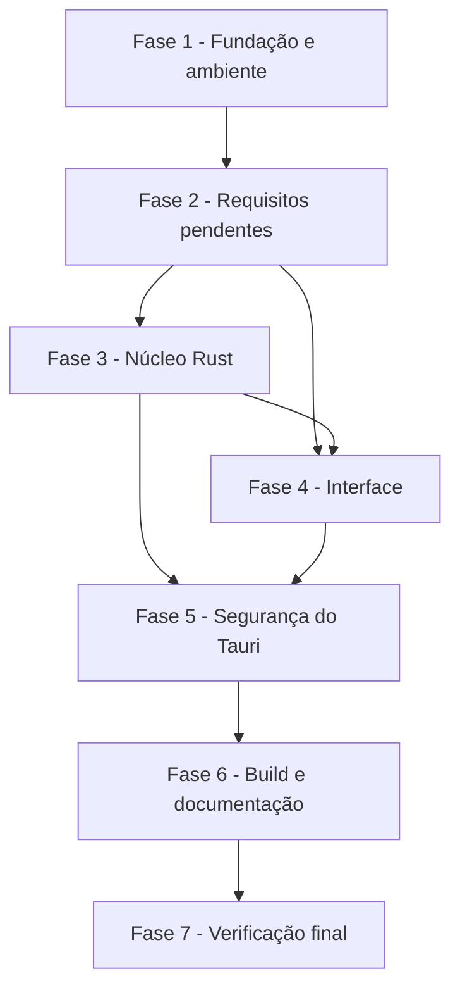

# Tarefas artigo2md - desktop-shell (esqueleto do app desktop macOS)

Escopo: app Tauri 2 em `desktop/` (Apple Silicon, macOS 11.0+) com barra lateral, árvore somente leitura, visualizador de Markdown (GFM, KaTeX, imagens relativas), configurações persistidas e build `.app` sem assinatura, conforme [spec.md](./spec.md), [plan.md](./plan.md), [data-model.md](./data-model.md), [contracts/commands.md](./contracts/commands.md) e [research.md](./research.md). Inclui os itens `[Gap]`/`[Ambiguity]` de [checklists/security.md](./checklists/security.md) e [checklists/ux.md](./checklists/ux.md). Sintaxe (código, comandos, campos, chaves) em inglês; textos de interface em português.

**Legenda de status:**
- `[ ]` Pendente
- `[~]` Em andamento
- `[x]` Concluido
- `[!]` Bloqueado

**Legenda de criticidade:**
- `[C]` Critico - Impacto financeiro direto ou bloqueante
- `[A]` Alto - Funcionalidade essencial
- `[M]` Medio - Necessario mas sem urgencia imediata

Regra de veracidade (Princípio V): todo item "a verificar" é conferido na fonte oficial antes de virar código; o resultado é registrado em research.md. Sem fonte, a tarefa fica `[!]` com bloqueio humano, nunca com valor suposto.

---

## FASE 1 - Fundação e ambiente

### 1.1 Ambiente de desenvolvimento `[C]`

Ref: plan.md §Pré-requisitos de ambiente; research.md R3, "A verificar"; block-006 (cargo-audit aprovado)

- [x] 1.1.1 Confirmar toolchain Rust instalado (`cargo --version`, `rustc --version` >= 1.90); não reinstalar <!-- cargo/rustc 1.100.0, R9.1 -->
- [x] 1.1.2 Verificar versão mínima de Node.js na doc oficial de pré-requisitos do Tauri 2 e conferir o Node/npm local; registrar em research.md <!-- doc não declara mínimo; deps exigem >=24.15 no ramo 24; local v24.22.2, R9.1 -->
- [x] 1.1.3 Instalar `cargo-audit` (`cargo install cargo-audit`, aprovado no block-006) e registrar a versão instalada <!-- cargo-audit 0.23.0 instalado pelo operador (block-007); `cargo audit` roda após `. "$HOME/.cargo/env"` (R9.8) -->
- [x] 1.1.4 Verificar compatibilidade entre vite, @sveltejs/vite-plugin-svelte, vitest, svelte e typescript da tabela do plan (peer dependencies via `npm view`); ajustar versões só com fonte e registrar em research.md

### 1.2 Estrutura do projeto `desktop/` `[A]`

Ref: spec FR-036; plan.md §Project Structure; research.md "A verificar" (scripts do template, pasta de saída do Vite)

- [x] 1.2.1 Criar o esqueleto Tauri 2 + Svelte 5 + TypeScript em `desktop/` seguindo a estrutura do plan (sem tocar `src/artigo2md/`, `tests/`, `pyproject.toml`) <!-- Rust compila e `npm run build` (Vite + Svelte) e `npm test` rodam; 130 testes vitest verdes (R9.9) -->
- [x] 1.2.2 Fixar as versões de dependências da tabela do plan em `Cargo.toml` e `package.json`; gerar `Cargo.lock` e `package-lock.json` (`npm ci` reprodutível) <!-- Cargo.lock com versões fixadas (=); package-lock.json gerado pelo operador (105 pacotes); `npm ci --dry-run` resolve sem erro (o `npm ci` real apaga node_modules e reinstala: não rodado pelo agente) -->
- [x] 1.2.3 Conferir no template gerado os scripts (`dev`, `build`, `test`, `tauri`) e a pasta de saída do Vite; registrar em research.md e quickstart.md <!-- scripts dev/build/test/tauri conferidos; pasta de saída do Vite = `desktop/dist/` (igual a `frontendDist`); registrado em R9.9 e no quickstart -->
- [x] 1.2.4 Adicionar ao `.gitignore` `desktop/node_modules/`, `desktop/src-tauri/target/` e a pasta de saída confirmada do Vite <!-- gitignore: desktop/node_modules/, desktop/src-tauri/target/, desktop/dist/ e desktop/src-tauri/gen/; dist/ so confirmado como saida do Vite apos o primeiro vite build -->
- [x] 1.2.5 Configurar `vitest` com `jsdom` e um teste trivial; configurar `cargo test` com `tempfile` <!-- vitest com jsdom (130 testes, 11 arquivos) e `cargo test` com tempfile (74 testes) -->
- [x] 1.2.6 Confirmar que `uv run pytest` continua passando sem alteração (SC-008) <!-- uv run pytest: 106 passed, 4 skipped; git status sem alteracao em src/artigo2md, tests, pyproject.toml -->

### 1.3 Licenças e vulnerabilidades da cadeia de dependências `[C]`

Ref: spec FR-037; plan.md §Dependências e licenças, §Endurecimento de segurança "Cadeia de dependências"; checklists/security.md CHK024, CHK025

- [x] 1.3.1 Gerar relatório de licenças das dependências transitivas cargo (a partir do `Cargo.lock`) <!-- 440 pacotes no Cargo.lock; 246 no grafo macOS arm64; relatorio em research R9.6 -->
- [x] 1.3.2 Gerar relatório de licenças das dependências transitivas npm (a partir do `package-lock.json`) <!-- 166 entradas do package-lock.json, 33 de produção, sem GPL/AGPL; relatório em research R9.8 e no README de `desktop/` -->
- [x] 1.3.3 Bloquear o commit se houver GPL/AGPL obrigatória; registrar o relatório no README de `desktop/` <!-- sem GPL/AGPL; MPL-2.0 (5 crates) e Unicode-3.0 (18) registrados por nome e licença em plan.md conforme a constitution 1.2.0 (block-008 aceito); relatório no README de `desktop/` -->
- [x] 1.3.4 Rodar `npm audit` e `cargo audit`; registrar resultado e tratamento de cada achado <!-- cargo audit: 0 vulnerabilidades, 3 avisos fora do grafo macOS; npm audit: 2 baixas (katex aninhado, GHSA-238p-pmpm-9mq7) mitigadas por options.katex + resolve.dedupe, risco residual aceito no lockfile (dec-052, R9.8) -->

---

## FASE 2 - Requisitos pendentes (gaps dos checklists e itens "a verificar")

### 2.1 Mensagens e estados de interface `[A]`

Ref: checklists/ux.md CHK006, CHK007, CHK010, CHK011; checklists/security.md CHK016; data-model.md §Catálogo de mensagens; contracts/commands.md §Erros

- [x] 2.1.1 Definir em português os textos de `tooLarge`, `invalidSettings`, `io` e `readError` e acrescentá-los ao catálogo em data-model.md
- [x] 2.1.2 Definir os estados "pasta aberta vazia" e "nenhum arquivo selecionado" (texto e onde aparecem) e registrar em data-model.md
- [x] 2.1.3 Definir a indicação de carregamento da árvore e do documento e registrar no plan.md
- [x] 2.1.4 Definir os rótulos sem texto literal na spec (opções de aparência, níveis de tamanho, "Recolher barra lateral") e acrescentá-los ao catálogo

### 2.2 Decisões de desenho da interface `[M]`

Ref: checklists/ux.md CHK014, CHK017, CHK021, CHK022, CHK024

- [x] 2.2.1 Fixar o tamanho de fonte de cada nível `small`/`medium`/`large` e registrar em data-model.md
- [x] 2.2.2 Definir o retorno visual de link externo inativo (FR-040) e registrar no plan.md
- [x] 2.2.3 Levar ao operador a decisão de escopo de acessibilidade (teclado e VoiceOver) desta feature (CHK022 `{humano}`); registrar a resposta e, se entrar no escopo, criar sub-tarefas na FASE 4
- [x] 2.2.4 Definir o protocolo de medição do SC-001 (quantas pessoas, como cronometrar) no quickstart.md

### 2.3 Itens de segurança a fixar `[C]`

Ref: checklists/security.md CHK004, CHK014, CHK017, CHK022, CHK023, CHK027

- [x] 2.3.1 Verificar na doc oficial do KaTeX a opção de limite de expansão de macros e fixar o valor no plan.md
- [x] 2.3.2 Especificar leitura limitada ao teto (`.md` 50.000.000 bytes, imagem 20.000.000 bytes) também durante a leitura, não só pelos metadados (TOCTOU), no plan.md e no contrato
- [x] 2.3.3 Definir destino, formato e retenção do log do lado Rust (sem enviar nada para fora da máquina) no plan.md
- [x] 2.3.4 Verificar na doc do Tauri 2 o mecanismo de restringir navegação e bloquear novas janelas; registrar em research.md
- [x] 2.3.5 Levar ao operador o item CHK027 `{humano}` (recusa de `.md` acima de 50 MB sem modo alternativo) se o operador quiser reavaliar; registrar a resposta

### 2.4 Itens "a verificar" da pesquisa `[A]`

Ref: research.md §"A verificar no execute-task"

- [x] 2.4.1 API Rust do `tauri-plugin-dialog` para abrir o diálogo de pasta pelo lado Rust; se não existir, bloqueio humano (sem aceitar caminho vindo da interface)
- [x] 2.4.2 API do diretório de configuração do app no Tauri 2
- [x] 2.4.3 Caminho exato da chave de CSP no `tauri.conf.json`, necessidade de `'unsafe-inline'` em `style-src` para o KaTeX e efeito dos nonces/hashes injetados pelo Tauri <!-- validado pelo operador no block-011 (onda-018, dec-071): KaTeX em linha e em bloco renderizou sob a CSP de produção (`style-src 'self'`, sem `unsafe-inline`); ressalva de rastreabilidade (literal do operador): parte da validação rodou no .app de 2026-11-25 00:19 (SHA-256 589caa8008c548a1...), parte numa cópia do build de 22:39 (SHA-256 7c7ce947...); o operador considerou suficiente e não repetirá -->
- [x] 2.4.4 Tipo recebido no JS para `tauri::ipc::Response` (se não for `ArrayBuffer`, plano B da Decision 5 e atualização do contrato)
- [x] 2.4.5 Nomes das regras do renderer do markdown-it (`image`, `link_open`, `link_close`), forma de sobrescrevê-las, tabelas GFM por padrão e codificação percentual de `src`/`href` <!-- regras image/link_open/link_close substituídas, tabelas GFM por padrão e codificação percentual de src/href confirmadas por vitest (R9.9) -->
- [x] 2.4.6 Fontes do pacote `katex` servidas de `'self'` pelo Vite (nunca CDN) <!-- fontes do katex emitidas como arquivos pelo Vite (assetsInlineLimit 0), CSS com `url(/assets/KaTeX_*)`, sem `data:` nem CDN (R9.9) -->
- [x] 2.4.7 Suporte a PNG, JPEG e GIF no webview e assinatura do JPEG (R2, R8) <!-- validado pelo operador no block-011 (onda-018, dec-071): imagens PNG, JPEG (com Exif) e GIF renderizaram no webview real; ressalva de rastreabilidade (literal do operador): parte da validação rodou no .app de 2026-11-25 00:19 (SHA-256 589caa8008c548a1...), parte numa cópia do build de 22:39 (SHA-256 7c7ce947...); o operador considerou suficiente e não repetirá -->
- [x] 2.4.8 `#[serde(rename_all = "camelCase")]`, `canonicalize` e `to_lowercase` na doc do serde e da std <!-- serde rename_all=camelCase, canonicalize e to_lowercase usados e cobertos por cargo test (R9.7) -->

---

## FASE 3 - Núcleo Rust

### 3.1 Modelo, erros e estado `[A]`

Ref: data-model.md; contracts/commands.md §Erros; plan.md §Convenções de Borda

- [x] 3.1.1 Implementar `model.rs` (AppSettings, UserSettings, TreeEntry, MarkdownDocument, OpenFolderInfo) com serialização camelCase
- [x] 3.1.2 Implementar `error.rs` com `ErrorCode` (incluindo `tooLarge`, `invalidSettings`) e `detail` sempre `null` na interface, texto técnico só no log
- [x] 3.1.3 Implementar `AppState { root: Mutex<Option<PathBuf>> }`
- [x] 3.1.4 Gerar em `cargo test` o JSON de exemplo de cada retorno para o teste de contrato

### 3.2 Confinamento de caminhos (`paths.rs`) `[C]`

Ref: spec FR-013, FR-030, FR-032, FR-040; plan.md §Endurecimento de segurança "Confinamento léxico primeiro"; Decisions 5 e 6

- [x] 3.2.1 Implementar confinamento léxico antes de tocar o disco, depois canonização e conferência por componente
- [x] 3.2.2 Resolver nomes exatamente como estão no disco (acento e caixa), sem normalização
- [x] 3.2.3 Testes: relativo ok; `..` saindo da raiz; `../../x.md` e `../../x.png` inexistentes → `outsideFolder`; atalho para fora
- [x] 3.2.4 Testes: nomes que diferem só por acento ou caixa resolvem só o exato

### 3.3 Árvore de arquivos (`fs_tree.rs`, `list_dir`) `[A]`

Ref: spec FR-005, FR-008, FR-028, FR-029, FR-030; SC-002; contracts/commands.md §list_dir

- [x] 3.3.1 Listar um nível sob demanda, pastas antes de arquivos, ordem alfabética sem caixa, ocultos omitidos
- [x] 3.3.2 Marcar atalhos simbólicos sem expandi-los (Decision 7) e subpastas sem permissão como `access = "denied"`
- [x] 3.3.3 Testes com `tempfile`: ordem, ocultos, sem permissão, atalho para fora, ciclo
- [x] 3.3.4 Teste de 5.000 itens com o primeiro nível em até 2 s (SC-002)

### 3.4 Documento (`document.rs`, `read_markdown`) `[A]`

Ref: spec FR-009, FR-018, FR-031, FR-034, FR-035; contracts/commands.md §read_markdown; plan.md §Endurecimento de segurança "Limites rígidos de leitura"

- [x] 3.4.1 Ler `.md` confinado, recusar não `.md` (`notMarkdown`) e não UTF-8 (`notText`)
- [x] 3.4.2 Marcar `isLarge` acima de 5.000.000 bytes e recusar acima de 50.000.000 bytes com `tooLarge` (metadados + leitura limitada)
- [x] 3.4.3 Testes: `.md` ok; não UTF-8; `isLarge`; `tooLarge`; apagado entre leituras; não `.md`

### 3.5 Imagens (`image.rs`, `read_image`) `[C]`

Ref: spec FR-013, FR-014, FR-016, FR-032, FR-041; contracts/commands.md §read_image; research.md R8

- [x] 3.5.1 Validar na ordem do contrato: confinamento, existência, extensão, assinatura, tamanho (20.000.000 bytes → `tooLarge`)
- [x] 3.5.2 Devolver bytes via `tauri::ipc::Response` (ou plano B confirmado em 2.4.4)
- [x] 3.5.3 Testes: SVG/extensão errada; assinatura incompatível; inexistente; fora da raiz; `tooLarge`

### 3.6 Links e configurações (`resolve_link`, `settings.rs`) `[A]`

Ref: spec FR-007, FR-022, FR-023, FR-024, FR-039, FR-040; contracts/commands.md §resolve_link, §save_settings, §reset_settings; Decision 4; H1 (block-006)

- [x] 3.6.1 Implementar `resolve_link` confinado (`.md` dentro da pasta; fora → `outsideFolder`)
- [x] 3.6.2 Implementar `settings.rs`: esquema, padrões, `settingsReset` para JSON ilegível, escrita atômica, `Mutex` único para as três gravações
- [x] 3.6.3 `save_settings` recebe `UserSettings` sem `lastFolder`; `reset_settings` preserva `lastFolder`
- [x] 3.6.4 Testes: padrões; ida e volta; JSON ilegível; valor fora do domínio; restaurar padrões; `save_settings` não altera `lastFolder`

### 3.7 Comandos e inicialização (`commands.rs`, `lib.rs`) `[A]`

Ref: contracts/commands.md §get_startup_state, §open_folder; spec FR-004, FR-007, FR-028

- [x] 3.7.1 Implementar `open_folder` sem argumentos, abrindo o diálogo pelo Rust e gravando `lastFolder`
- [x] 3.7.2 Implementar `get_startup_state` (reabre `lastFolder`, aviso `lastFolderUnavailable`)
- [x] 3.7.3 Registrar todos os comandos no `invoke_handler` como `async`
- [x] 3.7.4 Testes das funções puras chamadas pelos comandos (pasta removida, sem permissão)

---

## FASE 4 - Interface (Svelte 5 + TypeScript)

### 4.1 Camada de API e tipos `[A]`

Ref: plan.md §Project Structure (`lib/api.ts`, `lib/types.ts`, `lib/messages.ts`); contracts/commands.md

- [x] 4.1.1 Implementar `types.ts` espelhando os contratos
- [x] 4.1.2 Implementar `api.ts` como único ponto de `invoke()`
- [x] 4.1.3 Implementar `messages.ts` com o catálogo completo (incluindo os textos definidos na FASE 2)
- [x] 4.1.4 Testes: contrato (JSON do `cargo test` x `types.ts`) e catálogo sem chave vazia (SC-006) <!-- messages.test.ts e contract.test.ts (lê contract-samples.json do cargo test; pulado só se o arquivo não existir) -->

### 4.2 Renderização de Markdown `[C]`

Ref: spec FR-010 a FR-017, FR-033, FR-040, FR-041; plan.md §Renderização (Decision 8), §Endurecimento de segurança; SC-003

- [x] 4.2.1 Implementar `markdown.ts`: `html: false`, GFM, KaTeX com `throwOnError: false`, `trust: false` e limite de expansão (2.3.1)
- [x] 4.2.2 Sobrescrever as regras `image` (marcador `data-*`, sem ``) e `link_open`/`link_close` (`data-md-link` para `.md`, demais inativos)
- [x] 4.2.3 Implementar `render.worker.ts` (só produz HTML) e `sanitize.ts` com DOMPurify no thread principal, lista explícita e falha fechada (texto puro) <!-- render.worker.ts (Worker clássico) + sanitize.ts no thread principal; falha fechada testada -->
- [x] 4.2.4 Fila de imagens com concorrência limitada; encerrar o Worker e revogar `blob:` ao trocar de documento <!-- render.ts (RenderSession) e images.ts (fila de concorrência 4, revoga blob:); testes -->
- [x] 4.2.5 Testes vitest: tabela com alinhamento; fórmula em linha e em bloco; fórmula inválida isolada; HTML bruto como texto; link externo sem `href`; link `.md` com `data-md-link`; imagem remota bloqueada
- [x] 4.2.6 Testes de segurança: tags proibidas removidas; `\href`, `\url`, `\includegraphics` inertes; HTML final sem `src`/`href` remotos (SC-004)

### 4.3 Componentes e telas `[A]`

Ref: spec FR-001, FR-002, FR-004 a FR-009, FR-014, FR-018, FR-031, FR-034, FR-039; plan.md §Mapa FR → componente

- [x] 4.3.1 `App.svelte` e `Sidebar.svelte` (entradas "Arquivos" e "Configurações", destaque, recolher, largura 200 a 480 px)
- [x] 4.3.2 `FilesView.svelte`, `FileTree.svelte`, `TreeNode.svelte` (expandir/recolher, atalhos identificados, sem permissão, estados vazios e de carregamento)
- [x] 4.3.3 `Viewer.svelte` (avisos por status de imagem, arquivo grande, `tooLarge`, "Recarregar", links `.md` internos)
- [x] 4.3.5 Navegação por teclado (decisão do operador, 2.2.3): barra lateral, árvore (setas, Enter, Espaço, Home/End) e configurações operáveis só com teclado, foco visível e rótulos `aria-*` nos controles; testes vitest dos handlers de teclado <!-- tree-nav.ts (setas, Home/End, Enter, Espaço), separador da barra lateral por teclado, aria-*; testes em tree-nav.test.ts e components.test.ts -->
- [x] 4.3.4 Testes vitest dos estados de componente que não dependem do webview real <!-- components.test.ts: Sidebar, FileTree, Viewer, FilesView, SettingsView e App montados em jsdom -->

### 4.4 Configurações na interface `[A]`

Ref: spec FR-019 a FR-024, FR-039; data-model.md §AppSettings

- [x] 4.4.1 `settings.svelte.ts` com efeito imediato (FR-021) e gravação via `save_settings`
- [x] 4.4.2 `SettingsView.svelte`: aparência (claro, escuro, sistema) e três tamanhos de texto; "Restaurar padrões"
- [x] 4.4.3 `app.css` com temas claro/escuro e os tamanhos fixados em 2.2.1
- [x] 4.4.4 Aviso `settingsReset` na abertura quando as configurações estiverem inválidas (FR-023); testes <!-- teste de App: settingsReset mostra o aviso em português -->

---

## FASE 5 - Configuração de segurança do Tauri

### 5.1 CSP, capabilities e navegação `[C]`

Ref: spec FR-006, FR-015; SC-004; plan.md §Rede, §Endurecimento de segurança; contracts/commands.md §Permissões; checklists/security.md CHK003, CHK004, CHK023

- [x] 5.1.1 Gravar a CSP no caminho confirmado em 2.4.3, com `base-uri 'none'; form-action 'none'; object-src 'none'; frame-src 'none'` <!-- CSP e devCsp em tauri.conf.json -->
- [x] 5.1.2 `capabilities/default.json` só para a janela principal, permissões do core listadas uma a uma, sem `dialog:allow-open` e sem permissão de arquivos para o webview; listar em contracts/commands.md <!-- capabilities/default.json só para `main`, permissions vazia; justificativa em contracts/commands.md -->
- [x] 5.1.3 Aplicar o mecanismo de restrição de navegação e de bloqueio de novas janelas (2.3.4) <!-- on_navigation e on_new_window já em lib.rs (onda-010), testados no cargo test -->
- [x] 5.1.4 Configurar `minimumSystemVersion` 11.0 em `tauri.conf.json` <!-- minimumSystemVersion 11.0 conferido no Info.plist do .app -->
- [x] 5.1.5 Teste automatizado que lê a CSP do `tauri.conf.json` e falha se houver origem remota (SC-004) <!-- security-config.test.ts -->

---

## FASE 6 - Build e documentação

### 6.1 Build do `.app` `[A]`

Ref: spec FR-025, FR-026, FR-027, FR-042; SC-007; plan.md §Build do `.app`; research.md R5

- [x] 6.1.1 Rodar `npm run tauri build -- --bundles app` em `desktop/`, só arm64; confirmar a forma de fixar o alvo e a pasta de saída <!-- comando e saída em R9.10; --target aarch64-apple-darwin fixa o arm64 -->
- [x] 6.1.2 Confirmar que nenhuma identidade de assinatura é exigida <!-- R9.10 -->
- [x] 6.1.3 Calcular o SHA-256 do `.app` gerado <!-- R9.10 e README -->
- [x] 6.1.4 Abrir o `.app` após liberação manual do Gatekeeper e confirmar a janela principal <!-- assinatura do bundle corrigida na FASE 10 (10.1.1): `codesign --verify --deep --strict` passa no build real de 2026-11-26 08:28 e `Info.plist entries=14`, `Sealed Resources version=2`; o operador abriu pelo caminho do Gatekeeper uma cópia equivalente (assinada com `codesign --force --deep -s -`, `AppTranslocation` observado, block-011); o processo do build novo sobe, vivo após 10 s, 0 sockets; a janela principal foi exercida pelos cenários 1 a 10 do operador (block-011; ressalva: parte deles no .app de 00:19 e parte numa cópia do build de 22:39) (R9.13) -->

### 6.2 Documentação `[M]`

Ref: spec FR-026, FR-027; plan.md §Endurecimento de segurança "Distribuição sem assinatura"; quickstart.md

- [x] 6.2.1 README de `desktop/`: pré-requisitos, comando único de build, liberação do Gatekeeper, SHA-256, relatório de licenças <!-- desktop/README.md -->
- [x] 6.2.2 Atualizar quickstart.md com os comandos confirmados (dev, build, pasta de saída) <!-- quickstart atualizado -->
- [x] 6.2.3 Registrar em research.md o resultado de cada item "a verificar" <!-- research R9.9, R9.10 e lista "A verificar" atualizada -->

---

## FASE 7 - Verificação final

### 7.1 Gates de qualidade antes do commit `[C]`

Ref: spec FR-038; SC-003 a SC-008; quickstart.md (cenários 1 a 9); Princípio IV

- [x] 7.1.1 `cargo test` verde <!-- cargo test: 74 passed; fmt e clippy -D warnings sem achados -->
- [x] 7.1.2 `npm test` (vitest) verde <!-- npm test: 11 arquivos, 130 testes passed -->
- [x] 7.1.3 `uv run pytest` verde sem alterações na suíte Python <!-- uv run pytest: 106 passed, 4 skipped; sem alteração em src/artigo2md, tests, pyproject.toml, uv.lock -->
- [x] 7.1.4 `npm audit` e `cargo audit` sem achado não tratado <!-- cargo audit sem vulnerabilidades; npm audit com 2 baixas tratadas (R9.8) -->
- [x] 7.1.5 Executar os cenários do quickstart e registrar o resultado (inclui observação de tráfego, SC-004) <!-- validado pelo operador no block-011 (onda-018, dec-071): cenários 1 a 10 OK; SC-004: com Wi-Fi desligado o comportamento foi idêntico e `lsof` nos sockets do processo do app e do com.apple.WebKit.Networking associado não mostrou nenhuma conexão; ressalva de rastreabilidade (literal do operador): parte da validação rodou no .app de 2026-11-25 00:19 (SHA-256 589caa8008c548a1...), parte numa cópia do build de 22:39 (SHA-256 7c7ce947...); o operador considerou suficiente e não repetirá -->
- [x] 7.1.6 Revisar todas as telas e mensagens em português (SC-006) <!-- validado pelo operador no block-011 (onda-018, dec-071): telas e mensagens em português OK (SC-006); ressalva de rastreabilidade (literal do operador): parte da validação rodou no .app de 2026-11-25 00:19 (SHA-256 589caa8008c548a1...), parte numa cópia do build de 22:39 (SHA-256 7c7ce947...); o operador considerou suficiente e não repetirá -->

---

## Matriz de Dependencias

## Resumo Quantitativo

| Fase | Tarefas | Subtarefas | Criticidade |
|------|---------|------------|-------------|
| 1 - Fundação e ambiente | 3 | 14 | C/A |
| 2 - Requisitos pendentes | 4 | 21 | C/A/M |
| 3 - Núcleo Rust | 7 | 26 | C/A |
| 4 - Interface | 4 | 18 | C/A |
| 5 - Segurança do Tauri | 1 | 5 | C |
| 6 - Build e documentação | 2 | 7 | A/M |
| 7 - Verificação final | 1 | 6 | C |
| **Total** | **22** | **97** | - |

## Escopo Coberto

| Item | Descricao | Fase |
|------|-----------|------|
| FR-001 a FR-003, FR-039 | Janela, barra lateral, textos em português | 4 |
| FR-004 a FR-008, FR-028 a FR-030 | Abrir pasta, árvore somente leitura, erros de disco, atalhos | 3, 4 |
| FR-009 a FR-018, FR-031 a FR-035, FR-040, FR-041 | Visualizador, imagens, links, limites | 3, 4 |
| FR-015, FR-016, SC-004 | Zero conexão de rede (CSP, testes) | 4, 5 |
| FR-019 a FR-024 | Configurações | 3, 4 |
| FR-025 a FR-027, FR-042 | Build `.app` arm64 sem assinatura | 5, 6 |
| FR-036 a FR-038 | Estrutura `desktop/`, licenças, testes | 1, 7 |
| Checklists security/ux | Gaps e ambiguidades dos checklists | 2 |

## Escopo Excluido

| Item | Descricao | Motivo |
|------|-----------|--------|
| Instalação do rustup | Toolchain Rust | Já instalado pelo operador (cargo/rustc 1.100.0) |
| `.dmg`, assinatura, notarização | Distribuição assinada | Fora da feature (spec FR-027) |
| Intel e binário universal | Outras arquiteturas | Fora da feature (spec FR-042) |
| Conversão de PDF no app | Integração com a CLI Python | Features posteriores do roadmap |
| Exibir itens ocultos | Controle de ocultos | Fora da feature (spec FR-008, FR-020) |

## FASE 8 - Convergência

> Fase gerada automaticamente pela skill `converge` (reconciliação
> spec-vs-código). Cada tarefa abaixo corresponde a um achado (`Gap`)
> entre o que `spec.md`/`plan.md`/`tasks.md` descreveram e o estado
> presente do código. Tarefas sem o prefixo `[Revisar]` são acionáveis
> (`missing`/`partial`/`contradicts`); tarefas com `[Revisar]` são item de
> revisão (`unrequested`, FR-013) — nunca "implementar", o código já
> existe. Append-only: esta fase nunca reescreve fases/tarefas anteriores
> do arquivo (FR-009).

### 8.1 Caminho absoluto `lastFolder` enviado ao webview `[C]`

Ref: plan.md §Endurecimento de segurança "Fronteira de confiança"; spec FR-007 (User Story 1, P1); research.md R9.11 · tipo: `contradicts` · severidade: `HIGH`

O plan.md declara que "nenhum caminho absoluto vai ao webview nem vem dele", mas `get_startup_state`, `save_settings` e `reset_settings` em `desktop/src-tauri/src/commands.rs` devolvem `AppSettings` completo, com `lastFolder` (caminho absoluto) — e `desktop/src/lib/types.ts`/`desktop/src/lib/settings.svelte.ts` o recebem. A interface não usa o valor (só o aviso `lastFolderUnavailable`). contracts/commands.md (§save_settings, "Observação para revisão") e data-model.md descrevem o retorno atual, divergindo do plan.

- [x] 8.1.1 Corrigir `desktop/src-tauri/src/commands.rs` conforme plan.md "Fronteira de confiança": devolver à interface as configurações sem `lastFolder` (tipo de resposta próprio, sem caminho absoluto) em `get_startup_state`, `save_settings` e `reset_settings`; ajustar `types.ts`, `settings.svelte.ts`, contracts/commands.md, data-model.md e os testes (`cargo test`, contract.test.ts, settings.test.ts)

<!-- converge-key: 57e3bd282b1e -->

### 8.2 [Revisar] Dependência npm `@tauri-apps/plugin-dialog` sem uso `[M]`

Ref: plan.md §Dependências e licenças; research.md R9.11 · tipo: `unrequested` · severidade: `LOW`

`desktop/package.json` declara `@tauri-apps/plugin-dialog` 2.8.4 (listado como obrigatório no plan.md), mas nenhum arquivo em `desktop/src/` o importa: o diálogo de pasta é aberto pelo lado Rust (`open_folder`) e `capabilities/default.json` não concede `dialog:allow-open`. A dependência não sustenta nenhum requisito da spec. Remover exige `npm uninstall` (guarda de Bash: comando do operador).

- [x] 8.2.1 Revisar `desktop/package.json`: decidir manter, documentar retroativamente ou remover (`npm uninstall @tauri-apps/plugin-dialog` em `desktop/`, rodado pelo operador) e alinhar a tabela de dependências do plan.md e o relatório de licenças — decisão: remover; plan.md e research.md alinhados (onda-013); `npm uninstall` rodado pelo operador (block-009, onda-014): o nome não aparece mais em `package.json` nem `package-lock.json`; `npm test` (131), `tsc --noEmit`, `npm run build` e `uv run pytest` verdes (R9.11)

<!-- converge-key: 3329f1b361e2 -->

---

## FASE 9 - Correção: renderização cai no aviso de falha (validação humana, block-010)

> Fase aberta na onda-017 a partir da resposta do operador ao block-010 (dec-065, dec-068):
> cenário 1 ok; cenário 2 falha — todo `.md` abre com o aviso "Não foi possível renderizar
> este documento" e aparece como texto, inclusive Markdown simples. Diagnóstico e evidências em
> research.md R9.12.

### 9.1 Diagnosticar a falha com evidência `[C]`

Ref: research.md R9.12; spec FR-009 a FR-012 (US2); plan.md "Endurecimento de segurança" (Worker de renderização)

- [x] 9.1.1 Reproduzir fora da janela real o caminho de produção (esquema `tauri://localhost`, cabeçalhos do Tauri 2.12.7, CSP de produção) e o de desenvolvimento, e confirmar ou descartar a suspeita de `worker-src 'self'` <!-- suspeita descartada: produção renderiza em 4 montagens (inclusive o runtime Tauri real com os assets do .app de 00:20); as sessões do operador têm assinatura de `tauri dev` no unified log; causa confirmada no modo dev: Worker clássico recebe `import` ESM do Vite (SyntaxError) (R9.12, dec-069) -->
- [x] 9.1.2 Expor o detalhe técnico da falha (mensagem, arquivo e linha do `error`/`messageerror` do Worker, erro do render, falha do sanitizador) no aviso em português da interface, para o operador ler se a falha persistir <!-- "Detalhe técnico: <etapa>: <mensagem>" no aviso e no console.error; RenderFailedError, sanitizeHtmlChecked; render/components/sanitize tests (R9.12) -->

### 9.2 Corrigir sem afrouxar a CSP `[C]`

Ref: research.md R9.12; tauri.conf.json `app.security.csp`/`devCsp`; research.md R9.9 (Worker clássico, piso macOS 11)

- [x] 9.2.1 Corrigir a forma de instanciação do Worker conforme a causa confirmada, sem mudar a CSP de produção e sem `'unsafe-inline'`/`'unsafe-eval'` <!-- Worker de módulo só com o servidor do Vite (`__RENDER_WORKER_AS_MODULE__` = `command === "serve"`); build segue clássico IIFE; CSP e devCsp inalteradas; Tauri dev real: antes SyntaxError, depois renderiza (R9.12) -->
- [x] 9.2.2 Teste que inspeciona o build de produção (URL e forma do Worker vs CSP de produção) e o código que o Vite serve em desenvolvimento, falhando com o bug e passando com a correção <!-- tests/worker-build.test.ts: o teste de dev falha com a correção desfeita (classic + `import { renderMarkdown }`) e passa com ela; o de produção exige Worker clássico IIFE de /assets e worker-src 'self' -->

### 9.3 Gates, rebuild e validação humana `[C]`

Ref: spec FR-038; quickstart.md (cenários 1 a 8); tarefas 6.1.4, 7.1.5 e 7.1.6

- [x] 9.3.1 `cargo test`, `cargo fmt --check`, `cargo clippy -D warnings`, `npm test`, `tsc --noEmit`, `npm run build` e `uv run pytest` verdes <!-- cargo test 75 passed; fmt e clippy -D warnings sem achados; npm test 12 arquivos, 136 passed; tsc sem erros; npm run build ok; uv run pytest 106 passed, 4 skipped -->
- [x] 9.3.2 Reconstruir o `.app` a partir do código atual (`npm run tauri build -- --bundles app --target aarch64-apple-darwin`), registrar caminho, horário e SHA-256 do executável e confirmar que o processo sobe <!-- executável de 2026-11-25 22:39:04, SHA-256 7c7ce947b88ee3893f8c64a7916a78a7e3e0b0cef71edccbbaffe678e4fa7dad; Worker embutido = dist atual; `open -n`: vivo após 10 s, 0 sockets; README atualizado (R9.12) -->
- [x] 9.3.3 Bloqueio humano: operador valida no `.app` novo os cenários 1 a 8 do quickstart, o tráfego (SC-004), a revisão visual (SC-006), o KaTeX sob a CSP, PNG/JPEG/GIF e o Gatekeeper <!-- validado pelo operador no block-011 (onda-018, dec-071): cenários 1 a 10, tráfego (SC-004), revisão visual (SC-006), KaTeX sob a CSP e PNG/JPEG/GIF OK; Gatekeeper falhou no build de 22:39 (bundle recusado como danificado) e foi corrigido na FASE 10; ressalva de rastreabilidade (literal do operador): parte da validação rodou no .app de 2026-11-25 00:19 (SHA-256 589caa8008c548a1...), parte numa cópia do build de 22:39 (SHA-256 7c7ce947...); o operador considerou suficiente e não repetirá -->

---

## FASE 10 - Correção: assinatura ad hoc do bundle (Gatekeeper, block-011)

> Fase aberta na onda-018 a partir da resposta do operador ao block-011 (dec-071): cenários 1 a 10 OK;
> falha no Gatekeeper (6.1.4) — o `.app` do build de 22:39 em quarentena é recusado como danificado, sem
> "Abrir Mesmo Assim" (`codesign -dv`: `flags=0x20002(adhoc,linker-signed)`, `Info.plist=not bound`,
> `Sealed Resources=none`; `codesign --verify --deep --strict`: "code has no resources but signature
> indicates they must be present"). Diagnóstico e evidências em research.md R9.13.

### 10.1 Assinatura ad hoc válida do bundle inteiro `[C]`

Ref: research.md R9.13; spec FR-026, FR-027; tarefa 6.1.4

- [x] 10.1.1 Configurar `bundle.macOS.signingIdentity` = `"-"` em `tauri.conf.json` e confirmar no build real (`npm run tauri build -- --bundles app --target aarch64-apple-darwin`) <!-- o fonte do tauri-bundler não está em ~/.cargo/registry (compilado no @tauri-apps/cli 2.12.6); a chave vem de `config.schema.json` do CLI ("Identity to use for code signing") e o tratamento de "-" foi confirmado no build real: log `Signing with identity "-"` para o executável e para o .app; `codesign -dv`: `flags=0x10002(adhoc,runtime)`, `Info.plist entries=14`, `Sealed Resources version=2 rules=13 files=1`; `codesign --verify --deep --strict`: valid on disk, satisfies its Designated Requirement; `spctl -a`: "rejected" (desenvolvedor não identificado) em vez de "code has no resources" do bundle antigo; processo sobe com hardened runtime, vivo após 10 s, 0 sockets (R9.13) -->

### 10.2 Verificação automatizada da assinatura `[C]`

Ref: research.md R9.13; spec FR-026

- [x] 10.2.1 Script npm `verify:app` (`codesign --verify --deep --strict`) encadeado após o build em `build:app`, com teste de configuração que fixa `signingIdentity` e os scripts <!-- tests/security-config.test.ts (137 testes); contra uma cópia do bundle antigo (só assinatura do linker) no scratchpad o mesmo comando sai com exit 1 ("code has no resources but signature indicates they must be present"); contra o bundle novo sai com exit 0 (R9.13) -->

### 10.3 Documentação e gates `[C]`

Ref: spec FR-027, FR-038

- [x] 10.3.1 `desktop/README.md`: assinatura ad hoc, liberação pelo Gatekeeper (Ajustes do Sistema > Privacidade e Segurança > Abrir Mesmo Assim) e SHA-256 do executável e do manifesto atualizados <!-- executável 1f387adc525f0996e30549c9a18c395818bf02ee1b3bfe00c96cc51c5b793922; manifesto a64ffdcfb7e9fe33950278a71432949133f20048e1620fcd64b8a63a9e8bd1b2 (build de 2026-11-26 08:28; dois builds seguidos na mesma pasta deram os mesmos hashes) -->
- [x] 10.3.2 `cargo test`, `cargo fmt --check`, `cargo clippy -D warnings`, `npm test`, `tsc --noEmit`, `npm run build` e `uv run pytest` verdes <!-- cargo test 75 passed; fmt e clippy sem achados; npm test 12 arquivos, 137 passed; tsc sem erros; npm run build ok; uv run pytest 106 passed, 4 skipped -->
