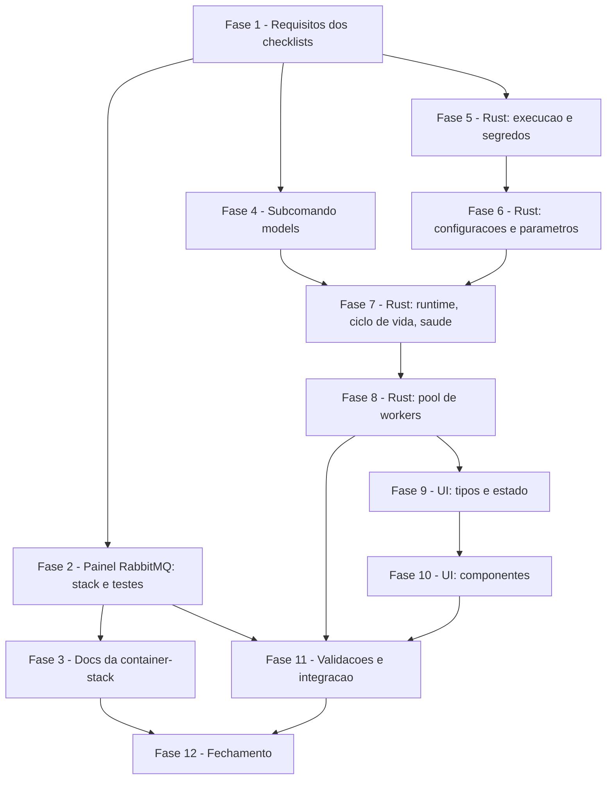

# Tarefas artigo2md - desktop-stack-control

Escopo: entregar o controle da infraestrutura pelo app desktop macOS (item 5 do roadmap): diagnóstico de Docker Desktop, OrbStack e colima; guia de instalação offline; iniciar e parar a stack da `container-stack` e o pool nativo `artigo2md worker`; painel de saúde por sondagens de loopback; primeira execução com downloads confirmados (imagens e subcomando novo `artigo2md models`); e, por decisão do operador (block-004, dec-023/dec-025), o painel de gestão do RabbitMQ fora da publicação padrão. Fecha os 12 itens `{auto}` abertos dos checklists e a tabela "Impacto nos artefatos e testes da container-stack" do plano. Origem: [spec.md](spec.md), [plan.md](plan.md), [research.md](research.md), [data-model.md](data-model.md), [quickstart.md](quickstart.md), [contracts/](contracts/), [checklists/](checklists/).

Gate de testes de cada tarefa de código: `uv run pytest` (Python), `cargo test` em `desktop/src-tauri` e `npm test` em `desktop/`, todos sem Docker; testes que usam o compose ficam atrás de `ARTIGO2MD_STACK=1` (Princípio IV). Valores e comandos marcados [PROPOSTA] ou "a validar na implementação" no plan/research/contracts são confirmados por teste ou sonda na implementação; nenhum dado factual novo (versão, licença, endereço, campo de payload) entra sem fonte rastreável. Arquivos marcados "(novo)" ainda não existem no repositório. Os 8 itens `{humano}` dos checklists não são decididos por este backlog: ficam na seção "Pendencias do Dono do Produto".

**Legenda de status:**
- `[ ]` Pendente
- `[~]` Em andamento
- `[x]` Concluido
- `[!]` Bloqueado

**Legenda de criticidade:**
- `[C]` Critico - Impacto financeiro direto ou bloqueante
- `[A]` Alto - Funcionalidade essencial
- `[M]` Medio - Necessario mas sem urgencia imediata

---

## FASE 1 - Requisitos em aberto dos checklists

Os 12 itens `{auto}` abertos viram tarefas de resolução de requisito, antes das tarefas de implementação que dependem deles. Cada tarefa fecha o item no checklist de origem com a citação nova (`[x]` + referência). Resolução que mude comportamento visível ao usuário além do já decidido no plano vira bloqueio humano ou `/clarify`, nunca decisão silenciosa.

### 1.1 Definir "indicação de atividade" do download de tamanho desconhecido (ux CHK006) `[M]`

Ref: checklists/ux.md CHK006; spec.md FR-032, US6-3; data-model.md FirstRunStep. Dep de: 10.3

- [x] 1.1.1 Descrever em spec.md FR-032 o que a pessoa vê quando `totalBytes` é nulo (por exemplo: volume baixado, contador `itemsDone/itemsTotal` e um sinal que muda a cada atualização), em termos verificáveis
- [x] 1.1.2 Espelhar a descrição em data-model.md (`FirstRunStep`) e no critério de aceite de US6-3
- [x] 1.1.3 Definir o teste que comprova a atividade (o valor exibido muda entre duas leituras do retrato com o download em curso) para uso em 10.3
- [x] 1.1.4 Marcar ux CHK006 como resolvido com a citação nova

### 1.2 Reconciliar a primeira "Iniciar infraestrutura" com a confirmação de download (ux CHK007) `[A]`

Ref: checklists/ux.md CHK007; spec.md US2-1, US6-1, FR-031; contracts/tauri-commands.md `start_stack` (`imagesMissing`). Dep de: 7.2, 10.2, 10.3

- [x] 1.2.1 Redigir em spec.md US2-1 o caso de imagens ausentes: o `start_stack` não chama o `up.sh`, devolve `imagesMissing` e a tela mostra a lista da primeira execução com tamanho aproximado e pedido de confirmação, sem baixar nada
- [x] 1.2.2 Ajustar o texto "sem pedir nada" de US2-1 para valer só para os parâmetros (credenciais, portas, pasta de dados), coerente com US6-1 e FR-031
- [x] 1.2.3 Conferir que contracts/tauri-commands.md e plan.md dizem o mesmo e acrescentar o cenário ao quickstart.md (cenário 2, passo 1)
- [x] 1.2.4 Marcar ux CHK007 como resolvido com a citação nova

### 1.3 Alinhar a pré-condição de "Iniciar workers" entre spec e contratos (ux CHK008) `[A]`

Ref: checklists/ux.md CHK008; spec.md FR-018, US3-1/2, US6-9; contracts/tauri-commands.md `start_workers` (`modelsMissing`); research.md Decision 12. Dep de: 8.1, 8.5

- [x] 1.3.1 Acrescentar a etapa "modelos de conversão" concluída às pré-condições de FR-018 e US3-2 da spec, com a mensagem em português e o caminho até "Preparar modelos"
- [x] 1.3.2 Reescrever US6-9 para distinguir os dois momentos: iniciar workers sem modelos (recusado com `modelsMissing`) e conversão solicitada por quem consome (interface de `desktop-processing`)
- [x] 1.3.3 Conferir que data-model.md (`WorkerPool` e `FirstRunStep`) e quickstart.md (cenário 7, "Fechamento") dizem o mesmo
- [x] 1.3.4 Marcar ux CHK008 como resolvido com a citação nova

### 1.4 Reconciliar o fechamento do app com o teto de 60 s (ux CHK009) `[A]`

Ref: checklists/ux.md CHK009; spec.md FR-024, edge "Fechar o app com um job em andamento"; plan.md M21; research.md Decision 12. Dep de: 8.4

- [x] 1.4.1 Reescrever o edge case da spec: o app só termina depois que nenhum processo de worker resta, exceto se o teto de 60 s (M21) for atingido
- [x] 1.4.2 Definir o que acontece após o teto: o app sai, registra os PIDs remanescentes e a próxima abertura aplica FR-021 (pool órfão)
- [x] 1.4.3 Conferir coerência com SC-005 e com o quickstart.md (cenário 5) e propagar a mesma redação a FR-024
- [x] 1.4.4 Marcar ux CHK009 como resolvido com a citação nova

### 1.5 Definir requisitos de acessibilidade das telas novas (ux CHK015) `[A]`

Ref: checklists/ux.md CHK015; spec.md FR-025, FR-026; desktop/src/components/TreeNode.svelte e FileTree.svelte (padrão atual de atributos `aria-*`). Dep de: 10.1, 10.2, 10.3, 10.4, 10.5

- [x] 1.5.1 Levantar o que o desktop-shell já pratica (atributos `aria-*`, rótulos em `messages.ts`, navegação por teclado) para a nova spec herdar o mesmo padrão
- [x] 1.5.2 Acrescentar a spec.md um requisito novo de acessibilidade: navegação por teclado, leitura por VoiceOver, e estado do indicador da barra lateral comunicado também por texto e rótulo acessível, não só por cor
- [x] 1.5.3 Para qualquer limiar numérico (por exemplo razão de contraste), citar fonte oficial; sem fonte consultada, registrar como PROPOSTA a validar, sem inventar valor
- [x] 1.5.4 Acrescentar a SC correspondente (verificação manual com VoiceOver e teste npm dos rótulos) e marcar ux CHK015 como resolvido

### 1.6 Completar o mapeamento de saída do `down.sh` (api CHK003) `[A]`

Ref: checklists/api.md CHK003; spec.md FR-014; contracts/external-processes.md `down.sh`; contracts/tauri-commands.md "Error Responses". Dep de: 7.2

- [x] 1.6.1 Acrescentar a "Error Responses" a linha do `down.sh`: código 1 → `stopFailed`, 3 → `dockerUnavailable`, 2 e qualquer código não documentado → `scriptFailed`
- [x] 1.6.2 Ampliar a descrição de `scriptFailed` para citar `up.sh` e `down.sh`, e atualizar external-processes.md (exit 2 "não ocorre" passa a ter tratamento genérico)
- [x] 1.6.3 Acrescentar a mensagem em português correspondente à lista de mensagens a implementar em 9.1
- [x] 1.6.4 Marcar api CHK003 como resolvido com a citação nova

### 1.7 Definir o comportamento com repositório de versão diferente da do app (api CHK011) `[A]`

Ref: checklists/api.md CHK011; spec.md FR-016, FR-036; contracts/models-cli.md; docs/specs/conversion-queue/contracts/worker-cli.md (`schema_version` do worker). Dep de: 4.2, 6.2, 7.4

- [x] 1.7.1 Decidir e registrar no contrato de `artigo2md models` um campo de versão nos eventos (PROPOSTA, análogo ao `schema_version` do worker) e como o app trata versão desconhecida
- [x] 1.7.2 Definir em spec.md (novo requisito junto de FR-016) a mensagem em português para repositório sem o subcomando `models` ou com contrato divergente, sem executar nenhuma operação
- [x] 1.7.3 Acrescentar a data-model.md o estado correspondente em `RepoCheck` e mapear a saída de uso inválido (exit 2) do `models` para ele, ou registrar por que fica como `other`
- [x] 1.7.4 Registrar que o app nunca usa `--management-panel`, logo a ausência dele no repositório não bloqueia nada (apenas a ausência de `models`)
- [x] 1.7.5 Marcar api CHK011 como resolvido com a citação nova

### 1.8 Rastrear cada linha da tabela de impacto da container-stack até uma tarefa (api CHK013) `[M]`

Ref: checklists/api.md CHK013; plan.md "Impacto nos artefatos e testes da container-stack". Dep de: 2.1, 3.1

- [x] 1.8.1 Acrescentar ao plan.md uma coluna ou tabela "Tarefa" ligando cada linha da tabela de impacto às tarefas 2.4 a 2.7 e 3.1 a 3.8 deste backlog
- [x] 1.8.2 Conferir que as 12 linhas da tabela têm exatamente uma tarefa dona e que a linha do `topology.py` (desenho) tem a tarefa 2.3
- [x] 1.8.3 Marcar api CHK013 como resolvido com a citação nova

### 1.9 Atribuir dono verificável a cada ponto "a validar na implementação" (api CHK014) `[A]`

Ref: checklists/api.md CHK014; plan.md "Riscos e pontos a validar", M2, M8. Dep de: 11.1 a 11.5

- [x] 1.9.1 Acrescentar ao plan.md uma tabela "ponto → tarefa/teste": bytes no `--progress json` (11.1), Compose para colima (11.2), `proc_listpids`/`proc_pidpath` no `libc` 0.2.191 (11.3), saída de `docker compose port rabbitmq 15672` sem publicação, recriação do container pelo `up` ao perder a porta e remoção pelo `down` do container iniciado com o arquivo adicional (11.4), dono do socket em escuta (11.5)
- [x] 1.9.2 Conferir que cada tarefa 11.x declara o critério de aceitação e o resultado alternativo (o que fazer se a sonda falhar)
- [x] 1.9.3 Marcar api CHK014 como resolvido com a citação nova

### 1.10 Tornar M2 e M8 especificáveis apesar das sondas pendentes (security CHK013) `[C]`

Ref: checklists/security.md CHK013; plan.md M2, M8; research.md Decision 12. Dep de: 8.2, 11.3, 11.5

- [x] 1.10.1 Escrever no plan.md o contrato de falha fechada de M8: sem `proc_listpids` e `proc_pidpath` utilizáveis, ou com qualquer conferência falhando, nenhum sinal é enviado e o registro do pool é descartado com aviso em português
- [x] 1.10.2 Definir o resultado aceitável da checagem de M2 (dono do socket em escuta) por runtime e o que o app faz quando a checagem não é possível, sem relaxar o requisito de RabbitMQ em execução e saudável
- [x] 1.10.3 Se a sonda de 11.3 ou 11.5 não oferecer mecanismo viável, registrar como risco aceito explícito no plan.md e abrir bloqueio humano; não decidir a aceitação sozinho
- [x] 1.10.4 Marcar security CHK013 como resolvido com a citação nova

### 1.11 Decompor o orçamento de 60 s de SC-005 (performance CHK005) `[A]`

Ref: checklists/performance.md CHK005; spec.md SC-005, FR-020; plan.md Technical Context (Performance Goals); research.md Decision 12. Dep de: 11.6

- [x] 1.11.1 Definir em spec.md/plan.md a regra de falha quando a soma "Parar workers" (até 45 s) mais `down.sh` passar de 60 s: o que a tela mostra e se o teste de integração falha
- [x] 1.11.2 Decidir se SC-005 vale por ação ou para a soma, em texto verificável, sem alterar a meta de 60 s
- [x] 1.11.3 Se a decomposição só fechar mudando a meta, registrar a dúvida junto de performance CHK014 na seção de pendências do dono do produto
- [x] 1.11.4 Marcar performance CHK005 como resolvido com a citação nova

### 1.12 Especificar a cadência de sondagem com a janela não visível (performance CHK013) `[M]`

Ref: checklists/performance.md CHK013; spec.md FR-025, FR-027; contracts/tauri-commands.md `get_infra_snapshot`; research.md Decision 10. Dep de: 7.6, 9.2

- [x] 1.12.1 Reescrever FR-027 para refletir o plano: o temporizador do núcleo sonda a cada 2 s enquanto o app estiver aberto, pois o indicador da barra lateral é visível em toda tela
- [x] 1.12.2 Definir a cadência de leitura da interface com a janela oculta ou minimizada (mantida) e deixar qualquer redução como pendência de performance CHK016 do dono do produto
- [x] 1.12.3 Conferir a aritmética de SC-003 (cerca de 7 a 8 s no pior caso) contra a cadência especificada
- [x] 1.12.4 Marcar performance CHK013 como resolvido com a citação nova

---

## FASE 2 - Painel do RabbitMQ fora da publicação padrão: stack, código e testes

Origem: block-004, dec-023, dec-025; plan.md "Painel de gestão do RabbitMQ fora da publicação padrão". Nomes novos são PROPOSTA a validar. Altera artefatos da `container-stack` (autorizado em block-004).

### 2.1 Publicar só a 5672 por padrão e criar o arquivo Compose do opt-in `[A]`

Ref: plan.md "Painel de gestão..." (Desenho); spec.md FR-029; stack/compose.yaml. Dep: FASE 1

- [x] 2.1.1 Em `stack/compose.yaml`, remover a publicação da porta de gestão do serviço `rabbitmq`, mantendo só `127.0.0.1:${ARTIGO2MD_RABBITMQ_PORT}:5672` e a imagem `rabbitmq:4.4-management`
- [x] 2.1.2 Criar `stack/compose.management.yaml` (novo) com só `services.rabbitmq.ports` publicando `127.0.0.1:${ARTIGO2MD_RABBITMQ_MANAGEMENT_PORT}:15672`, com a variável obrigatória e IP literal fixo
- [x] 2.1.3 Conferir com `docker compose config` (sem rede) que o arquivo base publica só a 5672 e base + adicional publica 5672 e 15672, ambas em `127.0.0.1`
- [x] 2.1.4 Teste em 2.4 cobre as duas configurações (sem Docker em execução)

### 2.2 Implementar `--management-panel` no `up.sh` `[A]`

Ref: plan.md "Painel de gestão..." (Desenho, atalho "já estava no ar"); stack/up.sh; contracts/external-processes.md `stack/up.sh`. Dep: 2.1

- [x] 2.2.1 Aceitar a opção `--management-panel`, que acrescenta `-f stack/compose.management.yaml` à chamada do Compose; sem a opção, o comportamento padrão não publica a 15672
- [x] 2.2.2 Validar e testar como ocupada a `ARTIGO2MD_RABBITMQ_MANAGEMENT_PORT` somente com a opção; sem ela, nenhuma checagem dessa porta
- [x] 2.2.3 Mostrar a URL do painel e o aviso em português sobre DNS rebinding só com a opção; sem ela, imprimir a linha "Painel do RabbitMQ: não publicado (use --management-panel)"
- [x] 2.2.4 Alterar o atalho "já estava no ar": sem a opção, só tomar o atalho se `docker compose port rabbitmq 15672` não devolver endereço; senão chamar `up` (a forma exata da saída é validada em 11.4)
- [x] 2.2.5 Manter os códigos de saída 0, 2, 3, 4 e 5 inalterados e `down.sh` sem mudança
- [x] 2.2.6 Testes em `tests/test_stack_scripts.py` (2.5) cobrem as ramificações com `docker` falso no `PATH`

### 2.3 Ajustar `.env.example`, mensagem do `topology.py` e `worker-cli.md` `[M]`

Ref: plan.md "Painel de gestão..." (`.env.example:27`, `topology.py:91`, `worker-cli.md:64`). Dep: 2.2

- [x] 2.3.1 Em `stack/.env.example`, manter a chave `ARTIGO2MD_RABBITMQ_MANAGEMENT_PORT` com comentário "usada só com `--management-panel`"
- [x] 2.3.2 Em `src/artigo2md/jobqueue/topology.py` (mensagem da linha 91), trocar "Remova-a pelo painel" por instrução de abrir o painel com `sh stack/up.sh --management-panel` (avisando do risco de DNS rebinding até um `up.sh` sem a opção) ou remover pela linha de comando do broker
- [x] 2.3.3 Replicar o mesmo texto em `docs/specs/conversion-queue/contracts/worker-cli.md` (linha 64 no momento do plano; reconferir)
- [x] 2.3.4 Ajustar o teste existente que confere a mensagem do `topology.py` (localizar em `tests/test_jobqueue_*.py`) e rodar `uv run pytest`

### 2.4 Atualizar `tests/test_stack_files.py` `[A]`

Ref: plan.md tabela de impacto (linhas 99, 208, 222-223). Dep: 2.1

- [x] 2.4.1 Alterar a asserção de portas do `rabbitmq` (`{"5672", "15672"}`) para só `5672` no arquivo base
- [x] 2.4.2 Acrescentar teste para `stack/compose.management.yaml`: publica só `15672` com host `127.0.0.1` e usa a variável obrigatória
- [x] 2.4.3 Ajustar as asserções das linhas 208 e 222-223 de modo que a regra de loopback valha para as duas configurações
- [x] 2.4.4 Rodar `uv run pytest tests/test_stack_files.py`

### 2.5 Atualizar `tests/test_stack_scripts.py` `[A]`

Ref: plan.md tabela de impacto (linhas 101, 179, 270, 345, 407). Dep: 2.2

- [x] 2.5.1 Ajustar a validação e a porta ocupada do painel para valerem só com `--management-panel`
- [x] 2.5.2 Testar que, sem a opção, a saída não contém URL do painel e contém a linha "não publicado"
- [x] 2.5.3 Testar o atalho "já estava no ar" nos dois modos com `docker` falso (porta publicada ou não)
- [x] 2.5.4 Rodar `uv run pytest tests/test_stack_scripts.py`

### 2.6 Atualizar `tests/test_stack_integration.py` `[A]`

Ref: plan.md tabela de impacto (linhas 48, 134-152, 246, 263, 325-326, 367-388). Dep: 2.2

- [x] 2.6.1 Subir a stack com `--management-panel` nos testes que usam a API HTTP do painel
- [x] 2.6.2 Novo teste: sem a opção, a 15672 não é publicada (`docker compose port` sem endereço); atrás de `ARTIGO2MD_STACK=1`
- [x] 2.6.3 Garantir que o teardown derruba também o container iniciado com o arquivo adicional (relacionado a 11.4)
- [x] 2.6.4 Rodar `uv run pytest` sem a variável e, com Docker disponível, `ARTIGO2MD_STACK=1 uv run pytest tests/test_stack_integration.py` (feito em 2026-11-27: `uv run pytest` 1646 passed/96 skipped; `ARTIGO2MD_STACK=1 uv run pytest tests/test_stack_integration.py` 10 passed em projeto Compose descartável; o fixture passou a usar `pull --policy missing`)

### 2.7 Atualizar `tests/test_jobqueue_integration.py` e `tests/test_api_integration.py` `[A]`

Ref: plan.md tabela de impacto (jobqueue 48, 78, 161, 372-411; api 213-214, 590, 630, 737, 791). Dep: 2.2

- [x] 2.7.1 Fazer os testes de fila que usam a API do painel subirem a stack com o opt-in
- [x] 2.7.2 Fazer os testes de API que usam a API do painel subirem a stack com o opt-in
- [x] 2.7.3 Confirmar que o painel só fica publicado durante a execução atrás de `ARTIGO2MD_STACK=1`
- [x] 2.7.4 Rodar `uv run pytest` (sem Docker, devem ser pulados sem falha)

---

## FASE 3 - Documentação da container-stack e de features afetadas

Cada tarefa abaixo corresponde a uma linha da tabela de impacto do plan.md. Números de linha citados vêm do plano e devem ser reconferidos no arquivo antes de editar.

### 3.1 Ajustar `docs/specs/container-stack/spec.md` `[M]`

Ref: plan.md tabela de impacto (US1 cenário 1, US2 cenário 1, FR-001, FR-006, entidade). Dep: 2.1

- [x] 3.1.1 US1 cenário 1 e US2 cenário 1: painel habilitado na imagem, mas publicado só por opt-in
- [x] 3.1.2 FR-001 e a entidade: refletir a publicação padrão sem a 15672
- [x] 3.1.3 FR-006: valer para a porta quando publicada, mantendo o IP literal `127.0.0.1`
- [x] 3.1.4 Citar block-004/dec-023/dec-025 como origem da mudança

### 3.2 Ajustar `docs/specs/container-stack/contracts/stack-scripts.md` `[M]`

Ref: plan.md tabela de impacto (linhas 22 e 45). Dep: 2.2

- [x] 3.2.1 Descrever a opção `--management-panel` e a saída do `up.sh` com e sem ela
- [x] 3.2.2 Atualizar a tabela de variáveis: `ARTIGO2MD_RABBITMQ_MANAGEMENT_PORT` só com o opt-in
- [x] 3.2.3 Registrar que os códigos de saída não mudam

### 3.3 Ajustar `docs/specs/container-stack/quickstart.md` `[M]`

Ref: plan.md tabela de impacto (linhas 9 e 27). Dep: 2.2

- [x] 3.3.1 URL do painel só com o opt-in
- [x] 3.3.2 Verificação `docker compose port … 15672` com e sem o opt-in
- [x] 3.3.3 Conferir que os passos continuam executáveis na ordem escrita

### 3.4 Ajustar `docs/specs/container-stack/research.md` `[M]`

Ref: plan.md tabela de impacto (Decision 5, Decision 9, Decision 11 riscos, resultados). Dep: 2.1

- [x] 3.4.1 Decision 5 e Decision 9: publicação padrão sem 15672
- [x] 3.4.2 Decision 11, riscos: DNS rebinding passa a "tratado por não publicação"; voltar a descrever o risco para o opt-in
- [x] 3.4.3 Seção de resultados: atualizar as linhas que citam a 15672 publicada
- [x] 3.4.4 Conferir que nenhum trecho afirma que o painel "exige login" sem fonte consultada

### 3.5 Ajustar `docs/specs/container-stack/data-model.md` `[M]`

Ref: plan.md tabela de impacto (linha 29, `container_ports` do rabbitmq). Dep: 2.1

- [x] 3.5.1 `container_ports` do rabbitmq: 15672 só com o opt-in
- [x] 3.5.2 Conferir estados e transições que citem a porta de gestão
- [x] 3.5.3 Conferir coerência com `stack/compose.management.yaml`

### 3.6 Anotar a resolução em `docs/specs/container-stack/checklists/security.md` `[M]`

Ref: plan.md tabela de impacto (CHK006, linha 15); docs/specs/container-stack/tasks.md tarefa 1.3.1. Dep: 2.2

- [x] 3.6.1 Anotar em CHK006 a resolução por dec-023/dec-025 (painel fora da publicação padrão)
- [x] 3.6.2 Manter o histórico original do item, sem apagar a justificativa anterior
- [x] 3.6.3 Conferir que os demais itens do checklist não citam mais a porta publicada por padrão

### 3.7 Ajustar menções ao painel em `project-api` e `conversion-queue` `[M]`

Ref: plan.md tabela de impacto (`docs/specs/project-api/quickstart.md:56`, `docs/specs/conversion-queue/plan.md:36`, `docs/specs/conversion-queue/tasks.md:28`). Dep: 2.2

- [x] 3.7.1 `docs/specs/project-api/quickstart.md`: o uso manual do painel exige `--management-panel`
- [x] 3.7.2 `docs/specs/conversion-queue/plan.md`: idem
- [x] 3.7.3 `docs/specs/conversion-queue/tasks.md`: idem, sem alterar nenhuma marcação `[x]` existente
- [x] 3.7.4 Rodar o gate de renderização (links e blocos de código) nos três arquivos

### 3.8 Atualizar o `README.md` `[A]`

Ref: plan.md tabela de impacto (README linhas 123, 164-165, 184-185); spec.md FR-029. Dep: 2.2

- [x] 3.8.1 Linha 123 e 164-165: painel fora da publicação padrão e como abri-lo pelo terminal
- [x] 3.8.2 Linhas 184-185: o risco de DNS rebinding volta com o opt-in; dizer que um painel aberto pelo terminal com a stack no ar só fecha no próximo "Iniciar infraestrutura"
- [x] 3.8.3 Registrar os riscos aceitos M11 e M12 e que o app nunca liga o opt-in
- [x] 3.8.4 Conferir que os comandos citados existem em `stack/up.sh` após a tarefa 2.2

---

## FASE 4 - Subcomando `artigo2md models` (mecanismo novo de FR-036)

Ref da fase: contracts/models-cli.md; research.md Decision 9 e Decision 17. Contrato PROPOSTA. Não importa `docling` no caminho de download nem no de status.

### 4.1 Módulo `modelcache.py`: constante de modelos e `status` `[A]`

Ref: contracts/models-cli.md (tabela de modelos, `models status --json`); spec.md FR-036(c). Dep: 1.7

- [x] 4.1.1 Criar `src/artigo2md/modelcache.py` (novo) com a constante dos dois modelos (repo_id e revisão da tabela do contrato) e a resolução do cache por `huggingface_hub.constants.HF_HUB_CACHE`
- [x] 4.1.2 Implementar `status` sem rede (`local_files_only=True`; `HF_HUB_DISABLE_TELEMETRY=1`), tratando snapshot incompleto como ausente
- [x] 4.1.3 Criar `tests/test_models_cli.py` (novo) com: cache vazio emite `present: false` e sai com 0; estrutura JSON de `status` (chaves snake_case)
- [x] 4.1.4 Teste de deriva: conferir a constante contra as specs do Docling instalado (`stage_model_specs`, `TableStructureModel`), pulando com mensagem se o Docling não estiver instalado
- [x] 4.1.5 Teste de que importar `modelcache` não importa `docling` (verificar `sys.modules` em subprocesso)

### 4.2 Módulo `modelcache.py`: `download` com eventos JSON Lines `[A]`

Ref: contracts/models-cli.md (`models download --json`, eventos e saídas 0/1/2/6/7); research.md Decision 9. Dep: 4.1

- [x] 4.2.1 Emitir `plan` (com `dry_run=True`), `disk`, `progress`, `model_done` e `result`, nessa ordem, conforme a tabela de eventos; mensagens em português
- [x] 4.2.2 Subclasse de `huggingface_hub.utils.tqdm` que emite no máximo 1 evento `progress` por segundo por modelo, sem desenhar barra
- [x] 4.2.3 Códigos de saída 1 (falha), 6 (plataforma não suportada) e 7 (disco insuficiente, `disk.ok=false`); término sem `result` tratado pelo app como `interrupted`
- [x] 4.2.4 Aplicar a decisão de 1.7 sobre o campo de versão nos eventos
- [x] 4.2.5 Testes em `tests/test_models_cli.py` com `snapshot_download` substituído por falso: ordem dos eventos, limite de 1 evento por segundo, `reason` de cada falha, saída 7 sem baixar byte algum
- [x] 4.2.6 Teste de que nenhuma linha emitida contém token ou credencial e de que stdout traz só JSON Lines

### 4.3 Ramo `models` em `cli.py` sem mexer em `convert`, `doctor`, `serve`, `worker` `[A]`

Ref: spec.md FR-039; contracts/models-cli.md. Dep: 4.2

- [x] 4.3.1 Adicionar o subcomando `models` com os verbos `status` e `download` e a opção `--json`, importando `modelcache` sob demanda como o ramo `worker`
- [x] 4.3.2 Garantir saída 2 para uso inválido e 6 fora do macOS
- [x] 4.3.3 Testes em `tests/test_cli.py` e `tests/test_models_cli.py`: `convert`, `doctor` e `serve` com comportamento idêntico (suíte existente verde) e `--help` do parser listando `models`
- [x] 4.3.4 Teste de que `artigo2md convert`/`serve` continuam sem importar `modelcache`

### 4.4 Dependência direta `huggingface-hub` e registro de licenças `[M]`

Ref: research.md Decision 17; spec.md FR-040; Constitution Princípio II. Dep: 4.1

- [x] 4.4.1 Em `pyproject.toml`, adicionar `huggingface-hub>=1.33,<2` como dependência direta e regenerar `uv.lock` sem trocar outras versões
- [x] 4.4.2 Conferir a licença em fonte oficial (metadados do pacote instalado) e registrar `huggingface_hub` (Apache-2.0), `tqdm` (`MPL-2.0 AND MIT`, transitiva, sem modificação) e `libc` no plan/research, sem texto novo sem fonte
- [x] 4.4.3 Verificar que `uv run pytest` passa com o lock novo e que nenhuma dependência obrigatória GPL/AGPL entrou
- [x] 4.4.4 Teste ou checagem automatizada de que `huggingface-hub` consta como direta no `pyproject.toml` (por exemplo em `tests/test_models_cli.py`)

---

## FASE 5 - Núcleo Rust: base de execução, segredos e instância

Ref da fase: plan.md "Project Structure" (`desktop/src-tauri/src/stack/`), "Segurança" M5 a M7, M10, M17, M20; research.md Decisions 1, 3, 13, 14. Convenções: camelCase no IPC, `deny_unknown_fields`.

### 5.1 Dependência `libc`, módulo `stack/` e códigos de erro novos `[A]`

Ref: plan.md "Project Structure"; contracts/tauri-commands.md "Error Responses"; desktop/src-tauri/src/error.rs; desktop/src/lib/types.ts (`ERROR_CODES`). Dep: 1.6

- [x] 5.1.1 Adicionar `libc = "=0.2.191"` ao `desktop/src-tauri/Cargo.toml` e conferir a licença em fonte oficial (`MIT OR Apache-2.0`)
- [x] 5.1.2 Criar o módulo `stack/` (novo) com `mod.rs` e declarar os submódulos que as tarefas seguintes preenchem
- [x] 5.1.3 Acrescentar a `ErrorCode` os códigos de "Error Responses" (operationInProgress, anotherInstance, dockerNotReady, repoInvalid, dataDirInvalid, imagesMissing, confirmationRequired, insufficientDisk, invalidParams, dockerUnavailable, portInUse, serviceUnhealthy, stopFailed, scriptFailed, modelsMissing, stackNotRunning, workerExited, downloadFailed, invalidStackSettings)
- [x] 5.1.4 Teste Rust de serialização dos códigos em camelCase e de que o detalhe continua `null` na resposta de erro
- [x] 5.1.5 Teste de paridade: o conjunto de códigos do Rust é igual a `ERROR_CODES` em `types.ts` (cobre 9.1)

### 5.2 `secret.rs`: tipo `Secret` e mascaramento `[C]`

Ref: spec.md FR-011, SC-007; plan.md M10, M19; research.md Decision 13. Dep: 5.1

- [x] 5.2.1 Implementar `Secret` sem `Debug`, `Display` nem `Serialize` do valor, com zeragem ao descartar
- [x] 5.2.2 Implementar o mascaramento de valores conhecidos em qualquer linha, aplicado antes de buffer, `technicalLog`, `log.rs` ou detalhe de `error.rs`
- [x] 5.2.3 Ajustar `log.rs` para receber só linhas já mascaradas
- [x] 5.2.4 Testes Rust: o valor de uma senha gerada não aparece em nenhuma saída capturada nem na formatação de erros e de `Command`

### 5.3 `exec.rs`: execução de processos com argumentos isolados `[C]`

Ref: spec.md FR-017, FR-015; plan.md M5, M6, M10, M15, M20; research.md Decisions 1, 3. Dep: 5.2

- [x] 5.3.1 Implementar a execução com `Command`, argumentos isolados, `env_clear()`, lista de variáveis permitida e `PATH` com `/usr/bin:/bin:/usr/sbin:/sbin` primeiro
- [x] 5.3.2 Aplicar `process_group(0)`, stdin nulo, tempo máximo com encerramento do grupo e leitura linha a linha limitada a 4 KiB
- [x] 5.3.3 Garantir `UV_OFFLINE=1`, `UV_PYTHON_DOWNLOADS=never` e `HF_HUB_DISABLE_TELEMETRY=1` nas chamadas ao `uv` e remover `DOCKER_HOST`/`DOCKER_CONTEXT` do ambiente dos filhos
- [x] 5.3.4 Nunca formatar `Command` nem erro de spawn com `{:?}`; validar `--context=<c>` com `[A-Za-z0-9._-]` e usar `--` antes de nomes de imagem
- [x] 5.3.5 Testes Rust com executáveis falsos: argumentos com espaços e caracteres especiais chegam intactos, ambiente herdado não vaza, tempo máximo encerra o grupo, linha longa é truncada

### 5.4 `locate.rs`: resolução de `docker`, `uv` e `colima` `[A]`

Ref: research.md Decision 3; plan.md M6, M7. Dep: 5.3

- [x] 5.4.1 Resolver pelo shell de login com `whence -p <nome>` (nome fixo no código, stdin nulo, 5 s, só a última linha) e cair na lista fixa de candidatos da Decision 3
- [x] 5.4.2 Aceitar o caminho só se for absoluto, arquivo regular executável, do uid corrente ou de root, sem escrita para grupo/outros
- [x] 5.4.3 Montar o `PATH` dos filhos com os diretórios do `docker` e do `uv` resolvidos depois dos diretórios do sistema
- [x] 5.4.4 Testes Rust em diretório temporário: alias ou caminho relativo recusado, arquivo gravável por outros recusado, fallback para a lista fixa

### 5.5 `instance_lock.rs`: `lifecycle.lock` e exclusão de operações `[A]`

Ref: spec.md FR-015; plan.md M17; research.md Decision 14; data-model.md Operation. Dep: 5.1

- [x] 5.5.1 Obter `flock(LOCK_EX | LOCK_NB)` em `lifecycle.lock` (`app_data_dir`, `O_CLOEXEC`, `O_NOFOLLOW`, modo `0600`); sem o lock, o retrato fica `readOnly`
- [x] 5.5.2 Implementar o `Mutex` de ciclo de vida (iniciar/parar stack, iniciar/parar workers, preparar imagens) e o `Mutex` próprio de "Preparar modelos"
- [x] 5.5.3 Garantir `app_data_dir` e `app_config_dir` com modo `0700`
- [x] 5.5.4 Testes Rust: segunda tentativa recusa com `operationInProgress`/`anotherInstance`; `prepareModels` convive com uma operação de stack

---

## FASE 6 - Núcleo Rust: configurações, repositório, pasta de dados e parâmetros

Ref da fase: research.md Decisions 4, 5, 6, 16; data-model.md; plan.md M1, M3, M4, M9, M14, M18. Dep: FASE 5.

### 6.1 `stack_settings.rs`: `stack-settings.json` `[A]`

Ref: data-model.md StackSettings, GuideProgress; research.md Decision 16; desktop/src-tauri/src/settings.rs (padrão). Dep: 5.5

- [x] 6.1.1 Implementar o tipo com `serde(rename_all = "camelCase", deny_unknown_fields)`, `schemaVersion` 1, padrões 4 e 4822 e validação (`workers` ≥ 1, `minFreeMemoryMb` ≥ 0)
- [x] 6.1.2 Escrita atômica com modo `0600`; arquivo ausente usa os padrões sem aviso, arquivo inválido volta aos padrões com aviso `reset`
- [x] 6.1.3 Conferir os padrões contra `src/artigo2md/jobqueue/settings.py` (`DEFAULT_WORKERS`, `DEFAULT_MIN_FREE_MEMORY_MB`) sem alterá-los
- [x] 6.1.4 Testes Rust com `tempfile`: padrões, valores inválidos recusados, persistência entre reaberturas, campo desconhecido recusado

### 6.2 `repo.rs`: `RepoCheck` e confiança na pasta do repositório `[C]`

Ref: spec.md FR-016; research.md Decision 4; data-model.md RepoCheck; plan.md M3, M4. Dep: 5.4, 1.7

- [x] 6.2.1 Verificar na ordem da Decision 4: pasta existe; `stack/compose.yaml`, `stack/up.sh`, `stack/down.sh`; `pyproject.toml` e `uv.lock`; `uv` resolvido; `uv run --no-sync --project <repo> artigo2md --version` com saída 0
- [x] 6.2.2 Aplicar M3: pasta, `stack/` e os três arquivos pertencem ao uid corrente, são regulares (sem link simbólico) e sem escrita para grupo/outros; mostrar o caminho canônico
- [x] 6.2.3 Tratar a versão do repositório conforme a decisão de 1.7 (ausência do subcomando `models`)
- [x] 6.2.4 Mapear cada falha para o `status` de `RepoCheck` com `missing` relativo ao repositório
- [x] 6.2.5 Testes Rust com repositório falso em diretório temporário: cada `status`, link simbólico recusado, permissão ampla recusada

### 6.3 `data_dir.rs`: pasta de dados do app `[A]`

Ref: spec.md FR-012; research.md Decision 6; plan.md M14. Dep: 6.1

- [x] 6.3.1 Propor `~/artigo2md-dados` expandido, criar com modo `0700` quando ausente e validar: existe, é diretório, é gravável (arquivo temporário), igual ao caminho canônico
- [x] 6.3.2 Recusar `/`, `$HOME`, `~/Library`, a pasta do repositório e seus ancestrais (`forbidden`)
- [x] 6.3.3 Preencher `DataDirCheck` (`ok`, `missing`, `notDirectory`, `notWritable`, `notCanonical`, `forbidden`) e usar o mesmo caminho para a stack e para o worker
- [x] 6.3.4 Testes Rust: link simbólico no caminho, pasta somente leitura, caminhos amplos, criação automática

### 6.4 `env_file.rs`: leitura, criação e edição parcial do `.env` `[C]`

Ref: spec.md FR-010, FR-011, FR-013; research.md Decision 5; data-model.md StackParams; plan.md M9; stack/up.sh (regras de validação). Dep: 5.2, 6.3

- [x] 6.4.1 Ler o `.env` com as regras do parser do `up.sh` (sem `eval`, remove `export `, aspas externas, ignora chaves fora de `[A-Za-z0-9_]`), mantendo credenciais em `Secret`
- [x] 6.4.2 Criar o `.env` quando ausente: temporário `.env.<aleatório>.tmp` com `create_new`, `0600`, `O_NOFOLLOW`, `fsync`, publicação sem sobrescrever (`link` + `unlink`; se o destino surgir no meio, usar o existente); senhas de 32 caracteres hexadecimais de `/dev/urandom`
- [x] 6.4.3 Validar o `.env` antes de chamar o `up.sh` com as mesmas regras (chave duplicada, `$`, `POSTGRES_HOST_AUTH_METHOD`, campos vazios, senha de exemplo ou curta, portas, pasta de dados), nomeando só a variável
- [x] 6.4.4 Reescrever somente as quatro chaves editáveis, preservando byte a byte as demais linhas e o modo `0600` (avisar se o modo atual for mais amplo); recusar link simbólico, não regular ou de outro uid
- [x] 6.4.5 Testes Rust: arquivo existente nunca sobrescrito nem com credencial regenerada, corrida na criação, comentários e credenciais preservados, a senha gerada não aparece em nenhuma saída capturada

### 6.5 Comandos de configuração e seleção de pastas `[C]`

Ref: contracts/tauri-commands.md (`get_stack_settings`, `save_stack_settings`, `pick_repo_folder`, `pick_data_dir`, `save_guide_progress`); plan.md M1; desktop/src-tauri/src/commands.rs (`open_folder`). Dep: 6.1, 6.2, 6.3, 6.4

- [x] 6.5.1 Implementar `pick_repo_folder` e `pick_data_dir` com o seletor nativo chamado do Rust; únicos caminhos que mudam `repoPath` e `dataDir`; recusados durante operação em andamento
- [x] 6.5.2 Implementar `get_stack_settings` (portas lidas do `.env`; `null` se ele não existe) e `save_stack_settings` (valida tudo antes de gravar, recusa `repoPath`/`dataDir` diferentes dos gravados com `invalidStackSettings`)
- [x] 6.5.3 Implementar `save_guide_progress` com `step` dentro do número de passos do runtime
- [x] 6.5.4 Registrar os comandos em `lib.rs` (`generate_handler!`) sem alterar a capability nem a CSP
- [x] 6.5.5 Testes Rust: a webview não consegue apontar `repoPath`/`dataDir` por `save_stack_settings`, porta fora de 1 a 65535 recusada, reescrita só das quatro chaves

---

## FASE 7 - Núcleo Rust: runtime, ciclo de vida, imagens, modelos e saúde

Ref da fase: research.md Decisions 2, 7, 8, 9, 10; contracts/external-processes.md; contracts/models-cli.md. Dep: FASES 4 e 6.

### 7.1 `runtime.rs`: detecção dos três runtimes `[A]`

Ref: spec.md FR-001, FR-002, FR-003; research.md Decision 2; data-model.md RuntimeReport. Dep: 5.4

- [x] 7.1.1 Detectar "instalado" por `/Applications/Docker.app`, `/Applications/OrbStack.app` ou `~/.orbstack/bin`, e executável `colima`
- [x] 7.1.2 Listar contextos por `docker context ls --format '{{json .}}'` e testar "em execução" por `docker --context <nome> info --format '{{json .}}'`; Compose por `docker --context <em uso> compose version`
- [x] 7.1.3 Classificar `ready`, `noRuntime`, `stopped`, `composeMissing`, `ambiguous` (contexto corrente `default` com mais de um `running`)
- [x] 7.1.4 Testes Rust com `docker` falso no `PATH`: os seis cenários de US1 e o caso de dois runtimes ativos

### 7.2 `lifecycle.rs`: `up.sh`, `down.sh` e tradução de códigos `[A]`

Ref: spec.md FR-007, FR-008, FR-009, FR-014, FR-015; research.md Decision 7; contracts/external-processes.md; contracts/tauri-commands.md `start_stack`/`stop_stack`. Dep: 5.5, 6.4, 7.1, 1.2, 1.6

- [x] 7.2.1 Executar `/bin/sh <repo>/stack/up.sh` e `down.sh` sem opções, com `current_dir` = repositório; o app nunca passa `--management-panel`, `--apagar-dados` nem `--atualizar-imagens`
- [x] 7.2.2 Ordem de `start_stack`: garante o `.env`, valida o `.env`, confere imagens (`imagesMissing` sem chamar o `up.sh`), `up.sh`; resultado só pelo código de saída
- [x] 7.2.3 Traduzir `up.sh` (0, 1, 2, 3, 4, 5) e `down.sh` (0, 1, 2, 3, desconhecido) para os códigos do IPC, buscando serviço e porta por consulta própria (`ps --all --format`), nunca pelo texto do script
- [x] 7.2.4 Idempotência: `alreadyInState` para iniciar com a stack no ar e parar com a stack parada
- [x] 7.2.5 Testes Rust com scripts falsos: cada código de saída, idempotência, nenhuma opção destrutiva passada, argumentos com espaços intactos

### 7.3 `images.rs`: etapa "imagens da infraestrutura" `[A]`

Ref: spec.md FR-030 a FR-035; research.md Decision 8; plan.md M15, M16. Dep: 7.2

- [x] 7.3.1 Listar imagens por `compose … config --images` (nunca `config` sem filtro) e decidir o estado por `docker image inspect`
- [x] 7.3.2 `prepare_images` com diálogo nativo de confirmação, verificação de espaço (`statvfs`) antes do primeiro byte, `pull --ignore-buildable` e `build api` com `--progress json` (a confirmação passa pelo trait `Confirmer`; o diálogo nativo e o `Mutex` de operação são ligados no comando `prepare_images`, 8.5.2)
- [x] 7.3.3 Parser tolerante das linhas JSON (campos ausentes ignorados; linha de erro `error: true`); progresso por contagem de imagens e atividade, com bytes se a sonda 11.1 os encontrar (bytes não são lidos: os campos de um `pull` real só serão conhecidos em 11.1; hoje progresso por contagem e atividade)
- [x] 7.3.4 Tradução de falhas (sem internet, disco cheio, interrompido) para `FirstRunStep.failure`
- [x] 7.3.5 Testes Rust com `docker` falso: sem confirmação nada é baixado, espaço insuficiente não inicia, linhas JSON de amostra do contrato

### 7.4 `models.rs`: etapa "modelos de conversão" `[A]`

Ref: spec.md FR-036; contracts/models-cli.md; contracts/tauri-commands.md `prepare_models`; plan.md M16. Dep: 4.3, 5.5, 6.2

- [x] 7.4.1 Consultar `artigo2md models status --json` via `uv run --no-sync --project <repo>` na abertura, em "Verificar novamente", antes de iniciar workers e ao fim de cada preparação (`check_models` pronto e chamado na abertura, em "Verificar novamente" e ao fim de `prepare_models`; a chamada antes de iniciar workers é ligada em 8.5)
- [x] 7.4.2 `prepare_models` com diálogo nativo de confirmação e `Mutex` próprio; consumir os eventos JSON Lines (`plan`, `disk`, `progress`, `model_done`, `result`) (confirmação pelo trait `Confirmer` e exclusão por `InstanceGate` de 5.5; o diálogo nativo é ligado no comando, 8.5.2)
- [x] 7.4.3 Mapear saídas 1, 7, 2, 6 e término sem `result` para `FirstRunStep.failure`; o estado nunca é persistido e uma etapa interrompida nunca é `done`
- [x] 7.4.4 Aplicar a decisão de 1.7 para evento com versão desconhecida
- [x] 7.4.5 Testes Rust com `uv` falso que emite as linhas do contrato: ordem dos eventos, `insufficientDisk`, ausência de `result`, sem confirmação nada executa

### 7.5 `health.rs`: sondagens de loopback `[A]`

Ref: spec.md FR-026, FR-027, FR-028, FR-037; research.md Decision 10; plan.md M13; src/artigo2md/infra.py (critério do `doctor`). Dep: 6.4

- [x] 7.5.1 Postgres: SSLRequest e primeiro byte `S`, `N` ou `E`; RabbitMQ: cabeçalho AMQP e quadro tipo 1 no canal 0; API: `GET /health` com 200 e `status == "ok"`
- [x] 7.5.2 `TcpStream` direto para `SocketAddr` `127.0.0.1:<porta>` (sem DNS, sem proxy, sem seguir redirecionamento), resposta limitada a 64 KiB, 1 s para conectar e 1 s para ler
- [x] 7.5.3 `GET /v1/status` desserializado em tipo próprio (`ApiStatus`), `consumerConnected` = `consumer.connected` e `null` com a API fora do ar
- [x] 7.5.4 Mapear os quatro estados de FR-026 (parado, iniciando, saudável, com problema) com `compose … ps --status running --services` e tempo máximo de 3 s
- [x] 7.5.5 Testes Rust com servidores TCP falsos em loopback: cada sondagem, tempo esgotado, resposta maior que 64 KiB truncada, serviço parado nunca vira erro

### 7.6 `mod.rs`: `InfraState`, temporizador, `get_infra_snapshot` e `refresh_infra` `[A]`

Ref: spec.md FR-025, FR-027; contracts/tauri-commands.md (`get_infra_snapshot`, `refresh_infra`, `get_operation_log`); data-model.md InfraSnapshot; research.md Decisions 10, 11. Dep: 7.1, 7.3, 7.4, 7.5, 1.12

- [x] 7.6.1 Temporizador do núcleo que atualiza o retrato a cada 2 s (runtime a cada 10 s, 5 s com o guia aberto; imagens e modelos só nos eventos da Decision 10), sem pegar o Mutex de operação na leitura (o estado do pool é alimentado pela FASE 8; o guia aberto liga `InfraState::set_guide_open` na 10.4)
- [x] 7.6.2 Calcular `summary` (saudável, parcial, parada) pela regra da Decision 10 e preencher `InfraSnapshot` completo
- [x] 7.6.3 Implementar `get_infra_snapshot`, `refresh_infra` e `get_operation_log` (linhas mascaradas, máximo de 500)
- [x] 7.6.4 Serializar um `InfraSnapshot` em fixture versionada em `desktop/tests/fixtures/` gerada por teste `cargo test` (insumo de 9.3)
- [x] 7.6.5 Testes Rust: composição do `summary` nos casos de US5, pior caso de atualização dentro de 10 s, `readOnly` com segunda instância

---

## FASE 8 - Núcleo Rust: pool de workers e fechamento do app

Ref da fase: spec.md FR-018 a FR-024; research.md Decision 12; plan.md M2, M8, M18, M21. Dep: FASE 7.

### 8.1 `pool.rs`: iniciar e parar workers `[A]`

Ref: spec.md FR-018, FR-019, FR-020; contracts/tauri-commands.md `start_workers`/`stop_workers`; contracts/external-processes.md `artigo2md worker`. Dep: 7.4, 7.5, 1.3

- [x] 8.1.1 Iniciar `<uv> run --no-sync --project <repo> artigo2md worker --data-dir <pasta> --workers <N> --min-free-memory <MB> --shutdown-timeout 30` em novo grupo de processos, com `RABBITMQ_DEFAULT_USER`, `RABBITMQ_DEFAULT_PASS`, `ARTIGO2MD_RABBITMQ_PORT` e `HF_HUB_OFFLINE=1` só no ambiente do processo (nunca em argumentos)
- [x] 8.1.2 Pré-condições: RabbitMQ listado em execução por `ps --status running --services` e sondagem AMQP aprovada imediatamente antes (M2); etapa `models` em `done` (`modelsMissing`); recusa com `stackNotRunning` e `alreadyInState` para pool já ativo
- [x] 8.1.3 Parada calma: `SIGTERM` só ao processo `uv`, espera de até 45 s, depois `SIGKILL` ao grupo; fim confirmado quando `killpg(pgid, 0)` falha com `ESRCH`
- [x] 8.1.4 Testes Rust com worker falso: argumentos e ambiente corretos (senha ausente de `ps`), recusa por pré-condição, parada calma e parada forçada sem processo remanescente

### 8.2 Registro do pool e órfão com proteção contra PID reciclado `[C]`

Ref: spec.md FR-021; research.md Decision 12; plan.md M8, M18; data-model.md WorkerPoolRecord. Dep: 8.1, 11.3, 1.10

- [x] 8.2.1 Gravar `worker-pool.json` (`pid`, `pgid`, `startedAt`, `repoPath`; atômico, `0600`, `deny_unknown_fields`) ao iniciar e apagar ao terminar
- [x] 8.2.2 Antes de qualquer sinal: listar membros do grupo (`proc_listpids` com `PROC_PGRP_ONLY`) e conferir horário de início ≥ `startedAt`; para órfão, também `proc_pidpath` igual ao `uv` resolvido e argumentos com `artigo2md worker`; qualquer falha = nenhum sinal
- [x] 8.2.3 Ao abrir: oferecer "Parar" (parada calma) ou "Continuar usando" (`adopted = true`); só adotar se `repoPath` do registro = configuração atual; só a instância com o lock resolve órfão; `resolve_previous_pool` válido só em `orphanFound`
- [x] 8.2.4 Testes Rust: PID reutilizado, registro editado, `repoPath` divergente, worker do usuário sem registro nunca tocado

### 8.3 Término inesperado, motivo traduzido e mensagens do pool `[A]`

Ref: spec.md FR-022, FR-023, US3-8, US3-9; contracts/external-processes.md (tabela de saídas); data-model.md WorkerPool. Dep: 8.1

- [x] 8.3.1 Thread que aguarda o filho registra o código; traduzir 0 a 5 para `WorkerExitReason`, `killed` (por sinal) e `unknown` (pool adotado que sumiu); estado `crashed` sem reinício automático; `start_workers` aceito em `stopped` e `crashed`
- [x] 8.3.2 Guardar as últimas 200 linhas de stderr do worker mascaradas, destacar o aviso de pool acima da RAM quando a linha começar com "Aviso:" e expor `memoryWarning`
- [x] 8.3.3 Pool adotado: conferir a cada 2 s se o grupo ainda tem membros válidos
- [x] 8.3.4 Testes Rust com worker falso: cada código de saída, ausência de laço de reinício, aviso de RAM destacado, mensagens sem credenciais

### 8.4 Fechamento do app: `CloseRequested`/`ExitRequested` `[A]`

Ref: spec.md FR-024, SC-005; research.md Decision 12; plan.md M21; quickstart.md cenários 5 e 7. Dep: 8.1, 7.4, 1.4

- [x] 8.4.1 Interceptar o fechamento enquanto houver pool ou operação em andamento; parada calma com estado "Encerrando workers…" e teto de 60 s (lógica testada em `ops.rs`; a ligação a `CloseRequested`/`ExitRequested` em `lib.rs` compila, mas não foi exercitada com a janela real — conferir em 11.8; o texto "Encerrando workers…" é da FASE 10, sobre o estado `stopping` do retrato)
- [x] 8.4.2 Operação em andamento (`up.sh`, `down.sh`, pull/build, `models download`) recebe `SIGTERM` no grupo, espera até 10 s e `SIGKILL`; a stack nunca é derrubada
- [x] 8.4.3 Passado o teto, sair registrando os PIDs remanescentes (regra de 1.4)
- [x] 8.4.4 Testes Rust com pool falso: grupo vazio antes da saída, teto respeitado, stack intacta, nenhuma ação quando a stack está no ar com o pool parado

### 8.5 Comandos `start_workers`, `stop_workers` e `resolve_previous_pool` `[A]`

Ref: contracts/tauri-commands.md; plan.md M16. Dep: 8.1, 8.2

- [x] 8.5.1 Implementar os três comandos com `alreadyInState` e erros do contrato, executando em `spawn_blocking`
- [x] 8.5.2 Implementar `start_stack`, `stop_stack`, `prepare_images` e `prepare_models` como comandos (`confirmed` desserializado como `serde_json::Value`, conferido à mão, `confirmationRequired` se ausente ou falso)
- [x] 8.5.3 Registrar todos em `lib.rs` sem mudar capability nem CSP
- [x] 8.5.4 Testes Rust: `confirmed` forjado não dispensa o diálogo nativo, operação concorrente recusada com `operationInProgress`

---

## FASE 9 - Interface Svelte: tipos, mensagens e estado

Ref da fase: plan.md "Project Structure" (`desktop/src/lib`), "Convenções de Borda"; spec.md FR-038. Dep: FASES 6 a 8.

### 9.1 `types.ts`, `api.ts` e `messages.ts` `[A]`

Ref: data-model.md; contracts/tauri-commands.md; desktop/src/lib/types.ts; desktop/src/lib/api.ts. Dep: 5.1, 1.6

- [x] 9.1.1 Acrescentar a `types.ts` os tipos de `data-model.md` (camelCase), os códigos novos em `ERROR_CODES` e `View += "infra"`
- [x] 9.1.2 Acrescentar a `api.ts` uma função por comando novo (único ponto de `invoke()`)
- [x] 9.1.3 Acrescentar a `messages.ts` todos os textos em português (estados, ações, avisos, tradução de códigos de erro e de saída do worker e dos scripts, avisos de confirmação com tamanho e fonte)
- [x] 9.1.4 Teste em `desktop/tests/infra.test.ts` (novo): toda `ErrorCode` e todo `WorkerExitReason` tem mensagem em português e nenhuma mensagem principal é texto técnico em inglês (feito em `desktop/tests/infra.test.ts`)

### 9.2 `infra.svelte.ts`: sondagem do retrato `[A]`

Ref: contracts/tauri-commands.md `get_infra_snapshot`; research.md Decision 11; spec.md FR-027. Dep: 9.1, 1.12

- [x] 9.2.1 Ler o retrato a cada 1 s com operação ou download em andamento e a cada 3 s fora disso, conforme a cadência definida em 1.12
- [x] 9.2.2 Expor estado reativo, `summary` e ações com tratamento de erro traduzido
- [x] 9.2.3 Garantir que a leitura nunca bloqueia a interface e que erro de leitura vira estado "com problema" sem congelar
- [x] 9.2.4 Testes em `desktop/tests/infra.test.ts`: cadências, transição de estados, composição do resumo

### 9.3 Paridade Rust ↔ TypeScript do `InfraSnapshot` `[A]`

Ref: data-model.md; quickstart.md cenário 8; plan.md "Convenções de Borda". Dep: 7.6, 9.1

- [x] 9.3.1 Replicar os tipos do retrato em `types.ts` e verificar paridade exata com o JSON serializado pelo Rust (fixture de 7.6.4), sem escrever o fixture à mão (paridade conferida lendo as `struct` e `enum` do código-fonte do Rust e a fixture de 7.6.4; `CONTRACT_KEYS` em `types.ts`)
- [x] 9.3.2 Teste npm que valida a fixture contra os tipos (chaves camelCase iguais às de `types.ts`)
- [x] 9.3.3 Teste smoke de enums: valores de `state`, `summary`, `overall` e `reason` do Rust presentes nos tipos TS
- [x] 9.3.4 Rodar `npm test`, incluindo `security-config.test.ts` sem alteração

---

## FASE 10 - Interface Svelte: componentes

Ref da fase: spec.md US1 a US7; plan.md "Project Structure". Textos só em português (FR-038). Dep: FASE 9.

### 10.1 `Sidebar.svelte`: entrada "Infraestrutura" e indicador resumido `[A]`

Ref: spec.md FR-025, US5-2; desktop/src/components/Sidebar.svelte; checklists/ux.md CHK015. Dep: 9.2, 1.5

- [x] 10.1.1 Acrescentar a entrada "Infraestrutura" ao lado de "Arquivos" e "Configurações"
- [x] 10.1.2 Indicador resumido (saudável, parcial, parada) visível em qualquer tela, com texto e rótulo acessível além da cor
- [x] 10.1.3 Navegação por teclado e atributos `aria-*` segundo o requisito de 1.5
- [x] 10.1.4 Testes em `desktop/tests/components.test.ts` e `infra.test.ts`: três estados, rótulos acessíveis, foco por teclado (testes em `desktop/tests/infra-components.test.ts`, arquivo novo, no lugar de `components.test.ts`; os testes antigos da barra lateral e do App foram atualizados para a terceira entrada)

### 10.2 `InfraPanel.svelte`: painel de saúde e ações `[A]`

Ref: spec.md FR-025 a FR-029, US2, US3, US5; contracts/tauri-commands.md. Dep: 10.1

- [x] 10.2.1 Mostrar runtime, Postgres, RabbitMQ, API e pool com estado em português, horário da última verificação e endereço local como texto (sem abrir navegador e sem endereço do painel de gestão)
- [x] 10.2.2 Ações "Iniciar/Parar infraestrutura", "Iniciar/Parar workers", "Verificar novamente" e "Reiniciar", liberadas conforme `runtime.overall`, `repo.status` e `dataDir.status`; recusas traduzidas
- [x] 10.2.3 Etapa atual das operações, detalhes técnicos sob demanda (`get_operation_log`), mensagens do pool, aviso "consumidor de eventos parado", aviso de pool acima da RAM, "Encerrando workers…" e oferta de pool órfão (Parar ou Continuar usando)
- [x] 10.2.4 Estado `readOnly` (segunda instância) com ações recusadas e aviso
- [x] 10.2.5 Testes npm: estados por diagnóstico, ações liberadas e bloqueadas, parado não aparece como erro, nenhuma credencial no DOM

### 10.3 `FirstRunList.svelte`: etapas da primeira execução `[A]`

Ref: spec.md FR-030 a FR-036, US6; data-model.md FirstRunStep. Dep: 10.2, 1.1, 1.2

- [x] 10.3.1 Lista com "imagens da infraestrutura" e "modelos de conversão", estado, progresso, tamanho aproximado com fonte e local dos arquivos
- [x] 10.3.2 Pedido de confirmação em português antes de qualquer download e passo explícito "Preparar modelos"; "Tentar de novo" e retomada
- [x] 10.3.3 Progresso com percentual quando `totalBytes` é conhecido e, senão, volume baixado com a indicação de atividade definida em 1.1; aviso de espaço insuficiente com quanto falta
- [x] 10.3.4 Testes npm: sem confirmação nada é disparado, ramo de tamanho desconhecido, falha e retomada

### 10.4 `guide.ts` e `InstallGuide.svelte`: guia de instalação `[A]`

Ref: spec.md FR-004 a FR-006, US4; research.md Decision 15; data-model.md GuideStep. Dep: 10.2

- [x] 10.4.1 Criar `desktop/src/lib/guide.ts` (novo) com o conteúdo estático em português dos três runtimes a partir da tabela da Decision 15, cada passo com `sourceUrl` oficial; passo sem fonte não entra
- [x] 10.4.2 Criar `InstallGuide.svelte` (novo): comparação, escolha, "passo i de n", endereços como texto copiável, nenhuma ação que abra navegador, baixe ou execute instalador
- [x] 10.4.3 Marcar como indisponível, com o motivo, o runtime cuja versão mínima do macOS não é atendida (OrbStack 14+, colima 13+; app 11+), com aviso sobre o suporte do Docker Desktop (a versão do macOS vem do comando novo `get_macos_version`, acrescentado ao contrato; sem ele nada seria lido na interface)
- [x] 10.4.4 Persistir o passo (`save_guide_progress`), refazer o diagnóstico a cada 5 s com o guia aberto e encerrar ao detectar "Docker pronto"; passo do Homebrew para o Compose manda seguir a mensagem do próprio Homebrew (o diagnóstico a cada 5 s usa o comando novo `set_guide_open`, que liga `InfraState::set_guide_open`; sem comando o núcleo ficava em 10 s)
- [x] 10.4.5 Testes em `desktop/tests/guide.test.ts` (novo): todo passo tem `sourceUrl`, nenhuma ação de abrir/baixar/executar, contagem de passos, retomada, funcionamento sem rede (`MAX_GUIDE_STEPS` do Rust trocado por 4, a maior contagem real, com teste de paridade que lê o Rust; resolve a nota da dec-039)

### 10.5 `StackSettings.svelte`: seção nas Configurações `[A]`

Ref: spec.md FR-013, FR-016, FR-019; contracts/tauri-commands.md (`get/save_stack_settings`, `pick_*`). Dep: 6.5, 9.1

- [x] 10.5.1 Seção com pasta do repositório (seletor nativo, resultado de `RepoCheck` em português), pasta de dados, número de workers (padrão 4) e memória livre mínima (padrão 4822 MB)
- [x] 10.5.2 Área avançada com as portas de Postgres, RabbitMQ e API; sem campo de porta do painel e sem endereço de publicação editável
- [x] 10.5.3 Validação antes de gravar com mensagens em português; escolhas mantidas ao reabrir o app
- [x] 10.5.4 Testes npm: valores inválidos recusados, `repoPath` e `dataDir` só pelo seletor, sem campo para o painel de gestão

### 10.6 `App.svelte`: view "infra" e integração `[A]`

Ref: spec.md FR-003, FR-024, US1-5; desktop/src/App.svelte. Dep: 10.1 a 10.5

- [x] 10.6.1 Acrescentar a view "infra" e levar do fim do guia à tela de infraestrutura
- [x] 10.6.2 Garantir que "Arquivos" e "Configurações" funcionam sem Docker, sem espera e sem erro
- [x] 10.6.3 Tela "Encerrando workers…" durante o fechamento (consome o estado de 8.4)
- [x] 10.6.4 Testes em `desktop/tests/components.test.ts`: navegação, funcionamento sem Docker, `security-config.test.ts` inalterado

---

## FASE 11 - Validações empíricas e integração

Cada tarefa fecha um ponto "a validar na implementação" do plano, com resultado alternativo explícito (api CHK014; ver 1.9).

### 11.1 Capturar a saída real de `--progress json` de um pull `[A]`

Ref: plan.md "Riscos" (bytes no `--progress json`); research.md Decision 8; contracts/external-processes.md. Dep: 7.3

- [x] 11.1.1 Executar um pull real com `docker compose … --progress json pull` num ambiente com Docker e guardar uma amostra (sem credenciais) como fixture (alpine:3.20 em projeto descartável, Compose v5.6.1; as imagens da stack não foram baixadas)
- [x] 11.1.2 Verificar se as linhas trazem campos de bytes; se sim, implementar percentual em `images.rs`; se não, manter contagem de imagens com atividade (há `current`/`total` por camada só nas linhas `Downloading`; `images.rs` soma `downloadedBytes`, sem percentual geral)
- [x] 11.1.3 Atualizar `contracts/external-processes.md` com o resultado observado (data e versão do Compose)
- [x] 11.1.4 Teste Rust usando a fixture capturada

### 11.2 Verificar o Docker Compose com colima `[M]`

Ref: plan.md "Riscos" (Compose para colima); research.md Decision 15. Dep: 10.4

- [ ] 11.2.1 Verificar em máquina com colima se `docker compose version` funciona após a instalação descrita no guia (NÃO VERIFICADO: sem colima nesta máquina; pendência manual)
- [x] 11.2.2 Se exigir passo extra, ajustar o texto do guia com fonte; se não houver ambiente disponível, registrar como não verificado no relatório (sem presumir) (ramo "sem ambiente disponível": colima ausente nesta máquina; registrado como NÃO VERIFICADO em plan.md, "Resultado de 11.2")
- [x] 11.2.3 Confirmar que "Docker Compose ausente" cobre a falha (teste de 7.1) (coberto por `RuntimeOverall::ComposeMissing` em `runtime.rs`)

### 11.3 Validar `proc_listpids` e `proc_pidpath` no `libc` 0.2.191 `[A]`

Ref: plan.md M8; research.md Decision 12. Dep: 5.1

- [x] 11.3.1 Conferir no código-fonte do `libc` 0.2.191 a disponibilidade e as assinaturas de `proc_listpids`, `proc_pidpath`, `proc_pidinfo` e das constantes `PROC_PGRP_ONLY`/`PROC_PIDTBSDINFO`
- [x] 11.3.2 Se alguma faltar, declarar a função via `extern` com fonte da documentação do sistema ou aplicar a falha fechada de 1.10 e registrar o impacto
- [x] 11.3.3 Teste Rust que consulta o próprio processo e um grupo de teste criado pelo teste

### 11.4 Validar `compose port`, recriação pelo `up` e remoção pelo `down` `[A]`

Ref: plan.md "Riscos" (atalho "já estava no ar") e "Painel de gestão..." (`down.sh` inalterado). Dep: 2.2, 2.6

- [x] 11.4.1 Observar a saída de `docker compose port rabbitmq 15672` com a porta não publicada e ajustar o atalho de `up.sh` (2.2.4) à forma real
- [x] 11.4.2 Observar se `up.sh` sem a opção recria o container que perdeu a porta e se `down.sh` remove o container iniciado com o arquivo adicional
- [x] 11.4.3 Registrar os resultados no plan.md e transformá-los em asserções do teste de integração de 2.6 (atrás de `ARTIGO2MD_STACK=1`). Resultado alternativo se a sonda falhar ou for ambígua: ver plan.md, "Dono verificável de cada ponto a validar" (atalho de `up.sh` cai para chamar `up` sempre; recriação/remoção divergentes viram Decisão e, se mudarem a `container-stack`, consulta ao operador)

### 11.5 Validar a checagem do dono do socket em escuta (M2) `[M]`

Ref: plan.md M2; checklists/security.md CHK013. Dep: 8.1, 1.10

- [x] 11.5.1 Investigar, por runtime, se há como verificar o dono do socket da 5672 sem credenciais e sem rede externa
- [x] 11.5.2 Implementar se viável; senão registrar o resultado e abrir o bloqueio humano de 1.10.3 (viável e implementado para Docker Desktop em `socket_owner.rs`; OrbStack/colima não observados => indeterminado, alternativa (c) do plano; sem bloqueio humano aberto, pendência de observação listada)
- [x] 11.5.3 Teste Rust da decisão tomada

### 11.6 Teste de integração `tests/test_desktop_stack_integration.py` `[A]`

Ref: plan.md "Source Code" (`tests/test_desktop_stack_integration.py`); spec.md FR-041; quickstart.md cenários 2 a 5. Dep: 8.5

- [x] 11.6.1 Criar o arquivo (novo) atrás de `ARTIGO2MD_STACK=1`: roundtrip de `/v1/status` e ciclo completo (subir, iniciar workers, parar workers, parar stack, subir de novo com dados preservados)
- [x] 11.6.2 Medir o tempo de "Parar workers" mais `down.sh` e falhar se a soma passar de 60 s, conforme a regra de 1.11
- [x] 11.6.3 Conferir ausência de processo `artigo2md worker` e de container do projeto ao final
- [x] 11.6.4 Sem a variável, o teste é pulado sem falha (`uv run pytest`)

### 11.7 Roundtrip Rust ↔ API (quickstart cenário 8) `[A]`

Ref: quickstart.md cenário 8; spec.md FR-028. Dep: 7.5, 7.6

- [x] 11.7.1 Teste Rust atrás de `ARTIGO2MD_STACK=1` que chama a sondagem real de `GET /v1/status` em `127.0.0.1:<porta da API>` e desserializa com o tipo de produção
- [x] 11.7.2 Conferir que `consumer.connected` é booleano no payload real e que `consumerConnected` do retrato é igual a ele
- [x] 11.7.3 Retornar cedo com aviso quando a variável está ausente

### 11.8 Verificações transversais: loopback, credenciais, idioma, tempos `[A]`

Ref: spec.md SC-001 a SC-008; quickstart.md cenário 9. Dep: 10.6, 11.6

- [ ] 11.8.1 Observar as conexões do processo do app numa sessão completa com `nettop -p <pid>` ou `lsof -a -i -p <pid>` e confirmar só `127.0.0.1` (SC-004) (PENDÊNCIA MANUAL do operador: exige sessão real do app; ver relatório da onda 015)
- [ ] 11.8.2 Procurar as senhas geradas na tela, nas mensagens, no registro do app e na lista de processos (`ps -axo command`) durante uma sessão completa (SC-007) (PENDÊNCIA MANUAL do operador: exige sessão real do app; ver relatório da onda 015)
- [x] 11.8.3 Revisar todas as telas, mensagens e passos do guia: texto visível 100% em português (SC-006) (revisão por leitura de `messages.ts`, `guide.ts` e componentes sem texto literal; strings em inglês só em fixtures de teste, comandos copiáveis e URLs)
- [ ] 11.8.4 Medir SC-001 (3 min), SC-003 (10 s) e SC-005 (60 s) e registrar os valores observados (PENDÊNCIA MANUAL do operador: exige sessão real do app; ver relatório da onda 015)
- [x] 11.8.5 Rodar `uv run artigo2md convert`, `doctor` e `serve` sem Docker e conferir comportamento idêntico (FR-039) (2026-11-27: `doctor` com saída idêntica com e sem `docker` no PATH; `convert -e markitdown` gerou arquivos idênticos; `serve` respondeu 200 em `/`)

---

## FASE 12 - Fechamento e gates finais

### 12.1 `.gitignore` e documentação do app `[M]`

Ref: plan.md "Source Code" (`.gitignore`, `README.md`); plan.md M9; desktop/README.md. Dep: 6.4

- [x] 12.1.1 Acrescentar `stack/.env.*.tmp` ao `.gitignore` (M9)
- [x] 12.1.2 Atualizar `desktop/README.md` e o README raiz com a entrada "Infraestrutura", a pasta do repositório e os pré-requisitos (`uv`, Docker)
- [x] 12.1.3 Conferir que nenhum comando ou caminho citado na documentação é inexistente
- [x] 12.1.4 Rodar o gate de renderização de documentação nos arquivos alterados (validate-docs-rendered: 0 ERRO; 5 AVISO em linhas anteriores a esta onda)

### 12.2 Gates finais e fechamento dos checklists `[A]`

Ref: spec.md FR-041, SC-009; quickstart.md; CLAUDE.md do projeto. Dep: FASES 2 a 11

- [x] 12.2.1 Rodar `uv run pytest`, `cargo test` em `desktop/src-tauri` e `npm test` em `desktop/`; todos verdes sem Docker (2026-11-27, sem Docker: pytest 1646 passed/96 skipped; cargo test 318 passed; npm test 274 passed)
- [~] 12.2.2 Com Docker disponível, rodar `ARTIGO2MD_STACK=1 uv run pytest` e os testes Rust de integração (parcial, 2026-11-27: `ARTIGO2MD_STACK=1` passou em test_stack_integration (10), test_jobqueue_integration (14), test_desktop_stack_integration (2, inclui o teste Rust de roundtrip); `tests/test_api_integration.py` NÃO foi rodado porque reconstrói e retaga `artigo2md-api:local`, imagem do operador)
- [x] 12.2.3 Marcar nos checklists os itens `{auto}` resolvidos, conferir que os 8 itens `{humano}` seguem abertos e que nenhum foi decidido por este backlog (8 itens `{humano}` seguem `[ ]`; nenhum `{auto}` aberto)
- [ ] 12.2.4 Rodar `converge` e `review-task` e tratar os achados críticos antes de concluir
- [ ] 12.2.5 Listar no relatório final as pendências do dono do produto e a pendência externa de ratificação, se houver

---

## Pendencias do Dono do Produto

Os 8 itens `{humano}` dos checklists NÃO são decididos por este backlog nem pelo agente: ficam como pendência do dono do produto, sem resposta presumida. Nenhuma tarefa acima depende de uma resposta; se a resposta mudar um requisito, abre-se nova rodada de `/clarify` e a tarefa afetada é reaberta.

| Item | Pergunta ao dono do produto | Tarefas potencialmente afetadas |
|------|-----------------------------|---------------------------------|
| ux CHK017 | O indicador "parcial" (inclusive stack no ar com pool parado, estado normal após fechar o app) comunica bem à pessoa não técnica? | 7.6, 10.1 |
| ux CHK018 | A comparação e o tom do guia (runtimes em destaque, recomendação, nível de detalhe técnico) refletem o que o dono do produto quer apresentar? | 10.4 |
| ux CHK019 | A meta de até 20 minutos para chegar a "Docker pronto" pelo guia (SC-002) é adequada ao público e à avaliação manual prevista? | 10.4, 11.8 |
| performance CHK014 | As metas de 3 min (SC-001) e de 60 s (SC-005) são aceitáveis para a pessoa não técnica? | 1.11, 11.6, 11.8 |
| performance CHK015 | Os padrões de 4 workers e 4822 MB de memória livre mínima são aceitáveis para Macs com pouca RAM, dado que só há aviso? | 6.1, 8.1 |
| performance CHK016 | A frequência de sondagem contínua em segundo plano (bateria) versus a frescura do indicador está de acordo com o apetite do produto? | 1.12, 7.6, 9.2 |
| security CHK018 | O risco M19 (credenciais no ambiente do processo `uv`, visível ao mesmo usuário e a root) é aceitável? O state registra aceite do operador em block-004; o item segue aberto até confirmação | 8.1 |
| security CHK019 | Os riscos M11 (tags de imagem mutáveis) e M12 (modelo na revisão `main`) seguem aceitos, com correção adiada? O state registra aceite do operador em block-004; o item segue aberto até confirmação | 7.3, 4.2 |

---

## Matriz de Dependencias

## Resumo Quantitativo

| Fase | Tarefas | Subtarefas | Criticidade |
|------|---------|------------|-------------|
| 1 - Requisitos em aberto dos checklists | 12 | 47 | C/A/M |
| 2 - Painel do RabbitMQ fora da publicação padrão: stack, código e testes | 7 | 30 | A/M |
| 3 - Documentação da container-stack e de features afetadas | 8 | 28 | A/M |
| 4 - Subcomando `artigo2md models` (mecanismo novo de FR-036) | 4 | 19 | A/M |
| 5 - Núcleo Rust: base de execução, segredos e instância | 5 | 22 | C/A |
| 6 - Núcleo Rust: configurações, repositório, pasta de dados e parâmetros | 5 | 23 | C/A |
| 7 - Núcleo Rust: runtime, ciclo de vida, imagens, modelos e saúde | 6 | 29 | A |
| 8 - Núcleo Rust: pool de workers e fechamento do app | 5 | 20 | C/A |
| 9 - Interface Svelte: tipos, mensagens e estado | 3 | 12 | A |
| 10 - Interface Svelte: componentes | 6 | 26 | A |
| 11 - Validações empíricas e integração | 8 | 28 | A/M |
| 12 - Fechamento e gates finais | 2 | 9 | A/M |
| **Total** | **71** | **293** | - |

## Escopo Coberto

| Item | Descricao | Fase |
|------|-----------|------|
| FR-001 a FR-006 | Diagnóstico do runtime e guia de instalação offline | 7, 10 |
| FR-007 a FR-017 | Ciclo de vida da stack, parâmetros, pasta de dados, portas, mensagens, pasta do repositório | 5, 6, 7, 9, 10 |
| FR-018 a FR-024 | Pool de workers, órfão, término inesperado, fechamento do app | 8, 10 |
| FR-025 a FR-029 | Painel de saúde, sondagens de loopback, painel do RabbitMQ não publicado | 2, 3, 7, 9, 10 |
| FR-030 a FR-036 | Primeira execução, downloads confirmados e subcomando `artigo2md models` | 4, 7, 10 |
| FR-037 a FR-041 | Loopback, idioma, CLI intacta, licenças, testes sem Docker | 4, 5, 11, 12 |
| Checklists `{auto}` | 12 itens abertos (ux CHK006-009 e CHK015; api CHK003, CHK011, CHK013, CHK014; security CHK013; performance CHK005, CHK013) | 1 |
| Impacto container-stack | 12 linhas da tabela do plano mais o desenho (`compose`, `up.sh`, `.env.example`, `topology.py`) | 2, 3 |
| Pontos a validar | Bytes no `--progress json`, Compose/colima, `libc`, `compose port`, recriação/remoção, dono do socket | 11 |
| Tier de entrega | Sem tier nos `args` da invocação: backlog completo, sem omissão de fases de produção; trilha de segurança (mascaramento de credenciais e registro) permanece | todas |

## Escopo Excluido

| Item | Descricao | Motivo |
|------|-----------|--------|
| Empacotamento | `.dmg`, stack/worker/ambiente `uv` dentro do `.app`, distribuição | Feature `desktop-release` (spec.md, fora de escopo) |
| Instalação do Docker | Instalar, empacotar ou distribuir o runtime Docker | Pré-requisito do usuário; o guia só orienta (FR-005) |
| Projetos e processamento | Interface de projetos, fontes e conversão de documentos | Features `desktop-projects` e `desktop-processing` |
| Apagar dados e atualizar imagens | Ações destrutivas e de atualização pelo app | Ficam nos scripts da `container-stack` (FR-008) |
| Painel de gestão no app | O app nunca liga `--management-panel` nem mostra o painel | Decisão do operador (block-004, dec-023/dec-025) |
| Windows e Linux | Outras plataformas | Fora de escopo (macOS apenas) |
| Itens `{humano}` | 8 itens dos checklists de ux, performance e security | Pendência do dono do produto; não decididos por este backlog |
| Ratificação de constitution | Qualquer edição de `docs/constitution.md` | Fora do escopo desta feature |

---

## FASE 13 - Convergência

> Fase gerada automaticamente pela skill `converge` (reconciliação
> spec-vs-código, onda-016, 2026-11-27). Cada tarefa abaixo corresponde a um achado (`Gap`)
> entre o que `spec.md`/`plan.md`/`tasks.md` descreveram e o estado
> presente do código. Tarefas sem o prefixo `[Revisar]` são acionáveis
> (`missing`/`partial`/`contradicts`); tarefas com `[Revisar]` são item de
> revisão (`unrequested`, FR-013) — nunca "implementar", o código já
> existe. Append-only: esta fase nunca reescreve fases/tarefas anteriores
> do arquivo (FR-009). Um achado viola o Princípio V da constitution (13.1, CRITICAL); os demais são de documentação,
> comentário ou nomes em código de teste, sem mudança de comportamento.

### 13.1 Versão do macOS "conferida nesta máquina" que não é a desta máquina `[C]`

Ref: task 10.4.3 (constitution Princípio V; regra global "jamais inventar dados") · tipo: `contradicts` · severidade: `CRITICAL`

`docs/specs/desktop-stack-control/contracts/tauri-commands.md:99` afirma `(ex.: "14.5.1", conferido nesta máquina em 2026-11-27)`. A leitura do mesmo arquivo nesta máquina (`plutil -extract ProductVersion raw /System/Library/CoreServices/SystemVersion.plist`, onda-016, 2026-11-27) devolve `27.2.1`, e `plan.md:244` registra "SDK 27.2". O "14.5.1" é só o valor da fixture do teste `product_version_is_read_from_the_plist_text` (`desktop/src-tauri/src/commands.rs:277`): o texto apresenta um dado de teste como observação real.

- [x] 13.1.1 Corrigir `contracts/tauri-commands.md:99`: ou citar o valor observado com o comando e a data, ou dizer que "14.5.1" é o exemplo da fixture de `commands.rs:277`, sem "conferido nesta máquina"; reler o restante do contrato procurando outro "conferido/observado" sem fonte

<!-- converge-key: 45740c3611ca -->

### 13.2 SC-001 chama de "medidos" os 2 minutos que são meta da container-stack `[C]`

Ref: SC-001 (spec.md:279; constitution Princípio V) · tipo: `contradicts` · severidade: `HIGH`

`docs/specs/desktop-stack-control/spec.md:279` diz "a parte da stack parte de 2 minutos medidos em `docs/specs/container-stack/spec.md`, SC-001", mas `docs/specs/container-stack/spec.md:153` (SC-001) é uma meta ("100% das execuções ... em até 2 minutos"), não uma medição.

- [x] 13.2.1 Trocar "medidos" por "da meta" (ou equivalente) em `spec.md:279`, sem mudar a meta de 3 minutos

<!-- converge-key: adcdd3c69fb1 -->

### 13.3 external-processes.md: células "observado" sem data nem saída `[A]`

Ref: task 11.1.3 · tipo: `partial` · severidade: `MEDIUM`

Em `docs/specs/desktop-stack-control/contracts/external-processes.md` as células das linhas 47, 49, 52, 70 e 105 dizem "observado" sem data (e, em 47/49/52, sem o comando ou a saída), ao contrário de `research.md:5-7`, que data as próprias observações.

- [x] 13.3.1 Para cada célula, acrescentar comando e data da observação de origem (plan.md "Resultado de 11.x" ou research.md) ou rebaixar para "não verificado"; não inventar data

<!-- converge-key: dbb1f44ae2e5 -->

### 13.4 Nomes em português no código de teste Rust `[A]`

Ref: regra global do operador: sintaxe em inglês (tasks 5.3, 5.4, 6.4, 7.5) · tipo: `contradicts` · severidade: `MEDIUM`

Identificadores e nomes de arquivo em português introduzidos por esta feature, só em testes: variável `alvo` e arquivo `"alvo"` em `desktop/src-tauri/src/stack/env_file.rs:785,899,1063`; arquivo `"alvo"` em `locate.rs:323`; arquivo `"neto.pid"` em `exec.rs:707`; chave JSON `"outra":"coisa"` em `health.rs:595`. `data_dir.rs:190` (`default_is_home_plus_artigo2md_dados`) deriva da pasta existente `artigo2md-dados` e pode ficar. Código de produção, flags, comandos, chaves e classes já estão em inglês.

- [x] 13.4.1 Renomear para inglês (`target`, `"target"`, `"grandchild.pid"`, `{"other":"thing"}`) e rodar `cargo test` em `desktop/src-tauri`

<!-- converge-key: 33d4c47a6e48 -->

### 13.5 README: o painel aberto pelo terminal também fecha com `down.sh` `[A]`

Ref: task 3.8 (spec.md FR-029; plan.md "Resultado de 11.4") · tipo: `contradicts` · severidade: `MEDIUM`

`README.md:187-189` afirma que "Um painel aberto pelo terminal com a stack no ar só fecha no próximo `sh stack/up.sh` sem a opção". O código e a observação de 11.4 dizem outra coisa: `stack/down.sh` (sem o arquivo adicional, `stack/down.sh:19,35-37`) remove o container do RabbitMQ iniciado com `stack/compose.management.yaml` (`plan.md:277`; asserção em `tests/test_stack_integration.py`, `test_panel_opt_out_recreates_rabbitmq_and_down_removes_it`). A mesma ideia, incompleta, aparece em `stack/up.sh:194`, `src/artigo2md/jobqueue/topology.py:92` e `docs/specs/conversion-queue/contracts/worker-cli.md:64`.

- [x] 13.5.1 Corrigir `README.md:187-189`: o painel fecha no próximo `sh stack/up.sh` sem a opção **ou** com `sh stack/down.sh` (e com "Parar infraestrutura" no app); conferir se `stack/up.sh:194`, `topology.py:92` e `worker-cli.md:64` devem citar também o `down.sh` (se a mensagem do `topology.py` mudar, manter `worker-cli.md` palavra por palavra e rodar `uv run pytest`)

<!-- converge-key: 0ab30b1a6b30 -->

### 13.6 container-stack spec: cenário "já estava no ar" sem a condição do painel `[A]`

Ref: task 3.1 (spec.md FR-029, Delta Requirements) · tipo: `partial` · severidade: `MEDIUM`

`docs/specs/container-stack/spec.md:24` (US1, cenário 4) diz que rodar o `up.sh` de novo com a stack no ar termina informando "já estava no ar". Em `stack/up.sh:200-213` isso só vale quando a publicação atual do painel bate com o modo pedido; senão o `up` é chamado e o RabbitMQ é recriado (`plan.md:275-276`).

- [x] 13.6.1 Acrescentar a `docs/specs/container-stack/spec.md:24` a condição do modo do painel (atalho só com a publicação atual igual à pedida; caso contrário recria o RabbitMQ), citando `stack/up.sh` e o resultado de 11.4

<!-- converge-key: a30866bfd5a8 -->

### 13.7 container-stack contrato dos scripts: atalho e `down.sh` com o painel `[A]`

Ref: task 3.2 · tipo: `partial` · severidade: `MEDIUM`

`docs/specs/container-stack/contracts/stack-scripts.md:24` cita só "A infraestrutura já estava no ar." no atalho, mas `stack/up.sh:209-211` imprime também a linha de estado do painel; a seção do `down.sh` (`stack-scripts.md:30-39`) não diz que ele remove o container iniciado com `compose.management.yaml` (observado em 11.4). Menores: a mensagem de `--atualizar-imagens` citada em `stack-scripts.md:10` difere do texto de `stack/up.sh:174`; o uso `[--apagar-dados] [--sim]` (`stack-scripts.md:30`) difere de `[--apagar-dados [--sim]]` (`stack/down.sh:4,39`); a tabela de etapas não tem a linha de `ARTIGO2MD_DATA_DIR` (`stack/up.sh:140-154`).

- [x] 13.7.1 Completar `docs/specs/container-stack/contracts/stack-scripts.md` com a linha do painel no atalho, o efeito do `down.sh` sobre o painel aberto e as três correções menores, cada uma citando a linha do script

<!-- converge-key: 2c63f5b33f1a -->

### 13.8 container-stack research: chamada do Compose e atalho sem o modo do painel `[A]`

Ref: task 3.4 · tipo: `partial` · severidade: `MEDIUM`

`docs/specs/container-stack/research.md:84` diz que os scripts "Sempre chamam `docker compose ... -f stack/compose.yaml`" e que o `up.sh` pula o `up` se "já lista os três serviços". Com `--management-panel`, `dc()` acrescenta `-f "$MANAGEMENT_FILE"` (`stack/up.sh:31-36`) e o atalho depende do modo do painel (`stack/up.sh:206-212`).

- [x] 13.8.1 Anotar em `docs/specs/container-stack/research.md:84` (nota datada, sem reescrever a decisão) o arquivo adicional do opt-in e a condição do atalho

<!-- converge-key: b11acf6e7cd0 -->

### 13.9 container-stack data-model: transição "já estava no ar" e validação da porta do painel `[A]`

Ref: task 3.5 · tipo: `partial` · severidade: `MEDIUM`

`docs/specs/container-stack/data-model.md:18` mantém a transição `no ar --up.sh--> no ar ("já estava no ar", exit 0)` sem a condição do painel, e `data-model.md:42` ("portas (`ARTIGO2MD_*_PORT`): inteiro 1–65535") não diz que `ARTIGO2MD_RABBITMQ_MANAGEMENT_PORT` só é validada com `--management-panel` (`stack/up.sh:129-131`; `stack-scripts.md:17` já diz).

- [x] 13.9.1 Completar `docs/specs/container-stack/data-model.md:18` e `:42` conforme `stack/up.sh:129-131,200-213`

<!-- converge-key: 0ed412f3cf4e -->

### 13.10 Comentário de cabeçalho do `compose.yaml` ainda cita o painel `[A]`

Ref: task 2.1 · tipo: `partial` · severidade: `MEDIUM`

`stack/compose.yaml:1` diz "Postgres, RabbitMQ (com painel) e API base", mas o arquivo não publica mais a 15672 (só `stack/compose.management.yaml:12`, por opt-in).

- [x] 13.10.1 Ajustar o comentário de `stack/compose.yaml:1` (o painel existe na imagem e só é publicado por `compose.management.yaml`); só comentário, rodar `uv run pytest -k stack_files`

<!-- converge-key: 207fd671aae9 -->

### 13.11 plan.md: seção do painel ainda marca como "a validar" o que 11.4 já observou `[A]`

Ref: task 11.4.3 · tipo: `partial` · severidade: `MEDIUM`

`docs/specs/desktop-stack-control/plan.md:317-321` ainda diz "a saída com porta não publicada é a validar na implementação" e "que remove o container iniciado com o arquivo adicional é a validar no teste de integração", contradizendo o próprio "Resultado de 11.4" (`plan.md:270-279`); as referências `stack/.env.example:27` (hoje linha 29) e `stack/up.sh:117,196`/`:166-175` estão defasadas; a tabela de impacto (`plan.md:345-358`) não lista `container-stack/spec.md:24`, `data-model.md:18,42`, `research.md:84` nem `desktop/README.md`.

- [x] 13.11.1 Atualizar a seção "Painel de gestão do RabbitMQ fora da publicação padrão" de `plan.md` com remissão ao "Resultado de 11.4", corrigir as linhas citadas, conferir a frase das portas da nota de 11.5 contra a saída capturada e completar a tabela de impacto

<!-- converge-key: 2221721762b6 -->

### 13.12 research.md Decision 8: bytes do pull ainda "a validar" `[A]`

Ref: task 11.1.3 · tipo: `partial` · severidade: `MEDIUM`

`docs/specs/desktop-stack-control/research.md:211-215` ainda marca **[A validar na implementação]** os campos de bytes do `pull` e promete percentual "se houver campos de bytes". O resultado de 11.1 (`plan.md:252-263`; `contracts/external-processes.md:63-66`) e `desktop/src-tauri/src/stack/images.rs` fixaram: bytes só por camada, `totalBytes` sempre ausente, sem percentual geral (ramo "tamanho desconhecido" de FR-032).

- [x] 13.12.1 Acrescentar a `research.md` Decision 8 a nota datada do resultado de 11.1, com remissão a `plan.md` e à fixture `desktop/src-tauri/src/stack/fixtures/compose-pull-progress.jsonl`

<!-- converge-key: c96fd32411c1 -->

### 13.13 Guia sem as alternativas Homebrew de Docker Desktop e OrbStack `[A]`

Ref: task 10.4.1 (research.md Decision 15; spec.md FR-004) · tipo: `partial` · severidade: `MEDIUM`

A tarefa 10.4.1 pede o conteúdo "a partir da tabela da Decision 15", que lista para Docker Desktop `brew install --cask docker-desktop` e para OrbStack `brew install orbstack` como alternativas (`research.md:444-445`). `desktop/src/lib/guide.ts` oferece para os dois só o caminho do instalador; a omissão não está registrada em nenhum artefato. FR-004 não exige a alternativa, e o nível de detalhe técnico do guia é pendência do dono do produto (ux CHK018).

- [x] 13.13.1 Registrar em `research.md` Decision 15 (nota datada) que o guia oferece só o caminho do instalador para Docker Desktop e OrbStack, com o motivo, deixando ux CHK018 aberto; acrescentar as alternativas Homebrew a `guide.ts` só se o dono do produto pedir (não decidir sozinho)

<!-- converge-key: a6f194e77b34 -->

## FASE 14 - Convergência

> Fase gerada automaticamente pela skill `converge` (reconciliação
> spec-vs-código, segunda passada, onda-018, 2026-11-27). Cada tarefa abaixo corresponde a um achado (`Gap`)
> entre o que `spec.md`/`plan.md`/`tasks.md` descreveram e o estado
> presente do código. Tarefas sem o prefixo `[Revisar]` são acionáveis
> (`missing`/`partial`/`contradicts`); tarefas com `[Revisar]` são item de
> revisão (`unrequested`, FR-013) — nunca "implementar", o código já
> existe. Append-only: esta fase nunca reescreve fases/tarefas anteriores
> do arquivo (FR-009). Os 13 achados da FASE 13 foram conferidos como fechados; o único achado novo é de
> referência de linha em documentação, sem mudança de comportamento.

### 14.1 Citações `stack/up.sh:N` defasadas nos artefatos desta feature `[A]`

Ref: task 13.3.1 (contracts/external-processes.md; mesma classe do achado 13.11) · tipo: `contradicts` · severidade: `MEDIUM`

A célula da linha 48 de `docs/specs/desktop-stack-control/contracts/external-processes.md`, reescrita na onda-017, cita `stack/up.sh:146` como a checagem do Compose, mas hoje `stack/up.sh:146` está no bloco de `ARTIGO2MD_DATA_DIR` e `docker compose version` está em `stack/up.sh:161`. O mesmo deslocamento (o `up.sh` ganhou o opt-in do painel e a validação de `ARTIGO2MD_DATA_DIR`) deixou outras citações apontando para linhas que não contêm o que o texto afirma, conferidas em 2026-11-27 contra o `stack/up.sh` atual (286 linhas):

- `contracts/external-processes.md`: `:13` (`up.sh:166-175`, "já estava no ar"; hoje `:200-213`), `:18` (`up.sh:216`, `--wait-timeout 120`; hoje `:261`), `:22` (`up.sh:117,196`, porta do painel; hoje `:129-131,236-239`), `:50` (`up.sh:203-212`, `image inspect`; hoje `:248-257`), `:53` (`up.sh:150`, `ps --status running`; hoje `:165`), `:54` (`up.sh:217-232`, `ps --all`; hoje `:262-276`, linha 267).
- `research.md`: `:61` (`up.sh:146`; hoje `:161`), `:86` (`up.sh:178-180`, `nc`; hoje `:216-217,232`), `:90` (`up.sh:143,178`; hoje `:158,232`), `:136` (`up.sh:117-123`; hoje `:128-138`), `:157` (`up.sh:128-139`; hoje `:140-154`), `:174` (`up.sh:166-175`; hoje `:200-213`), `:177` (`up.sh:217-232`), `:203` e `:209` (`up.sh:203-212`), `:312` (`up.sh:150`).
- `data-model.md`: `:55` (`up.sh:128-139`), `:56` (`up.sh:117-123`), `:60` (`up.sh:106-108`, credenciais não vazias; hoje `:118-119`).

As afirmações em si conferem com o código; só o ponteiro de linha está errado. As citações de `stack/up.sh` dos artefatos da `container-stack` e de `plan.md` foram conferidas e estão corretas.

- [x] 14.1.1 Corrigir cada citação `stack/up.sh:N` listada acima para a linha atual (conferindo com `grep -n` no `stack/up.sh` do momento da correção, não copiando os números desta tarefa) e varrer `docs/specs/desktop-stack-control/` por outras citações `up.sh:` ainda defasadas; só documentação, sem alterar texto de mensagem nem código

<!-- converge-key: f5641171027b -->
