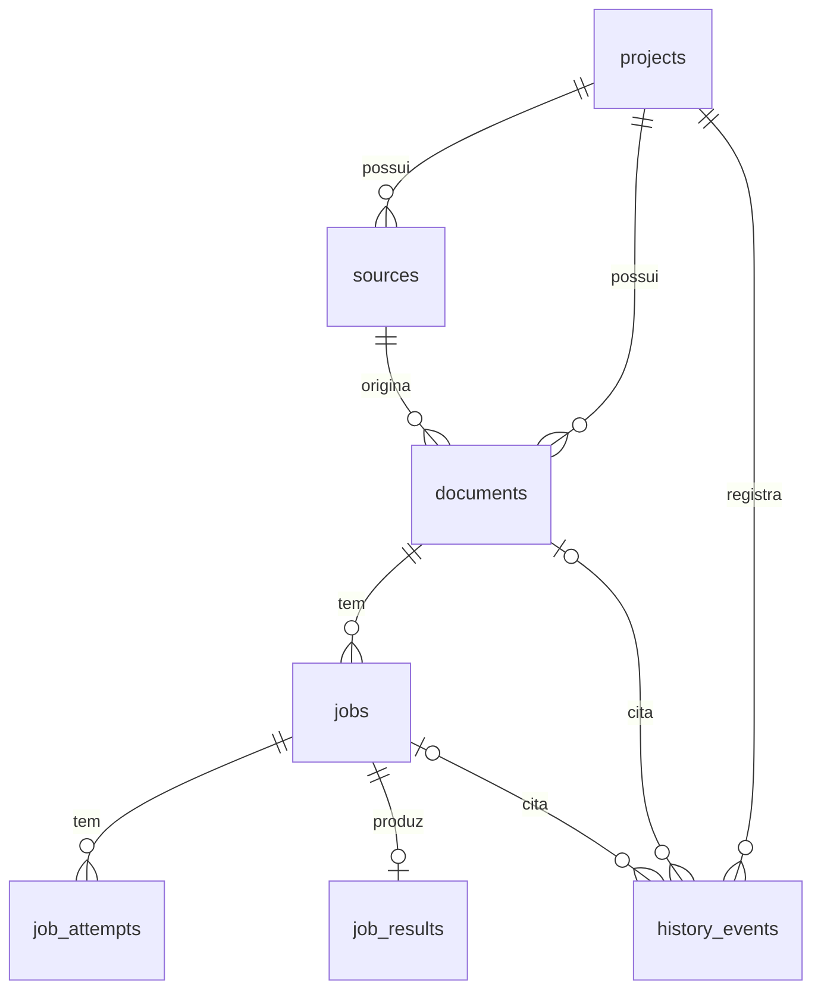

# Data Model: Persistência da versão desktop (job-store)

**Feature**: `job-store` | **Spec**: [spec.md](spec.md) | **Research**: [research.md](research.md)

> Todo o schema é **[PROPOSTA — a validar na implementação]**: tabelas novas, sem contrato externo pré-existente.
> Nomes em inglês (FR-020); comentários do SQL em português. Fonte única: `src/artigo2md/store/migrations/0001_initial.sql`.
> Todos os identificadores são `bigint GENERATED ALWAYS AS IDENTITY`; todos os instantes são `timestamptz`
> com `DEFAULT now()` (FR-022), exceto `history_events.occurred_at`, que usa `clock_timestamp()` (ver a entidade).



Todas as chaves estrangeiras usam `ON DELETE CASCADE`: excluir o projeto remove tudo o que depende dele (FR-011)
e nada de outros projetos. Nenhuma outra operação da camada apaga linhas.

## Entity: schema_migrations

Registro das migrações aplicadas (FR-012). Criada pelo runner (`CREATE TABLE IF NOT EXISTS`), não por um arquivo
de migração.

| Field | Type | Constraints | Description |
|-------|------|-------------|-------------|
| version | integer | PK, `> 0` | número do arquivo `NNNN_<slug>.sql` |
| name | text | NOT NULL | nome do arquivo |
| checksum | text | NOT NULL, 64 hex | SHA-256 dos bytes do arquivo |
| applied_at | timestamptz | NOT NULL DEFAULT now() | instante da aplicação |

## Entity: projects

| Field | Type | Constraints | Description |
|-------|------|-------------|-------------|
| id | bigint | PK identity | |
| name | text | NOT NULL, `CHECK (btrim(name) <> '')` | nome; a camada grava `name.strip()` (Python, espaços Unicode nas pontas); lido de volta, devolve o valor gravado |
| name_key | text | NOT NULL, `CHECK (name_key <> '')` | chave de unicidade calculada pela camada: `unicodedata.normalize('NFC', name).casefold()` normalizado de novo em NFC; independe da localidade do banco (`Á`=`á`, `ß`=`ss`, `a`≠`á`) |
| status | text | NOT NULL DEFAULT 'active', `CHECK IN ('active','archived')` | |
| created_at | timestamptz | NOT NULL DEFAULT now() | |
| updated_at | timestamptz | NOT NULL DEFAULT now() | atualizado pela camada em toda alteração |

**Índices**: `projects_active_name_key` UNIQUE em `(name_key) WHERE status = 'active'` (FR-001; arquivar libera o
nome, desarquivar esbarra nele). Não se usa `lower(name)`: o resultado de `lower()` no banco depende da localidade
do cluster, e a regra de FR-001 tem de ser a mesma em qualquer máquina.

**State transitions**: `active → archived` (arquivar) e `archived → active` (desarquivar, recusado se o nome estiver
em uso por outro projeto ativo). Exclusão remove a linha e tudo abaixo.

## Entity: sources

| Field | Type | Constraints | Description |
|-------|------|-------------|-------------|
| id | bigint | PK identity | |
| project_id | bigint | NOT NULL FK → projects(id) CASCADE | |
| kind | text | NOT NULL `CHECK IN ('folder','file')` | tipo (FR-002) |
| mode | text | NOT NULL `CHECK IN ('in_place','copied')` | indicada no lugar ou copiada (FR-002) |
| path | text | NOT NULL `CHECK (path <> '')` | gravado como informado; nunca verificado no disco |
| created_at | timestamptz | NOT NULL DEFAULT now() | |

**Restrições**: UNIQUE `(id, project_id)` — alvo da FK composta de `documents`. Não há unicidade de `(project_id, path)`: duas fontes com o mesmo caminho no mesmo projeto são permitidas (FR-002).

**Índices**: `sources_project_idx` em `(project_id)` (exclusão em cascata e listagem por projeto).

## Entity: documents

| Field | Type | Constraints | Description |
|-------|------|-------------|-------------|
| id | bigint | PK identity | |
| project_id | bigint | NOT NULL FK → projects(id) CASCADE | |
| source_id | bigint | NOT NULL | |
| path | text | NOT NULL `CHECK (path <> '')` | caminho do PDF |
| created_at | timestamptz | NOT NULL DEFAULT now() | |

**Restrições**:
- FK composta `(source_id, project_id) → sources(id, project_id)` CASCADE: a fonte é do mesmo projeto (FR-013).
- UNIQUE `(project_id, path)`: mesmo caminho não duplica no projeto; outro projeto pode repetir (FR-003).
  O registro usa `ON CONFLICT (project_id, path) DO NOTHING` e devolve o existente (US1, cenário 4), que mantém a
  fonte original; a fonte informada na chamada repetida só é validada como do mesmo projeto.
- UNIQUE `(id, project_id)` — alvo das FKs compostas de `jobs` e `history_events`.
- Índice `documents_source_idx` em `(source_id, project_id)`: sustenta a verificação da FK composta quando uma fonte é removida em cascata.

**Status derivado** (FR-009, não é coluna): status do job mais recente (`ORDER BY requested_at DESC, id DESC`) ou
`not_processed` quando não há job. O registro `DocumentStatus` devolvido por `list_documents` tem:
`document_id`, `project_id`, `source_id`, `path`, `status` (`not_processed` ou um dos cinco estados de job),
`latest_job_id` (`None` sem job), `latest_job_requested_at` (`None` sem job) e `last_result`
(`ResultSummary | None`). `ResultSummary` descreve o resultado do job `succeeded` mais recente do documento
(mesma ordem `requested_at DESC, id DESC`), com `job_id`, `markdown_path`, `engine`, `score`, `accepted` e
`created_at`; é `None` quando nenhum job do documento foi bem-sucedido. O status vem do job mais recente e o
`last_result` do mais recente bem-sucedido: podem ser jobs diferentes.

## Entity: jobs

| Field | Type | Constraints | Description |
|-------|------|-------------|-------------|
| id | bigint | PK identity | |
| project_id | bigint | NOT NULL | redundante para validar eventos e cancelar em lote |
| document_id | bigint | NOT NULL | |
| requested_engine | text | NOT NULL `CHECK IN ('auto','docling','pymupdf','mineru','markitdown')` | = `router.ENGINES` |
| status | text | NOT NULL DEFAULT 'pending' `CHECK IN ('pending','running','succeeded','failed','cancelled')` | |
| requested_at | timestamptz | NOT NULL DEFAULT now() | |
| started_at | timestamptz | NULL | preenchido em `pending → running` |
| finished_at | timestamptz | NULL | preenchido ao chegar a estado final |
| error_summary | text | NULL | obrigatório quando `failed` |

**Restrições**:
- FK composta `(document_id, project_id) → documents(id, project_id)` CASCADE.
- UNIQUE `(id, project_id)` e UNIQUE `(id, document_id)` — alvos das FKs de `history_events`.
- `CHECK`: `status = 'pending'` ⇒ `started_at IS NULL AND finished_at IS NULL`; `status = 'running'` ⇒
  `started_at IS NOT NULL AND finished_at IS NULL`; estados finais ⇒ `finished_at IS NOT NULL`;
  `status = 'failed'` ⇒ `error_summary IS NOT NULL`.

**Índices**:
- `jobs_project_idx` em `(project_id)` (cancelamento em lote e exclusão em cascata por projeto).
- `jobs_one_active_per_document` UNIQUE `(document_id) WHERE status IN ('pending','running')` (FR-004, FR-013).
- `jobs_document_recent_idx` em `(document_id, requested_at DESC, id DESC)` (status derivado, SC-003).

**State transitions** (FR-010; gatilho `BEFORE UPDATE` `jobs_guard_transition` repete a regra):

```text
pending ──► running ──► succeeded
   │           ├──────► failed
   │           └──────► cancelled
   └──────────────────► cancelled
```

Estados finais (`succeeded`, `failed`, `cancelled`) não mudam mais; não existe `running → pending`. Alterar
qualquer coluna de um job final é recusado pelo gatilho.

## Entity: job_attempts

| Field | Type | Constraints | Description |
|-------|------|-------------|-------------|
| id | bigint | PK identity | |
| job_id | bigint | NOT NULL FK → jobs(id) CASCADE | |
| position | integer | NOT NULL `> 0`; UNIQUE `(job_id, position)` | ordem da tentativa no job, atribuída pela camada |
| engine | text | NOT NULL `CHECK (engine <> '')` | texto livre (FR-005) |
| seconds | double precision | NOT NULL `>= 0` | duração (`Attempt.seconds`) |
| score | double precision | NULL, `0..100` | campos de `Quality` |
| accepted | boolean | NULL | |
| tables_found | integer | NULL, `>= 0` | |
| tables_expected | integer | NULL, `>= 0` | |
| chars_per_page | double precision | NULL, `>= 0` | |
| issues | text[] | NULL | |
| error | text | NULL | texto do erro do motor |
| created_at | timestamptz | NOT NULL DEFAULT now() | |

**Restrições**: os seis campos de qualidade são todos nulos ou todos preenchidos; `CHECK (score IS NOT NULL OR
error IS NOT NULL)` — uma tentativa nunca fica sem as duas informações. Tentativas só são aceitas para job em
`running` (validação da camada na mesma transação, com `SELECT ... FOR UPDATE` no job).

## Entity: job_results

| Field | Type | Constraints | Description |
|-------|------|-------------|-------------|
| job_id | bigint | PK, FK → jobs(id) CASCADE | no máximo um resultado por job |
| markdown_path | text | NOT NULL `<> ''` | caminho do `.md` gerado |
| engine | text | NOT NULL `<> ''` | motor vencedor (texto livre) |
| score | double precision | NOT NULL `0..100` | |
| accepted | boolean | NOT NULL | pode ser `false` (FR-006) |
| tables_found | integer | NOT NULL `>= 0` | |
| tables_expected | integer | NOT NULL `>= 0` | |
| chars_per_page | double precision | NOT NULL `>= 0` | |
| issues | text[] | NOT NULL DEFAULT '{}' | também são os avisos (FR-007) |
| created_at | timestamptz | NOT NULL DEFAULT now() | |

**Garantias no banco** (FR-006):
- Gatilho `BEFORE INSERT` `job_results_require_succeeded_job`: o job precisa estar em `succeeded`.
- Gatilho de restrição `DEFERRABLE INITIALLY DEFERRED` `jobs_succeeded_requires_result` (`AFTER UPDATE` em `jobs`):
  no commit, um job `succeeded` precisa ter resultado. A camada grava estado, resultado e evento na mesma
  transação (FR-014).
- `job_results` não tem operação de alteração na camada.

## Entity: history_events

| Field | Type | Constraints | Description |
|-------|------|-------------|-------------|
| id | bigint | PK identity | desempate estável da ordem |
| project_id | bigint | NOT NULL FK → projects(id) CASCADE | |
| document_id | bigint | NULL | |
| job_id | bigint | NULL | |
| event_type | text | NOT NULL, `CHECK IN (...)` (lista na research, Decision 6) | |
| occurred_at | timestamptz | NOT NULL DEFAULT clock_timestamp() | instante em que a linha foi gravada (não o início da transação, que é o que `now()` devolve); dentro de uma transação, eventos gravados em sequência têm instantes crescentes |
| message | text | NOT NULL | mensagem em português |

**Restrições** (FR-008 — documento e job pertencem ao projeto do evento):
- FK composta `(document_id, project_id) → documents(id, project_id)` CASCADE (ignorada quando `document_id` é nulo).
- FK composta `(job_id, project_id) → jobs(id, project_id)` CASCADE.
- FK composta `(job_id, document_id) → jobs(id, document_id)` CASCADE (quando ambos preenchidos, o job é do documento).
- Gatilho `BEFORE UPDATE` `history_events_append_only` recusa alteração. A camada não oferece alteração nem remoção
  individual; a remoção só ocorre em cascata pela exclusão do projeto.

**Índices**: `history_events_project_idx` em `(project_id, occurred_at, id)`; `history_events_document_idx` em
`(document_id, occurred_at, id) WHERE document_id IS NOT NULL`; `history_events_job_idx` em `(job_id) WHERE job_id IS NOT NULL`
(FKs compostas por job).

**Ordem da linha do tempo**: `(occurred_at, id)`. Para transações concorrentes, a ordem é a do instante de
gravação de cada linha, não a do commit: um evento de transação lenta pode aparecer antes de outro já confirmado.
O `id` desempata instantes iguais. Os índices de FK de `job_attempts` e `job_results` já são cobertos por
`UNIQUE (job_id, position)` e pela chave primária `job_id`.

## Operações em lote (FR-011)

- **Arquivar** (recusado com `StoreValidationError` se já arquivado): numa transação — `UPDATE projects SET
  status='archived'`; `UPDATE jobs SET status='cancelled', finished_at=now() WHERE project_id=$1 AND status IN
  ('pending','running')`; um evento `job_cancelled` por job cancelado e um `project_archived`.
- **Desarquivar** (recusado com `StoreValidationError` se já ativo; com `ProjectNameTakenError` se o `name_key` está
  em uso por projeto ativo): `UPDATE projects SET status='active'` e um evento `project_unarchived`.
- **Excluir**: numa transação — mesmo cancelamento (para que nenhum job final mude depois) e `DELETE FROM projects`;
  a cascata remove todo o resto. Nenhum arquivo do disco é tocado.
