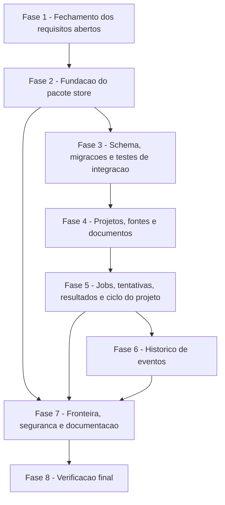

# Tarefas artigo2md - job-store (persistência da versão desktop)

Escopo: persistência no Postgres da `container-stack` — modelo de dados (7 tabelas + `schema_migrations`), migrações versionadas só de avanço, camada de repositório assíncrona `artigo2md.store` (driver `asyncpg`) e testes (sem Docker sempre; integração atrás de `ARTIGO2MD_DB_TESTS=1`). Fonte: `docs/specs/job-store/{spec,plan,research,data-model,quickstart}.md`, `contracts/` e `checklists/`. Nenhuma rota de API, fila ou tela entra aqui (roadmap, item 3).

**Legenda de status:**
- `[ ]` Pendente
- `[~]` Em andamento
- `[x]` Concluido
- `[!]` Bloqueado

> Nota da onda-009: `[~]` em tarefas de teste de integracao = teste escrito (e conferido por inspecao e por dublê sem banco), mas **ainda nao executado**: depende da stack do artigo2md no ar e do `stack/.env` (acao que exige consentimento do operador; bloqueio humano registrado). `[!]` = depende dessa mesma execucao (ou de `ARTIGO2MD_STACK=1`).

**Legenda de criticidade:**
- `[C]` Critico - Impacto financeiro direto, de seguranca ou bloqueante
- `[A]` Alto - Funcionalidade essencial
- `[M]` Medio - Necessario mas sem urgencia imediata

> Convencoes: sintaxe (arquivos, funcoes, tabelas, colunas) em ingles; comentarios, mensagens e documentacao em portugues (FR-020). Nenhum valor de dado externo e inventado: cada nome de parametro do `asyncpg` citado nas tarefas deve ser conferido na fonte S05/S06 da research antes de entrar em contrato ou codigo. Nao commitar sem pedido do operador; stage so dos arquivos da tarefa.

---

## FASE 1 - Fechamento dos requisitos abertos dos checklists

> Os gaps e ambiguidades abertos dos checklists viram tarefas de edicao de spec/contrato/data-model. Os itens `{humano}` ficam na tarefa 1.7 e bloqueiam o inicio da FASE 2 (execute-task) ate o operador responder.

### 1.1 Fechar lacunas do contrato de operacoes `[A]`

Ref: checklists/api.md CHK011, CHK013, CHK014, CHK015, CHK016; spec FR-001, FR-008, FR-011; contracts/repository.md

- [x] 1.1.1 CHK011: definir em `contracts/repository.md` e na spec (edge cases, FR-011) o comportamento de `archive_project` sobre projeto ja arquivado e de `unarchive_project` sobre projeto ja ativo (recusa com `StoreValidationError` nos dois casos, simetrica, ou no-op idempotente) e registrar a escolha
- [x] 1.1.2 CHK013: resolver o conflito entre "nome lido de volta identico" (US5-6) e "nome gravado sem espacos nas pontas" (data-model, `projects.name`): decidir se o nome e aparado, e alinhar spec (FR-001/US5-6), data-model e contrato
- [x] 1.1.3 CHK014: declarar no contrato quem emite os eventos `project_created`, `source_added`, `document_added`, `job_created`, `job_started`, `attempt_recorded` (a propria operacao, na mesma transacao, ou a `project-api` via `add_event`); a decisao governa a tarefa 6.3
- [x] 1.1.4 CHK015: especificar a traducao de SQLSTATE 23503 e 23514 em `StoreValidationError` para `add_event` com documento/job inexistente ou de outro projeto, incluindo a corrida com exclusao concorrente do projeto (confirmar os atributos do erro do driver na fonte S07/S08 da research)
- [x] 1.1.5 CHK016: definir que `get_result` e `list_attempts` levantam `JobNotFoundError` para `job_id` inexistente, distinguindo de "job sem resultado" (`None`) e "job sem tentativas" (lista vazia); atualizar a tabela de operacoes
- [x] 1.1.6 Reler `contracts/repository.md` e confirmar que nenhuma operacao ficou sem coluna "Recusas" coerente com FR-004/FR-010; marcar CHK011/013/014/015/016 como resolvidos em `checklists/api.md` com a evidencia

### 1.2 Fechar lacunas do modelo de dados e das migracoes `[A]`

Ref: checklists/api.md CHK012, CHK017, CHK018, CHK019, CHK020, CHK021; spec FR-001, FR-003, FR-008, FR-009, FR-012; data-model.md; contracts/migrations.md

- [x] 1.2.1 CHK012: definir a regra de "ignorando maiusculas e minusculas" para acentuados e nao-ASCII (`Á`/`á`; decidir explicitamente o caso `ß`) e como o indice `lower(name)` se comporta independentemente da localidade do banco (decisao: coluna `name_key` com `casefold`, sem `lower(name)`); registrar na spec (FR-001) e no data-model
- [x] 1.2.2 CHK017: documentar que duas fontes com o mesmo caminho no mesmo projeto sao permitidas (ou proibi-las com restricao unica) e que o documento devolvido por `add_document` ja existente mantem a fonte original; atualizar data-model e contrato
- [x] 1.2.3 CHK018: enumerar os campos de `DocumentStatus` e do "resumo do ultimo resultado" (FR-009) no contrato e no data-model, com o valor `not_processed`
- [x] 1.2.4 CHK019: documentar no contrato a sequencia de recuperacao de job orfao (a `project-api` chama `fail_job` ou `cancel_job` e depois `create_job`) e quem e responsavel por ela
- [x] 1.2.5 CHK020: definir a ordem da linha do tempo para eventos de transacoes concorrentes (instante de gravacao do evento versus inicio da transacao; `now()` devolve o inicio da transacao), ajustar o `DEFAULT` de `occurred_at` no data-model e a nota da research D10
- [x] 1.2.6 CHK021: acrescentar a linha "migracao aplicada que nao existe mais no codigo" (`MigrationChecksumError`, historico divergente) a tabela "Comportamento" de `contracts/migrations.md`, com mensagem em portugues
- [x] 1.2.7 Marcar CHK012/017/018/019/020/021 como resolvidos em `checklists/api.md` com a evidencia

### 1.3 Fechar lacunas de rastreabilidade e cobertura de cenarios `[M]`

Ref: checklists/api.md CHK022, CHK023; spec FR-020, FR-022, US1, US2, US4; quickstart.md

- [x] 1.3.1 CHK022: dar a FR-020 (nomes em ingles) e FR-022 (instantes com fuso) um cenario de aceite ou criterio de sucesso que os cite como cobertos, com a forma de verificacao declarada
- [x] 1.3.2 CHK023: acrescentar ao `quickstart.md` os cenarios da US4 (isolamento entre documentos, ordem estavel, paginacao, imutabilidade)
- [x] 1.3.3 CHK023: acrescentar ao `quickstart.md` os cenarios de US1-7 (mesmo caminho em dois projetos), US2-8/9/10 (finalizacao com `accepted=false`, job falho sem resultado, atomicidade/rollback) e as faixas de `Quality` (score fora de 0..100, valores negativos)
- [x] 1.3.4 Rodar o gate de cobertura de requisitos (`requirement-coverage.sh`, mesmo usado no checklist) e confirmar que FR-020/FR-022 aparecem cobertos; marcar CHK022/CHK023

### 1.4 Fechar requisitos de seguranca abertos `[C]`

Ref: checklists/security.md CHK004, CHK005, CHK008, CHK020; spec FR-016, FR-005, FR-007; research D4; Constitution I

- [x] 1.4.1 CHK004: ler `stack/compose.yaml` e determinar se a rede interna da stack tem sub-rede declarada; com a fonte, redefinir o criterio do nome `postgres` (em vez de qualquer endereco privado); sem fonte, registrar a pendencia como bloqueio humano em vez de supor uma faixa
- [x] 1.4.2 CHK005: especificar que a conexao usa o endereco ja validado (nao resolve o nome de novo ao conectar) ou documentar por que a segunda resolucao e aceita; atualizar research D4 e `contracts/repository.md`
- [x] 1.4.3 CHK008: exigir que `StoreDatabaseError` e `MigrationFailedError` sejam lancadas sem encadear texto bruto do driver (`from None`, campo `detail` nunca copiado) e que a mensagem use so texto proprio em portugues; atualizar os dois contratos
- [x] 1.4.4 CHK020: classificar os campos de texto livre (`error`, `error_summary`, `issues`, `message`) como possivel conteudo derivado de documento, declarar que permanecem so no banco local e que nada deles e enviado a fora; registrar na spec (FR-005/FR-007) e no plan
- [x] 1.4.5 Marcar CHK004/005/008/020 como resolvidos em `checklists/security.md` com a evidencia

### 1.5 Fechar metas e medicao de desempenho `[M]`

Ref: checklists/performance.md CHK002, CHK003, CHK004, CHK008; spec SC-001, SC-003, FR-009, FR-008, FR-011

- [x] 1.5.1 CHK002: definir o ambiente de referencia de SC-001 e SC-003 sem inventar hardware (por exemplo, "a maquina de desenvolvimento onde o teste roda, banco da stack local, cache quente") e exigir que o teste registre o ambiente medido na saida
- [x] 1.5.2 CHK003: definir como "uma unica consulta" e medida (contador de comandos enviados pelo pool no teste, ou log do servidor) e atualizar o quickstart, cenario 9
- [x] 1.5.3 CHK004: decidir de forma explicita se ha ou nao alvo de tempo para `list_events`, `create_job`, `complete_job`, arquivar e excluir projeto grande; registrar a decisao (a checklist aceita "sem meta, por decisao") na spec
- [x] 1.5.4 CHK008: decidir se `list_documents` ganha `limit`/`offset` ou se permanece sem paginacao com o limite documentado (1.000 documentos, SC-003); atualizar FR-009 e o contrato
- [x] 1.5.5 Marcar CHK002/003/004/008 como resolvidos em `checklists/performance.md` com a evidencia

### 1.6 Fechar indices, pool e prazos `[A]`

Ref: checklists/performance.md CHK007, CHK011, CHK012, CHK013; data-model.md; contracts/repository.md; contracts/migrations.md; research S05/S06

- [x] 1.6.1 CHK007: definir no data-model os indices para as operacoes em lote por projeto (`jobs(project_id)`, `sources(project_id)` e demais colunas de FK usadas por cancelamento e exclusao em cascata) ou registrar a ausencia como decisao
- [x] 1.6.2 CHK011: definir tamanho do pool e comportamento quando as conexoes se esgotam (espera, prazo, recusa), conferindo os nomes de parametros na fonte S05 do `asyncpg` antes de escreve-los no contrato
- [x] 1.6.3 CHK012: definir prazo maximo para conectar e para executar consulta, de modo que "banco indisponivel" falhe em tempo definido (`DatabaseUnavailableError`); parametros marcados [PROPOSTA] e configuraveis, conferidos na fonte S05
- [x] 1.6.4 CHK013: definir limite de espera pelo `pg_advisory_lock` de migracao e a mensagem em portugues quando o outro processo trava (nova linha em `contracts/migrations.md`; distinguir espera de execucao em SC-001)
- [x] 1.6.5 Marcar CHK007/011/012/013 como resolvidos em `checklists/performance.md` com a evidencia

### 1.7 Registrar respostas do operador aos itens humanos `[A]`

Ref: checklists/api.md CHK026, CHK027; checklists/security.md CHK021, CHK022, CHK023; checklists/performance.md CHK005, CHK017

- [x] 1.7.1 api CHK026: a lista fechada de tipos de evento (research D6) basta para a futura tela de historico (roadmap, item 8)? Resposta (block-006, A): a lista fechada de tipos de evento basta; novos tipos entram por migracao.
- [x] 1.7.2 api CHK027: aceita-se que job orfao em andamento so saia por intervencao explicita da `project-api`, sem expiracao automatica (block-002)? Resposta (block-006, A): aceito, sem expiracao automatica; so a `project-api` retira job orfao.
- [x] 1.7.3 security CHK021: aceitar os riscos residuais L-01 (usuario da imagem, sem papel de menor privilegio) e L-02 (sem TLS em loopback/rede interna)? Resposta (block-006, A): L-01 e L-02 aceitos.
- [x] 1.7.4 security CHK022: aceitar L-03 (texto sem limite de tamanho em nomes, caminhos e mensagens) ou exigir teto? Resposta (block-006, A): L-03 aceito, sem teto de tamanho.
- [x] 1.7.5 security CHK023: ha exigencia de acompanhar avisos de seguranca conhecidos do `asyncpg` (faixa `>=0.32.0,<0.33`) alem da licenca? Resposta (block-006, A): nao acompanhar advisories; so a verificacao de licenca.
- [x] 1.7.6 performance CHK005: qual o volume esperado por projeto (documentos, jobs por documento, tentativas, eventos) alem dos 1.000 documentos de SC-003? Resposta (block-006, A): manter so a meta de SC-003 (1.000 documentos); demais volumes nao especificados.
- [x] 1.7.7 performance CHK017: ha expectativa ou limite aceitavel de crescimento do volume `pgdata` dada a retencao indeterminada? Resposta (block-006, A): sem limite de crescimento do `pgdata`; o usuario exclui projetos quando quiser (FR-011).
- [x] 1.7.8 Registrar cada resposta no checklist correspondente (item marcado `[x]` com a resposta citada) e propagar as consequencias para spec/plan/contratos; os itens `[!]` passam a `[x]`

---

## FASE 2 - Fundacao do pacote `artigo2md.store`

> Depende da FASE 1 (decisoes que mudam contrato, config e erros). A escolha de stack (`asyncpg`, runner proprio) ja foi decidida pelo operador (block-005/dec-024); a aprovacao de dependencia abaixo vem depois dela.

### 2.1 Dependencia `asyncpg`, lock e estrategia de testes assincronos `[A]`

Ref: plan.md Technical Context; research D1, D2, V-01; spec FR-018, FR-021; stack/THIRD_PARTY_LICENSES.md

- [x] 2.1.1 Acrescentar `asyncpg>=0.32.0,<0.33` ao dependency group `api` e ao extra `dev` em `pyproject.toml`; NAO acrescentar a `[project] dependencies` (FR-021)
- [x] 2.1.2 Regenerar `uv.lock` com `uv lock` e conferir (V-01) a versao resolvida de `async-timeout` para Python 3.10 e, se diferente de 5.0.1, a licenca dela no PyPI; atualizar `stack/THIRD_PARTY_LICENSES.md` se preciso
- [x] 2.1.3 Definir como testar codigo `async` sem nova dependencia (por exemplo `asyncio.run` dentro dos testes); se `pytest-asyncio` for desejado, confirmar licenca em fonte oficial e registrar no registro de licencas antes de adiciona-lo (Principio II) — sem confirmacao, bloqueio humano. Resultado: `asyncio.run` dentro dos testes; `pytest-asyncio` NAO adicionado (teste confere)
- [x] 2.1.4 Escrever teste (sem banco) que le `pyproject.toml` e confirma `asyncpg` no group `api` e no extra `dev` e ausente de `dependencies`, e que o group `api` continua sem docling/pymupdf4llm
- [x] 2.1.5 Rodar `uv run --extra dev --extra pymupdf pytest tests/test_stack_files.py` e confirmar que os testes existentes da stack seguem verdes

### 2.2 Erros, modelos e exports `[A]`

Ref: contracts/repository.md (hierarquia, registros); research D6, D7, D8; spec FR-007, FR-020

- [x] 2.2.1 Criar `src/artigo2md/store/errors.py` com a hierarquia `StoreError` e filhas do contrato (inclui `MigrationError`, `SchemaTooNewError`, `MigrationChecksumError`, `MigrationFailedError`, `MigrationLockTimeoutError`), todas lancadas `from None`, mensagens em portugues
- [x] 2.2.2 Criar `src/artigo2md/store/models.py` com dataclasses congeladas (`Project`, `Source`, `Document`, `Job`, `Attempt`, `Result`, `HistoryEvent`, `DocumentStatus`) e `QualityRecord` com validacao de faixa (score 0..100, contagens e densidade nao negativas) antes do SQL
- [x] 2.2.3 Declarar em `models.py` as constantes dos valores enumerados (estados, tipos, modos, tipos de evento, motores solicitados) sem importar `router`
- [x] 2.2.4 Criar `src/artigo2md/store/__init__.py` exportando `Store`, `DbSettings`, `apply_migrations` e os erros, sem importar `asyncpg` no topo de modulos que a CLI possa carregar
- [x] 2.2.5 Escrever `tests/test_store_contract.py` (sem banco): campos de `QualityRecord` iguais aos de `router.Quality`; constante de motores igual a `router.ENGINES`; recusa de score fora de 0..100 e de valores negativos; `Result.warnings` igual a `quality.issues`

### 2.3 Configuracao de conexao e protecao da senha `[C]`

Ref: contracts/repository.md (Configuracao); research D4; spec FR-016, SC-007; checklists/security.md CHK001..CHK010

- [x] 2.3.1 Criar `src/artigo2md/store/config.py` com `DbSettings` (`password` com `field(repr=False)`) e `DbSettings.from_env` na ordem ambiente → `ARTIGO2MD_STACK_ENV` → `./stack/.env`, reusando `infra.parse_env_file`
- [x] 2.3.2 Implementar a lista fechada de hosts (`127.0.0.1`, `::1`, `localhost`, `postgres`) e a resolucao previa de `postgres`, com o criterio decidido na tarefa 1.4 (todos os enderecos loopback ou privados; sem faixa mais estreita citavel) e `resolve_connect_host()` devolvendo o endereco validado para a conexao; recusa sem ecoar o valor recusado
- [x] 2.3.3 Implementar as falhas `StoreConfigError` que citam so o nome da variavel (ausente, vazia, porta fora de 1..65535), com mensagens em portugues do contrato
- [x] 2.3.4 Escrever `tests/test_store_config.py` (sem banco): parametros ausentes/invalidos, host remoto recusado sem eco, ordem de resolucao, `repr(settings)` e `str(exc)` sem a senha
- [x] 2.3.5 Escrever teste de que host remoto e recusado antes de qualquer tentativa de conexao (nenhum socket aberto), usando monkeypatch da resolucao de nomes

---

## FASE 3 - Schema, migracoes e infraestrutura de testes de integracao

### 3.1 Migracao `0001_initial.sql` `[A]`

Ref: data-model.md; research D5, D6, D10; spec FR-001..FR-011, FR-013, FR-022

- [x] 3.1.1 Criar `src/artigo2md/store/migrations/0001_initial.sql` com `projects`, `sources`, `documents`, `jobs`, `job_attempts`, `job_results`, `history_events`, todas com `bigint GENERATED ALWAYS AS IDENTITY`, `timestamptz` e FKs `ON DELETE CASCADE` (comentarios em portugues, identificadores em ingles)
- [x] 3.1.2 Implementar os `CHECK` de dominio (estados, tipos, modos, motor solicitado, faixas de qualidade, consistencia de `started_at`/`finished_at`/`error_summary`, qualidade todo-nula ou todo-preenchida)
- [x] 3.1.3 Implementar os indices unicos parciais `projects_active_name_key` (em `name_key`) e `jobs_one_active_per_document`, as FKs compostas e os indices de consulta (inclui `jobs_project_idx`, `sources_project_idx`, `documents_source_idx`, `history_events_job_idx` da tarefa 1.6)
- [x] 3.1.4 Implementar os gatilhos `jobs_guard_transition`, `job_results_require_succeeded_job`, `jobs_succeeded_requires_result` (diferido) e `history_events_append_only`
- [x] 3.1.5 Aplicar o resultado das tarefas 1.1/1.2 (`occurred_at DEFAULT clock_timestamp()`, coluna `name_key`, aparar nome, fontes repetidas permitidas) ao SQL e conferir o arquivo contra o data-model
- [x] 3.1.6 Escrever teste (sem banco) que confere a lista de motores e os valores enumerados do SQL contra as constantes de `models.py` e `router.ENGINES`, e que o nome dos arquivos de migracao segue `NNNN_<slug>.sql`

### 3.2 Runner de migracao `[A]`

Ref: contracts/migrations.md; research D3; spec FR-012; US3

- [x] 3.2.1 Criar `src/artigo2md/store/migrator.py` com `known_migrations()` (leitura via `importlib.resources`, checksum SHA-256 dos bytes) e `MigrationReport`
- [x] 3.2.2 Implementar `apply_migrations_on(connection)`: espera pelo lock com `pg_try_advisory_lock` (chave constante) repetido a cada 0,2 s ate 60 s (`MigrationLockTimeoutError`), `CREATE TABLE IF NOT EXISTS schema_migrations`, comparacao com o historico aplicado e liberacao do lock no `finally`
- [x] 3.2.3 Implementar as recusas `SchemaTooNewError`, `MigrationChecksumError` (checksum divergente e historico divergente) antes de aplicar qualquer coisa, com mensagens do contrato
- [x] 3.2.4 Implementar a aplicacao de cada migracao pendente em transacao propria com registro em `schema_migrations`, e `MigrationFailedError` com o nome do arquivo e sem encadear texto bruto do driver (tarefa 1.4)
- [x] 3.2.5 Implementar `apply_migrations(settings)` com a conexao de migracao sem `command_timeout` e o limite de 60 s de espera pelo lock (tarefa 1.6.4)
- [x] 3.2.6 Escrever teste (sem banco) de `known_migrations()`: versoes contiguas a partir de `0001`, checksum estavel e igual ao SHA-256 do arquivo

### 3.3 Fixture de banco temporario `[C]`

Ref: research D9; spec FR-019, SC-005, SC-006; checklists/security.md CHK012, CHK016, CHK017

- [x] 3.3.1 Criar fixture de sessao em `tests/conftest.py` ou `tests/store_fixtures.py` que, so com `ARTIGO2MD_DB_TESTS=1`, cria `artigo2md_test_<16 hex>` via `CREATE DATABASE` com identificador citado e aplica as migracoes
- [x] 3.3.2 Implementar o teardown (`DROP DATABASE ... WITH (FORCE)`) protegido pela guarda `^artigo2md_test_[0-9a-f]{16}$` e diferente de `POSTGRES_DB`, que aborta sem apagar nada se a guarda falhar, inclusive apos falha de teste
- [x] 3.3.3 Implementar o `skipif` com motivo em portugues ("defina ARTIGO2MD_DB_TESTS=1 com a stack no ar") e a falha com mensagem clara quando o usuario nao puder criar banco (V-02)
- [x] 3.3.4 Escrever teste (sem banco) da guarda de nome: nomes validos passam; o nome de `POSTGRES_DB`, nomes fora do padrao e tentativas de injecao sao recusados sem executar nada
- [x] 3.3.5 Rodar `uv run --extra dev --extra pymupdf pytest` sem a variavel e confirmar suite verde com a integracao `SKIPPED` (cenario 1 do quickstart)

### 3.4 Testes de integracao das migracoes `[A]`

Ref: quickstart.md cenario 6; spec US3-1..7, SC-001

- [x] 3.4.1 Criar `tests/test_store_integration.py` (parte migracoes): banco vazio aplica `applied=(1,)` em ate 10 s; segunda aplicacao devolve `applied=()` sem alterar nada
- [x] 3.4.2 Testar duas chamadas concorrentes (`asyncio.gather`): ambas sem erro e cada versao registrada uma so vez
- [x] 3.4.3 Testar checksum alterado (`MigrationChecksumError`), versao `9999` inserida (`SchemaTooNewError`) e historico divergente (versao aplicada sem arquivo)
- [x] 3.4.4 Testar migracao de teste com SQL invalido no meio: `MigrationFailedError` citando o arquivo, nenhuma tabela parcial, versao nao registrada
- [x] 3.4.5 Rodar `ARTIGO2MD_DB_TESTS=1 uv run --extra dev --extra pymupdf pytest -k "store and migrat"` com a stack no ar

---

## FASE 4 - Repositorio: ciclo de vida, projetos, fontes e documentos (US1)

### 4.1 `Store`: pool, transacao e traducao de erros `[A]`

Ref: contracts/repository.md (Ciclo de vida, hierarquia de excecoes); spec FR-014, FR-015; checklists/performance.md CHK011, CHK012

- [x] 4.1.1 Criar `src/artigo2md/store/repository.py` com `Store.open/close/__aenter__/__aexit__` sobre `asyncpg.create_pool`, com argumentos nomeados (nunca DSN em texto) e os parametros de pool/prazo decididos na tarefa 1.6
- [x] 4.1.2 Implementar `Store.transaction()` devolvendo `StoreSession` com as mesmas operacoes na mesma transacao; fora dela, cada metodo roda em transacao curta
- [x] 4.1.3 Implementar a traducao de erros do driver: `UniqueViolationError` por `constraint_name` para `ProjectNameTakenError`/`ActiveJobExistsError`, 23503/23514 para `StoreValidationError`, falha de conexao para `DatabaseUnavailableError` (`from None`), demais para `StoreDatabaseError` sem `detail` do servidor
- [x] 4.1.4 Garantir que toda consulta use parametros `$n` e que nenhum valor do usuario seja concatenado em SQL (FR-015)
- [x] 4.1.5 Testes de integracao: abrir/fechar `Store`, dados identicos apos reabrir, `DatabaseUnavailableError` com porta fechada sem a senha na mensagem, repetir apos reconectar funciona

### 4.2 Projetos: criar, ler e listar `[A]`

Ref: spec US1-1, FR-001; data-model.md (projects); quickstart cenario 2

- [x] 4.2.1 Implementar `create_project(name)` com `INSERT ... ON CONFLICT (name_key) WHERE status = 'active' DO NOTHING RETURNING` (com `name_key` calculado pela camada: NFC + `casefold`), nome gravado com `strip()`, nome vazio/so espacos recusado (`StoreValidationError`) e nome ativo repetido recusado (`ProjectNameTakenError`), conforme a regra de nome da tarefa 1.1/1.2
- [x] 4.2.2 Implementar `get_project` (`ProjectNotFoundError`) e `list_projects(include_archived=False)`
- [x] 4.2.3 Implementar o mapper `_row_to_project` e a atualizacao de `updated_at` em toda alteracao
- [x] 4.2.4 Testes de integracao: projeto criado e lido de volta identico; nome vazio; nome repetido com maiusculas/minusculas e com acentuados; nome de projeto arquivado reutilizavel (depende da tarefa 5.4 para o arquivamento)

### 4.3 Fontes e documentos `[A]`

Ref: spec US1-2..4, US1-7, FR-002, FR-003, FR-013; data-model.md (sources, documents)

- [x] 4.3.1 Implementar `add_source(project_id, kind, mode, path)` com validacao previa de `kind`/`mode` e sem verificar o caminho no disco (FR-002)
- [x] 4.3.2 Implementar `add_document(project_id, source_id, path)` com `ON CONFLICT (project_id, path) DO NOTHING` devolvendo `(Document, created)` e recusando fonte de outro projeto
- [x] 4.3.3 Implementar os mappers `_row_to_source` e `_row_to_document`
- [x] 4.3.4 Testes de integracao: fonte pasta no lugar e fonte arquivo copiada; `kind`/`mode` invalidos sem registro parcial; mesmo caminho duas vezes no mesmo projeto (um documento, `created=False`); mesmo caminho em dois projetos (dois documentos independentes); caminho inexistente no disco aceito
- [x] 4.3.5 Teste de caracteres especiais: nomes e caminhos com acentos, espacos, aspas, barras e texto de comando de banco gravados e lidos identicos (US5-6, FR-015)

---

## FASE 5 - Repositorio: jobs, tentativas, resultados e ciclo de vida do projeto (US2, US1-5..9)

### 5.1 Criar e iniciar jobs; transicoes de estado `[A]`

Ref: spec US2-1, US2-4..7, FR-004, FR-010, FR-013; research D5; quickstart cenario 4

- [x] 5.1.1 Implementar `create_job(document_id, requested_engine)` validando o motor contra a constante, com `INSERT ... ON CONFLICT (document_id) WHERE status IN ('pending','running') DO NOTHING RETURNING`; zero linhas gera `ActiveJobExistsError`
- [x] 5.1.2 Implementar `start_job` e o helper de transicao (`UPDATE ... WHERE id = $1 AND status = ANY($allowed) RETURNING`, com leitura do estado atual para distinguir `JobNotFoundError` de `InvalidJobTransitionError`)
- [x] 5.1.3 Implementar `_row_to_job` e garantir que a recusa de transicao nao altera o registro
- [x] 5.1.4 Testes de integracao: job nasce `pending` com motor e data do pedido; motor fora de `ENGINES` recusado; segundo job para documento com job nao final recusado; novo job apos estado final; reprocessamento mantem job anterior intacto
- [x] 5.1.5 Testes de concorrencia: duas tarefas `asyncio.gather` criando job no mesmo documento resultam em exatamente um sucesso e um `ActiveJobExistsError`; `UPDATE` direto de `running` para `pending` e recusado pelo gatilho

### 5.2 Registrar tentativas por motor `[A]`

Ref: spec US2-2, FR-005, FR-007; data-model.md (job_attempts); checklists/api.md CHK006

- [x] 5.2.1 Implementar `record_attempt(job_id, engine, seconds, quality=None, error=None)` com `SELECT ... FOR UPDATE` no job, `position` atribuida pela camada e validacao de job `running`
- [x] 5.2.2 Validar faixas e a regra "nunca sem qualidade e sem erro" antes do SQL (`StoreValidationError`), com mensagens em portugues
- [x] 5.2.3 Implementar `_row_to_attempt` e `list_attempts(job_id)` em ordem de `position` (comportamento de job inexistente conforme a tarefa 1.1)
- [x] 5.2.4 Testes de integracao: duas tentativas na ordem em que ocorreram; tentativa com erro e sem qualidade; tentativa sem as duas informacoes recusada; tentativas concorrentes sem `position` duplicada; tentativa em job nao `running` recusada

### 5.3 Finalizar jobs de forma atomica `[A]`

Ref: spec US2-3, US2-8..10, FR-006, FR-007, FR-010, FR-014; quickstart cenarios 3 e 4

- [x] 5.3.1 Implementar `complete_job(job_id, markdown_path, engine, quality, message)` numa transacao: `running -> succeeded`, `INSERT` do resultado e evento `job_succeeded`; `accepted=false` termina como `succeeded`
- [x] 5.3.2 Implementar `fail_job(job_id, error_summary, message)` (sem resultado, evento `job_failed`) e `cancel_job(job_id, message)` (a partir de `pending` ou `running`, evento `job_cancelled`)
- [x] 5.3.3 Implementar `get_result(job_id)` e `_row_to_result`, com `Result.warnings` igual a `quality.issues`
- [x] 5.3.4 Testes de integracao: seis campos de `Quality` identicos apos gravar e ler (SC-002), incluindo `issues` vazio, varios itens e acentos, mantendo a ordem; `accepted=False` termina como concluido
- [x] 5.3.5 Testes de integracao de recusa: segunda finalizacao do mesmo job (`InvalidJobTransitionError`, sem segundo resultado nem evento); job falho sem resultado e com tentativas guardadas; score 101 e valores negativos recusados sem alterar o job
- [x] 5.3.6 Teste de atomicidade: forcar falha na gravacao do resultado ou do evento e confirmar que estado final, resultado e evento nao ficam gravados (US2-10), e que o gatilho diferido recusa job `succeeded` sem resultado

### 5.4 Arquivar, desarquivar e excluir projeto `[A]`

Ref: spec US1-5, US1-6, US1-8, US1-9, FR-001, FR-011; data-model.md (Operacoes em lote); quickstart cenario 5

- [x] 5.4.1 Implementar `archive_project(project_id)` numa transacao: arquiva, cancela jobs `pending`/`running`, um evento `job_cancelled` por job e um `project_archived`; devolve `ArchiveOutcome(project, cancelled_job_ids)`
- [x] 5.4.2 Implementar `unarchive_project(project_id)` com `ProjectNameTakenError` quando ha projeto ativo de mesmo nome, sem renomear nada, e evento `project_unarchived`
- [x] 5.4.3 Implementar `delete_project(project_id)`: cancela jobs nao finais e remove o projeto, com a cascata removendo todo o resto; nenhum arquivo do disco e tocado
- [x] 5.4.4 Testes de integracao: arquivar mantem tudo e oculta da listagem padrao; resultado tardio em job cancelado por arquivamento e recusado; desarquivar com nome livre e com nome ocupado; excluir remove fontes, documentos, jobs, tentativas, resultados e eventos e preserva outro projeto
- [x] 5.4.5 Teste de que nenhuma operacao do repositorio le, grava ou apaga arquivos do disco (inspecao do codigo e execucao com caminhos inexistentes)

### 5.5 Listar documentos com status e ultimo resultado `[A]`

Ref: spec US1-3, FR-009, SC-003; data-model.md (status derivado); checklists/performance.md CHK003, CHK008

- [x] 5.5.1 Implementar `list_documents(project_id)` em uma unica consulta (documento + job mais recente por `(requested_at DESC, id DESC)` + resumo do ultimo resultado), devolvendo `DocumentStatus` com os campos definidos na tarefa 1.2
- [x] 5.5.2 Implementar a decisao da tarefa 1.5.4: `list_documents` sem paginacao (referencia de 1.000 documentos); garantir que toda consulta passe pelo ponto unico de execucao de SQL do repositorio, que o contador do teste observa
- [x] 5.5.3 Testes de integracao: documento sem job e `not_processed`; status reflete o job mais recente; documento com job mais recente cancelado ou falho mas com job anterior concluido mostra o status do mais recente e mantem o resultado do ultimo job bem-sucedido
- [x] 5.5.4 Teste de contagem de consultas conforme o metodo definido na tarefa 1.5 (uma unica consulta)

---

## FASE 6 - Historico de eventos (US4)

> Prioridade P2 (spec): pode ser entregue depois do nucleo de jobs e resultados.

### 6.1 Registrar eventos `[M]`

Ref: spec US4-1, US4-3, FR-008; data-model.md (history_events); contracts/repository.md (`add_event`)

- [x] 6.1.1 Implementar `add_event(project_id, event_type, message, document_id=None, job_id=None)` com validacao previa do tipo e do pertencimento de documento/job ao projeto
- [x] 6.1.2 Aplicar a traducao de 23503/23514 definida na tarefa 1.1.4 (`ForeignKeyViolationError`/`CheckViolationError`; na corrida com a exclusao do projeto, reler e devolver `ProjectNotFoundError`) para documento/job inexistente ou de outro projeto, inclusive na corrida com exclusao concorrente
- [x] 6.1.3 Implementar `_row_to_event` e confirmar que a camada nao oferece alteracao nem remocao individual de eventos, tentativas ou resultados
- [x] 6.1.4 Testes de integracao: evento com projeto, documento e job; tipo fora da lista recusado; documento de outro projeto e job de outro documento recusados; `UPDATE` direto recusado pelo gatilho `history_events_append_only`

### 6.2 Consultar a linha do tempo `[M]`

Ref: spec US4-2, US4-4, FR-008, FR-022; research D10; checklists/api.md CHK007, CHK008, CHK020

- [x] 6.2.1 Implementar `list_events(project_id=None, document_id=None, limit=100, offset=0)` exigindo exatamente um filtro e `limit` de 1 a 500, ordenado por `(occurred_at, id)`
- [x] 6.2.2 Testes de integracao: eventos de dois documentos intercalados no tempo mostram so os do documento consultado em ordem estavel, inclusive com o mesmo instante
- [x] 6.2.3 Teste de paginacao com centenas de eventos: paginas disjuntas e completas; `limit` fora de 1..500 e filtros ausentes ou duplicados recusados
- [x] 6.2.4 Teste de fuso: todos os instantes voltam como `datetime` com fuso definido (FR-022)

### 6.3 Eventos automaticos das operacoes `[M]`

Ref: checklists/api.md CHK014; research D6; contracts/repository.md

- [x] 6.3.1 Aplicar a decisao da tarefa 1.1.3 (as operacoes emitem seus proprios eventos; `attempt_started` fica com a `project-api` via `add_event`; `delete_project` nao emite): gravar `project_created`, `source_added`, `document_added`, `job_created`, `job_started` e `attempt_recorded` na mesma transacao da operacao
- [x] 6.3.2 Conferir que os eventos de `complete_job`, `fail_job`, `cancel_job`, `archive_project` e `delete_project` seguem o contrato e que cada tipo da lista da research D6 tem um emissor documentado
- [x] 6.3.3 Testes de integracao: sequencia de operacoes produz a linha do tempo esperada, na ordem; falha de uma operacao nao deixa evento orfao

---

## FASE 7 - Fronteira, seguranca e documentacao (US5, US6)

### 7.1 Teste de fronteira da camada `[C]`

Ref: spec US5-4, FR-017, FR-021, SC-004; research D8; quickstart cenario 8; Constitution I

- [x] 7.1.1 Criar `tests/test_store_boundary.py`: subprocesso que importa `artigo2md.cli`, `web`, `worker`, `router`, `engines`, `pdfscan`, `infra` e `api.app` e confirma `asyncpg` e `artigo2md.store` ausentes de `sys.modules`
- [x] 7.1.2 Acrescentar varredura AST de `src/artigo2md/**/*.py` fora de `store/` sem import de `asyncpg` nem de `artigo2md.store`
- [x] 7.1.3 Acrescentar varredura AST de `store/` confirmando que nao importa `router`, `engines`, `pdfscan`, `worker`, `web` nem `cli`
- [x] 7.1.4 Teste de que `convert`, `doctor` e `serve` seguem sem conectar ao banco e sem exigir o driver (paridade com FR-021), por inspecao de imports e execucao do `doctor` sem `asyncpg` simulado

### 7.2 Teste de segredo e de isolamento do banco real `[C]`

Ref: spec US5-3, US5-7, FR-016, FR-019, SC-006, SC-007; quickstart cenario 7

- [x] 7.2.1 Testes de integracao: senha errada e porta fechada produzem `DatabaseUnavailableError` sem a senha em `str(exc)`, `repr(settings)` nem na saida capturada pelo pytest
- [x] 7.2.2 Teste de que uma suite de integracao completa nao le nem altera o banco real (`POSTGRES_DB`): comparar o estado do banco real antes e depois (apenas contagem de tabelas e checksum de `schema_migrations`, sem ler dados do usuario)
- [x] 7.2.3 Teste de que nenhuma mensagem de erro traduzida inclui o `detail` bruto do servidor nem texto de parametros de conexao (tarefa 1.4)

### 7.3 Registro de licencas e imagem da API `[A]`

Ref: spec US6, FR-018, SC-008; stack/THIRD_PARTY_LICENSES.md; research (Registro de licencas)

- [x] 7.3.1 Conferir que `stack/THIRD_PARTY_LICENSES.md` tem `asyncpg` 0.32.0 com licenca, enquadramento no Principio II, URL da fonte oficial e data, sem a marca "presumida"; incluir qualquer dependencia nova decidida na tarefa 2.1
- [x] 7.3.2 Escrever ou estender teste (sem Docker) que le o registro de licencas e falha se algum item da feature estiver sem fonte oficial ou com licenca nao permissiva
- [x] 7.3.3 Conferir pelo `uv.lock` e por teste do group `api` que a imagem da API continua sem Docling nem pymupdf4llm com o driver incluido
- [x] 7.3.4 Se houver Docker disponivel, construir `artigo2md-api:local` e confirmar que `import asyncpg` funciona na imagem e que `docling` nao esta instalado (apenas quando `ARTIGO2MD_STACK=1`)

### 7.4 README e quickstart `[M]`

Ref: plan.md Project Structure; quickstart.md

- [x] 7.4.1 Acrescentar ao `README.md` uma secao curta, em portugues, sobre os testes de integracao do banco (`ARTIGO2MD_DB_TESTS=1`, stack no ar, banco temporario)
- [x] 7.4.2 Documentar a variavel nova `ARTIGO2MD_POSTGRES_HOST` (padrao `127.0.0.1`, valores aceitos) e, se necessario, em `stack/.env.example` sem inserir segredo
- [x] 7.4.3 Conferir que os comandos do quickstart funcionam como escritos e atualizar o texto que divergir do implementado
- [x] 7.4.4 Rodar o gate de documentacao renderizada (links internos e blocos de codigo) sobre `docs/specs/job-store/` e corrigir o que falhar

---

## FASE 8 - Verificacao final

### 8.1 Suite completa e integracao `[A]`

Ref: spec FR-019, SC-001, SC-002, SC-005, SC-006; Constitution IV

- [x] 8.1.1 Rodar `uv run --extra dev --extra pymupdf pytest` sem Docker e sem `ARTIGO2MD_DB_TESTS` e confirmar suite verde com a integracao `SKIPPED` e motivo em portugues
- [x] 8.1.2 Com a stack no ar, rodar `ARTIGO2MD_DB_TESTS=1 uv run --extra dev --extra pymupdf pytest -k store` e confirmar todos os cenarios das US1-US5 verdes
- [x] 8.1.3 Confirmar que o banco temporario foi removido ao final, inclusive apos uma falha forcada de teste, e que o banco real nao mudou
- [x] 8.1.4 Confirmar tempo de migracao em banco vazio (SC-001) e nenhuma ocorrencia da senha na saida completa dos testes (SC-007)

### 8.2 Escala da listagem de documentos `[A]`

Ref: spec SC-003; quickstart cenario 9; checklists/performance.md CHK002, CHK003

- [x] 8.2.1 Escrever teste de integracao com um projeto de 1.000 documentos (metade com jobs concluidos) e medir `list_documents` com o metodo definido na tarefa 1.5
- [x] 8.2.2 Confirmar o limite de 2 s e registrar na saida do teste o ambiente medido (conforme a tarefa 1.5); acima do limite, abrir tarefa de ajuste de indice
- [x] 8.2.3 Confirmar com `EXPLAIN` (somente leitura, em banco temporario) que o plano usa o indice `jobs_document_recent_idx`

### 8.3 Conformidade de requisitos e documentacao `[M]`

Ref: spec FR-001..FR-022; plan.md; checklists/*.md

- [x] 8.3.1 Rodar o gate de cobertura de requisitos e confirmar todos os FR cobertos por cenario ou criterio
- [x] 8.3.2 Conferir que todos os itens dos tres checklists estao `[x]` (auto resolvidos na FASE 1, humanos respondidos na 1.7)
- [x] 8.3.3 Conferir que nomes de sintaxe estao em ingles e comentarios/mensagens/documentacao em portugues em todos os arquivos novos (FR-020)
- [x] 8.3.4 Reconciliar `spec.md`, `plan.md`, `data-model.md` e contratos com o codigo final onde a implementacao divergiu de uma [PROPOSTA], anotando a divergencia

---

## Matriz de Dependencias

## Resumo Quantitativo

| Fase | Tarefas | Subtarefas | Criticidade |
|------|---------|------------|-------------|
| 1 - Fechamento dos requisitos abertos dos checklists | 7 | 40 | C/A/M |
| 2 - Fundacao do pacote `artigo2md.store` | 3 | 15 | C/A |
| 3 - Schema, migracoes e infraestrutura de testes de integracao | 4 | 22 | C/A |
| 4 - Repositorio: ciclo de vida, projetos, fontes e documentos (US1) | 3 | 14 | A |
| 5 - Repositorio: jobs, tentativas, resultados e ciclo de vida do projeto (US2, US1-5..9) | 5 | 24 | A |
| 6 - Historico de eventos (US4) | 3 | 11 | M |
| 7 - Fronteira, seguranca e documentacao (US5, US6) | 4 | 15 | C/A/M |
| 8 - Verificacao final | 3 | 11 | A/M |
| **Total** | **32** | **152** | - |

## Escopo Coberto

| Item | Descricao | Fase |
|------|-----------|------|
| US1 / FR-001..FR-003, FR-011 | Projetos, fontes, documentos; arquivar, desarquivar e excluir | 4, 5 |
| US2 / FR-004..FR-007, FR-009, FR-010 | Jobs, tentativas, resultados com qualidade, transicoes de estado, status de documento | 5 |
| US3 / FR-012 | Migracoes versionadas, runner proprio, lock, checksum | 3 |
| US4 / FR-008 | Eventos de historico somente de acrescimo e linha do tempo paginada | 6 |
| US5 / FR-014..FR-017, FR-019, FR-021 | Camada assincrona, config segura, fronteira, testes de integracao com banco temporario | 2, 3, 4, 7 |
| US6 / FR-018 | Licenca do driver no registro de licencas, imagem da API sem motores pesados | 2, 7 |
| FR-013, FR-020, FR-022 | Integridade referencial, nomes em ingles, instantes com fuso | 3, 6, 8 |
| Gaps dos checklists | api CHK011-023; security CHK004, 005, 008, 020; performance CHK002, 003, 004, 007, 008, 011, 012, 013 | 1 |
| Itens humanos dos checklists | api CHK026-027; security CHK021-023; performance CHK005, 017 (respondidos pelo operador no block-006) | 1 (tarefa 1.7) |
| Tier de entrega usado na geracao deste backlog | nao informado nos args; backlog gerado completo. Nao ha fase de infra de producao: feature e camada local monousuario | - |

## Escopo Excluido

| Item | Descricao | Motivo |
|------|-----------|--------|
| Rotas HTTP, fila de conversao, telas | `project-api`, `conversion-queue` e UI | Pertencem as features seguintes do roadmap (itens 4 a 8); esta feature entrega so a persistencia |
| Subcomando de CLI para migrar | Comando para aplicar migracoes | Spec, Assumptions: migracoes aplicadas por chamada explicita da camada |
| Reversao de migracoes | Downgrade de schema | FR-012: migracoes so avancam |
| Persistencia de `Analysis` (inspecao do PDF) | Resumo da inspecao do PDF | Spec, Assumptions |
| Backup e restauracao | Copia do volume `pgdata` | Spec: historico local e regeneravel reprocessando os PDFs |
| TLS, papel de menor privilegio, limite de tamanho de texto | Riscos residuais L-01, L-02, L-03 | Aceitos pelo operador (block-006, tarefa 1.7); permanecem como risco registrado no plan |
| Verificacao de arquivos no disco | Existencia ou conteudo dos PDFs e Markdown | FR-002/FR-011: a camada nao toca o sistema de arquivos |

---

## FASE 9 - Convergência

> Fase gerada automaticamente pela skill `converge` (reconciliação
> spec-vs-código). Cada tarefa abaixo corresponde a um achado (`Gap`)
> entre o que `spec.md`/`plan.md`/`tasks.md` descreveram e o estado
> presente do código. Tarefas sem o prefixo `[Revisar]` são acionáveis
> (`missing`/`partial`/`contradicts`); tarefas com `[Revisar]` são item de
> revisão (`unrequested`, FR-013) — nunca "implementar", o código já
> existe. Append-only: esta fase nunca reescreve fases/tarefas anteriores
> do arquivo (FR-009).

### 9.1 Teste de SC-001 sem registro do ambiente e sem comparar o schema na reaplicação `[C]`

Ref: 3.4 · tipo: `partial` · severidade: `HIGH`

SC-001 exige que "o teste registra na saída o ambiente medido (sistema, versão do Python e `server_version` do Postgres)" e que "uma segunda aplicação não altera nenhum registro nem o schema". Em `tests/test_store_integration.py`, `test_empty_database_gets_all_migrations_then_second_call_changes_nothing` imprime só o tempo (`SC-001: migração em banco vazio em ... s`) e compara apenas as linhas de `schema_migrations` antes e depois da segunda chamada; não imprime sistema, versão do Python nem `server_version`, e não compara o schema. Completar é aditivo (o teste de SC-003 em `tests/test_store_repository_integration.py` já faz o registro do ambiente).

- [x] 9.1.1 Completar `tests/test_store_integration.py` conforme 3.4/SC-001: imprimir sistema (`platform.platform()`), versão do Python e `SHOW server_version` junto do tempo medido, e comparar um retrato do schema (por exemplo, tabelas, colunas, índices, constraints e gatilhos lidos do catálogo) antes e depois da segunda aplicação

<!-- converge-key: 1235003b8f34 -->

### 9.2 Verificação automática de forma dos identificadores cobre só o SQL `[A]`

Ref: FR-020 · tipo: `partial` · severidade: `MEDIUM`

US5, cenário 8, pede que um teste automatizado inspecione os identificadores "(tabelas, colunas, índices, gatilhos, funções, classes, módulos e arquivos)" e confira ASCII e `snake_case`/`PascalCase` conforme o tipo; o quickstart, cenário 14.4, cita "os arquivos `.sql` e os módulos". Em `tests/test_store_migrations.py`, `test_sql_identifiers_are_ascii_snake_case_english_shape` cobre só os identificadores declarados no SQL; nenhum teste confere a forma dos nomes de módulos/arquivos (`snake_case` ASCII), classes (`PascalCase` ASCII) e funções (`snake_case` ASCII) de `src/artigo2md/store/`. Completar é aditivo.

- [x] 9.2.1 Completar `tests/test_store_migrations.py` (ou teste sem banco equivalente) conforme FR-020/US5-8: via `ast`, conferir que arquivos e módulos de `src/artigo2md/store/` são ASCII `snake_case`, classes são ASCII `PascalCase` e funções/métodos são ASCII `snake_case` (o idioma segue na revisão humana)

<!-- converge-key: f94864d9fd1c -->
