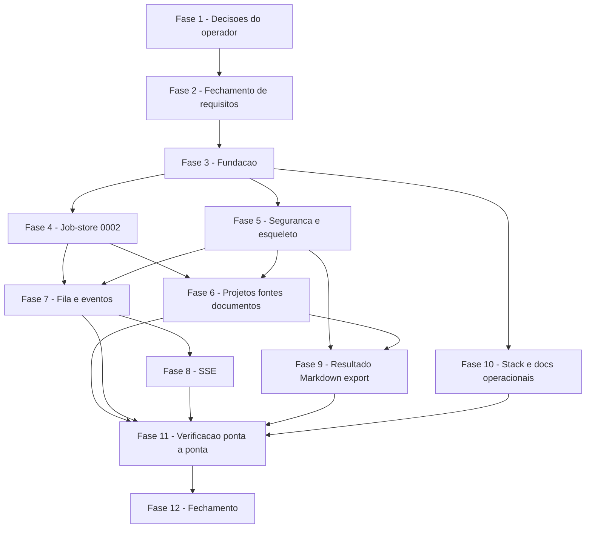

# Tarefas artigo2md - project-api

Escopo: backlog da feature `project-api` (API HTTP/SSE da versão desktop sobre o job-store e a fila da stack), derivado de `spec.md`, `plan.md`, `research.md`, `data-model.md`, `quickstart.md`, `contracts/*.md` e `checklists/{api,security,operations}.md`. Os itens `{humano}` dos checklists ficam na FASE 1 e MUST ser decididos pelo dono do produto antes de qualquer `execute-task`; nenhum agente os decide.

**Legenda de status:**
- `[ ]` Pendente
- `[~]` Em andamento
- `[x]` Concluido
- `[!]` Bloqueado

**Legenda de criticidade:**
- `[C]` Critico - Impacto financeiro direto ou bloqueante
- `[A]` Alto - Funcionalidade essencial
- `[M]` Medio - Necessario mas sem urgencia imediata

**Convencoes deste backlog:** sintaxe (nomes de arquivos, rotas, funcoes, campos) em ingles; mensagens ao usuario, logs e documentacao em portugues; `uv run pytest` verde antes de qualquer commit; nenhum dado factual (rota, campo, valor) e escrito sem fonte rastreavel (Constitution V); a FASE 1 e bloqueante para as demais.

---

## FASE 1 - Decisoes do operador (bloqueante para execute-task)

### 1.1 Decidir metas e limites numericos propostos `[C]`

Ref: checklists/api.md CHK021, CHK031; checklists/operations.md CHK016. Itens `{humano}`: NAO auto-resolver. Registrar a resposta do dono no proprio item do checklist (marcar `[x]` citando a decisao e quem decidiu).

- [x] 1.1.1 Decisao do operador: aceitar ou ajustar a meta de latencia do SSE (2 s em 95% das medicoes, SC-004) (api CHK021)
- [x] 1.1.2 Decisao do operador: aceitar ou ajustar os limites [PROPOSTA] (prazo de publicacao 10 s, 32 assinantes SSE, exportacao 512 MiB, corpo 16 MiB, 10 000 caminhos por pedido, truncamento de 2000 caracteres, fila SSE de 1000 eventos, keep-alive de 15 s) (api CHK031)
- [x] 1.1.3 Decisao do operador: definir se "medir no cenario 4" basta como criterio de capacidade do consumidor sequencial ou se ha limiar de vazao com 4 workers (operations CHK016)

### 1.2 Decidir premissas de seguranca `[C]`

Ref: checklists/security.md CHK003, CHK017, CHK020. Itens `{humano}`: NAO auto-resolver.

- [x] 1.2.1 Decisao do operador: confirmar, por fonte, a origem de producao do app (`tauri://localhost` como padrao de `ARTIGO2MD_API_ALLOWED_ORIGINS`) ou informar a origem correta (security CHK003) -- nota: a variavel foi removida depois (13.9, dec-052); a origem confirmada ficou fixa no codigo
- [x] 1.2.2 Decisao do operador: aceitar (e registrar no plan) ou rejeitar o risco de publicador local forjar `result`/`error` bem formado para um `job_id` real, dado que credenciais do broker equivalem a confianca total (security CHK017)
- [x] 1.2.3 Decisao do operador: declarar a ausencia de limitacao de taxa como decisao explicita (N/A por ser monousuario local) ou exigir um limite (security CHK020)

### 1.3 Decidir operacao, permissoes e retencao `[C]`

Ref: checklists/operations.md CHK006, CHK008, CHK018. Itens `{humano}`: NAO auto-resolver.

- [x] 1.3.1 Decisao do operador: escolher o runtime Docker do macOS em uso e o criterio/saida se o usuario `10001` nao ler ou remover arquivos do worker no bind mount (operations CHK006, plan R-02)
- [x] 1.3.2 Decisao do operador: aceitar ou restringir a politica do `uv lock` (somente o grupo `api` ganha `pika`, nenhuma outra versao pode mudar) (operations CHK008)
- [x] 1.3.3 Decisao do operador: definir a politica de retencao dos diretorios `<data_dir>/<job_id>/` de jobs substituidos (manter tudo ou limpar) (operations CHK018)

---

## FASE 2 - Fechamento de requisitos (gaps, ambiguidades e conflitos dos checklists)

### 2.1 Especificar gaps do contrato HTTP/SSE `[A]`

Ref: checklists/api.md CHK007, CHK009, CHK013, CHK023, CHK024; contracts/http-api.md; contracts/live-events.md; research.md Decision 11.

- [x] 2.1.1 Definir em `contracts/http-api.md` o status e o `code` de `POST /v1/projects/{id}/jobs` quando o corpo traz `document_ids` e `not_processed` juntos, nenhum dos dois, ou ids de documento de outro projeto (api CHK007)
- [x] 2.1.2 Declarar a ordenacao de `GET /v1/projects`, `GET /v1/projects/{id}/documents` e das tentativas em `contracts/http-api.md` e `data-model.md` (api CHK009)
- [x] 2.1.3 Definir em `contracts/live-events.md` o que o fluxo emite e o que ocorre com assinantes quando o projeto e arquivado ou excluido com jobs nao finais (um `job_state cancelled` por job? fluxo encerrado?) (api CHK023)
- [x] 2.1.4 Definir o comportamento de `GET /v1/projects/{id}/export` sem nenhum documento concluido (zip vazio, 404 ou outro) em `contracts/http-api.md` e `research.md` Decision 11 (api CHK024)
- [x] 2.1.5 Registrar em `spec.md` os valores numericos dos limites (corpo, caminhos por pedido, exportacao) conforme a decisao 1.1.2, ligando-os a um requisito (api CHK013)

### 2.2 Especificar gaps de seguranca `[C]`

Ref: checklists/security.md CHK006, CHK009, CHK010, CHK017, CHK020; research.md Decision 9, Decision 10; plan.md S-07.

- [x] 2.2.1 Enumerar em `contracts/http-api.md` os metodos e cabecalhos permitidos pelo CORS (preflight de `PATCH`, `DELETE`, `Content-Type: application/json`) (security CHK006)
- [x] 2.2.2 Especificar o equivalente portavel de `/proc/self/fd` para a verificacao do descritor em ambiente sem Linux (testes `uv run pytest` no macOS) sem enfraquecer o confinamento (security CHK010)
- [x] 2.2.3 Atualizar `research.md` Decision 10 para a mesma sequencia de S-07 (abrir com `O_NOFOLLOW`, conferir caminho real do descritor), eliminando a ambiguidade de qual regra vale (security CHK009)
- [x] 2.2.4 Registrar no plan as decisoes do operador sobre fronteira de confianca do broker e ausencia de limitacao de taxa conforme 1.2.2 e 1.2.3 (security CHK017, CHK020) — feito na onda-006: plan S-08 e S-10
- [x] 2.2.5 Registrar no plan e em `contracts/configuration.md` a origem permitida confirmada em 1.2.1 (security CHK003) — feito na onda-006: plan R-01, research Decision 9/F19, configuration.md e variavel nova `ARTIGO2MD_API_ALLOW_DEV_ORIGIN` (dev `http://localhost:1420`, desligada por padrao)

### 2.3 Especificar gaps de operacao `[A]`

Ref: checklists/operations.md CHK003, CHK007, CHK010, CHK014, CHK017; research.md Decision 3, 5, 11.

- [x] 2.3.1 Especificar a mensagem de diagnostico em portugues para o descompasso entre `--data-dir` do worker e `ARTIGO2MD_DATA_DIR` da API (sintoma: caminho de Markdown fora do diretorio de dados) (operations CHK003)
- [x] 2.3.2 Incluir `uv.lock` na arvore de arquivos do plan e em `contracts/configuration.md` como entregavel com criterio de aceite (diff restrito ao grupo `api`, conforme 1.3.2) (operations CHK007)
- [x] 2.3.3 Escrever a premissa (ou backfill) para jobs `pending` ja existentes quando a migracao `0002` e aplicada e `published_at` e nulo (operations CHK010)
- [x] 2.3.4 Especificar o sinal minimo de consumidor parado/desconectado visivel ao app, sem alterar o significado de `/health` (operations CHK014)
- [x] 2.3.5 Relacionar o teto de exportacao (conforme 1.1.2) ao tamanho do `tmpfs /tmp` e fixar o valor de `size` no compose ou reduzir o teto (operations CHK017)

### 2.4 Ajustar redacao de ambiguidades e conflitos na spec e no plan `[A]`

Ref: checklists/api.md CHK006, CHK011, CHK012, CHK016, CHK017, CHK019; checklists/operations.md CHK013, CHK021.

- [x] 2.4.1 Definir a fronteira entre `400 invalid_request` e `422 validation_failed` para `kind`, `mode` e `engine` invalidos em `contracts/http-api.md` (api CHK006)
- [x] 2.4.2 Alinhar a redacao de FR-008 (16384 bytes da mensagem) ao limite efetivo de 1024 bytes do caminho (`PC_PATH_MAX`) citando `queue-messages.md` (api CHK011)
- [x] 2.4.3 Delimitar em FR-031 a excecao do registro parcial de FR-007/FR-008 (`created/existing/rejected`) (api CHK012)
- [x] 2.4.4 Afirmar em `spec.md` (US4-6/FR-025) a transicao do job para `failed` com motivo quando `markdown_path` esta fora do diretorio de dados (api CHK016)
- [x] 2.4.5 Alinhar SC-005, quickstart cenario 4 e R-06 sobre republicacao at-least-once (resultado duplicado descartado, nenhum resultado/historico duplicado) (api CHK017, operations CHK013)
- [x] 2.4.6 Reescrever SC-008 com criterio observavel para "sem precisar ler o codigo" e para "100% das rotas" (api CHK019)
- [x] 2.4.7 Definir no quickstart cenario 1 a origem do PDF de amostra (fixture de `tests/conftest.py` ou artefato versionado) (operations CHK021)

### 2.5 Revalidar checklists e consistencia dos artefatos `[M]`

Ref: checklists/api.md; checklists/security.md; checklists/operations.md.

- [x] 2.5.1 Marcar `[x]` nos checklists apenas os itens efetivamente fechados pelas tarefas 2.1 a 2.4, citando o trecho alterado como evidencia
- [x] 2.5.2 Rodar a verificacao de cobertura de requisitos sobre `spec.md` (`requirement-coverage.sh`) e conferir zero FR sem cenario
- [x] 2.5.3 Rodar a analise cruzada spec/plan/tasks (skill `analyze`) e tratar divergencias de numeracao de FR/CHK -- onda-006: analise cruzada sem CRITICAL; FR/SC referenciados existem na spec; ajustes: plan [PROPOSTA] dos limites aceitos e 8.2.4

---

## FASE 3 - Fundacao: contrato compartilhado, dependencia, configuracao e erros

### 3.1 Extrair o contrato da fila para `jobqueue/schema.py` `[A]`

Ref: research.md Decision 1; plan.md Project Structure; docs/specs/conversion-queue/contracts/queue-messages.md.

- [x] 3.1.1 Criar `src/artigo2md/jobqueue/schema.py` com o contrato v1 sem dependencia de `router`/`pdfscan` (`build_job`, `validate_event`, limites, `JOB_ID_RE`) -- onda-007: jobqueue/schema.py criado, so stdlib (mapas estaticos REPORT/ANALYSIS/ATTEMPT/QUALITY_KINDS, ENGINES literal)
- [x] 3.1.2 Fazer `contract.py` reexportar de `schema` e manter a introspecao usada nos testes; ajustar `amqp.py`, `topology.py`, `output.py` para importar de `schema` -- onda-007: contract.py virou fachada (reexporta schema + introspecao); amqp/topology/output importam de schema
- [x] 3.1.3 Criar `tests/test_jobqueue_schema.py` comparando `schema` com a introspecao dos dataclasses de `router` (`Attempt`, `Quality`) e `schema.ENGINES == router.ENGINES` -- onda-007: tests/test_jobqueue_schema.py 8 passed (mapas == introspecao; schema.ENGINES == router.ENGINES)
- [x] 3.1.4 Testar em processo novo que importar `jobqueue.schema`, `topology` e `amqp` nao carrega `pypdfium2`, `artigo2md.router` nem `artigo2md.pdfscan` -- onda-007: teste em processo novo: schema/topology/amqp/output nao carregam pypdfium2/router/pdfscan/engines/docling/psutil (passed)
- [x] 3.1.5 Rodar a suite existente do worker (`tests/test_jobqueue_*`) para provar que nenhum comportamento do worker mudou -- onda-007: uv run pytest tests/test_jobqueue_*.py test_worker.py test_fake_amqp.py -> 272 passed, 14 skipped; suite completa 776 passed, 60 skipped

### 3.2 Acrescentar `pika` ao grupo `api` e regenerar `uv.lock` `[A]`

Ref: checklists/operations.md CHK007, CHK008; contracts/configuration.md "pyproject.toml"; research.md Decision 3. Depende da decisao 1.3.2.

- [x] 3.2.1 Acrescentar `"pika==1.5.0"` ao grupo `api` de `pyproject.toml` sem alterar outras dependencias -- onda-007: pyproject.toml: grupo api = [..., "pika==1.5.0"], nenhuma outra dependencia alterada
- [x] 3.2.2 Regenerar `uv.lock` com `uv lock` e conferir que o diff se restringe ao grupo `api` (politica de 1.3.2) -- onda-007: uv lock: git diff --stat uv.lock = 2 insertions (pika no grupo api e no specifier); nenhuma versao mudou
- [x] 3.2.3 Verificar que `uv sync --frozen --only-group api` resolve e que `import pika` funciona nesse ambiente -- onda-007: uv sync --frozen --only-group api em venv isolado instalou pika==1.5.0; import pika -> 1.5.0
- [x] 3.2.4 Testar que `uv sync --extra dev --extra queue` continua sem conflito e que `uv run pytest` segue verde -- onda-007: uv sync --locked --extra dev --extra queue ok; uv run pytest -> 784 passed, 60 skipped (registro de licenca do pika na imagem api acrescentado em stack/THIRD_PARTY_LICENSES.md, exigido por test_stack_files)

### 3.3 Implementar `ApiSettings` (`api/settings.py`) `[A]`

Ref: contracts/configuration.md "Variaveis lidas pela API"; data-model.md "Entity: ApiSettings"; research.md Decision 5.

- [x] 3.3.1 Criar `ApiSettings` com `data_dir_host`, `data_dir_mount`, `allowed_origins`, broker (host, porta, credenciais) e `DbSettings.from_env`, mais `allow_dev_origin` (variavel `ARTIGO2MD_API_ALLOW_DEV_ORIGIN`, desligada por padrao) -- onda-007: api/settings.py: ApiSettings (data_dir_host/mount, allowed_origins, allow_dev_origin, broker, db, *_error, warnings) com DbSettings.from_env e BrokerSettings
- [x] 3.3.2 Implementar as validacoes de cada variavel (caminhos absolutos sem `..`/`\0`/`/` final, origens `esquema://host[:porta]` sem `*`, `ARTIGO2MD_API_ALLOW_DEV_ORIGIN` so liga com `1`/`true` e entao acrescenta `http://localhost:1420`, host do broker com filtro loopback/privado) -- onda-007: validacoes por variavel implementadas (caminho absoluto, origens esquema://host[:porta] sem *, ALLOW_DEV_ORIGIN so 1/true, host do broker lista fechada + resolve_connect_host loopback/privado)
- [x] 3.3.3 Garantir que falha de configuracao nunca derruba o processo, que `repr` das credenciais oculta a senha e que a mensagem cita so o nome da variavel -- onda-007: from_env nunca levanta (teste de ambiente vazio e de lixo); Credentials mascara senha; mensagens citam so o nome da variavel
- [x] 3.3.4 Criar `tests/test_api_settings.py` cobrindo cada variavel valida/invalida, origem invalida -> lista vazia com aviso em portugues, origem de desenvolvimento ligada so pela variavel explicita e ausencia de senha em `repr`/log -- onda-007: tests/test_api_settings.py 73 passed (inclui ausencia de senha em repr/str/log e import sem docling/pika/asyncpg)

### 3.4 Implementar `api/errors.py` (corpo de erro unico) `[A]`

Ref: contracts/http-api.md "Corpo de erro"; spec.md FR-031; checklists/api.md CHK006 (resolvido em 2.4.1).

- [x] 3.4.1 Implementar o corpo `{"error": {"code", "message"}}` e a tabela codigo/status do contrato (inclui `503 data_dir_permission_denied`, decisao 1.3.1) -- onda-007: api/errors.py: ERRORS (18 codigos, status e mensagem padrao em portugues) == tabela de contracts/http-api.md (teste); corpo {"error":{code,message}}; inclui 503 data_dir_permission_denied
- [x] 3.4.2 Traduzir as excecoes do `store` (`ProjectNameTakenError`, `ActiveJobExistsError`, `InvalidJobTransitionError`, `StoreValidationError`, `*NotFoundError`, `DatabaseUnavailableError`) para o codigo correspondente -- onda-007: translate_store_error cobre ProjectNameTaken, ActiveJobExists, InvalidJobTransition, StoreValidation (estado->409, dominio->422), *NotFound, DatabaseUnavailable/StoreConfig/Migration->503, demais->500
- [x] 3.4.3 Substituir o 422 padrao do FastAPI por `400 invalid_request` em portugues que cita o campo sem eco do valor, e criar o handler `500 internal_error` com mensagem fixa -- onda-007: handler RequestValidationError -> 400 invalid_request citando o campo sem eco do valor; handlers 404/405/500 com mensagem fixa; log so com o tipo da excecao
- [x] 3.4.4 Criar testes que percorrem todos os codigos da tabela e verificam mensagem em portugues sem senha, credencial, texto bruto de driver nem pilha (SC-002) -- onda-007: tests/test_api_errors.py 58 passed (percorre todos os codigos; sem senha/driver/pilha em corpo e log)

---

## FASE 4 - Extensoes do job-store e migracao 0002

### 4.1 Migracao `0002_project_api.sql` e modelos `[A]`

Ref: contracts/store-extensions.md "Migracao 0002"; data-model.md; docs/specs/job-store/contracts/repository.md.

- [x] 4.1.1 Criar `src/artigo2md/store/migrations/0002_project_api.sql` com `jobs.published_at`, indice parcial `jobs_unpublished_idx` e troca do CHECK de `history_events_event_type_check` incluindo `project_renamed` -- onda-008: 0002_project_api.sql criado (ALTER TABLE jobs ADD COLUMN published_at; indice parcial jobs_unpublished_idx; DROP/ADD do CHECK history_events_event_type_check com project_renamed); aplicada em Postgres 18 descartavel (container local 127.0.0.1) pelos testes de integracao
- [x] 4.1.2 Substituir `jobs_guard_transition()` na migracao para aceitar `pending -> failed` mantendo as demais regras -- onda-008: CREATE OR REPLACE FUNCTION jobs_guard_transition() com pending -> running|cancelled|failed; test_migration_0002_trigger_function_keeps_every_other_rule_of_0001 prova que so essa regra difere; integracao: pending->failed aceito, final imutavel, pending->succeeded recusado
- [x] 4.1.3 Acrescentar `published_at` ao dataclass `Job` e `project_renamed` a `EVENT_TYPES` em `models.py` -- onda-008: models.py: Job.published_at (default None) e EVENT_TYPES += project_renamed; _row_to_job le published_at
- [x] 4.1.4 Aplicar o tratamento escolhido em 2.3.3 para jobs `pending` preexistentes (premissa documentada ou backfill) -- onda-008: premissa documentada (sem backfill) no cabecalho da 0002; test_0002_on_a_populated_0001_database_keeps_data_and_treats_pending_jobs_as_unpublished (banco com 0001 populado, aplica 0002, published_at nulo, list_unpublished_jobs devolve o pending) passou
- [x] 4.1.5 Ajustar `tests/test_store_migrations.py:69` para comparar `EVENT_TYPES` com o CHECK vigente apos todas as migracoes -- onda-008: tests/test_store_migrations.py compara EVENT_TYPES com o CHECK vigente apos todas as migracoes (_current_check_lists) e ganhou 2 testes da 0002; test_store_integration.py deixou de fixar so a 0001 (ALL_VERSIONS/LATEST); 125 passed (migrations+unit+contract) e integracao 36 passed com DB

### 4.2 Operacoes novas em `repository.py` `[A]`

Ref: contracts/store-extensions.md "Operacoes novas"; spec.md FR-002, FR-011.

- [x] 4.2.1 Implementar `rename_project` (nome sem espacos nas pontas, `updated_at`, evento `project_renamed`, recusas de nome vazio/em uso, caso do proprio `name_key`) -- onda-008: StoreSession.rename_project (strip, name_key, UPDATE com updated_at, evento project_renamed; mesma chave do proprio projeto so troca a grafia; colisao -> ProjectNameTakenError via indice; vazio -> StoreValidationError; inexistente -> ProjectNotFoundError)
- [x] 4.2.2 Implementar `get_source`, `list_sources`, `get_document`, `get_job` e `list_project_job_ids` com as excecoes do contrato -- onda-008: get_source (StoreNotFoundError 'Fonte nao encontrada.'), list_sources, get_document, get_job, list_project_job_ids em StoreSession e delegadas por Store (_OPERATIONS)
- [x] 4.2.3 Implementar `mark_job_published` (idempotente) e `list_unpublished_jobs(limit=1000)` -- onda-008: mark_job_published (UPDATE ... WHERE published_at IS NULL AND status IN pending/running; job final devolvido sem alteracao porque o gatilho recusa UPDATE em final) e list_unpublished_jobs(limit=1000, 1..100000)
- [x] 4.2.4 Alterar `fail_job` para aceitar `pending -> failed` e `running -> failed` e delegar em `Store`/`StoreSession` -- onda-008: _TRANSITIONS['failed'] origens (pending, running); teste unitario e integracao (pending->failed e running->failed, evento job_failed, finais seguem recusando)
- [x] 4.2.5 Criar `tests/test_store_extensions_integration.py` (`ARTIGO2MD_DB_TESTS=1`) cobrindo cada operacao nova, cada recusa e a nova transicao -- onda-008: tests/test_store_extensions_integration.py 10 passed com ARTIGO2MD_DB_TESTS=1 contra Postgres 18 descartavel; 8 testes unitarios novos em test_store_repository_unit.py (89 passed)

### 4.3 Repositorio falso `tests/fake_store.py` `[A]`

Ref: plan.md Technical Context (Testing); spec.md FR-034.

- [x] 4.3.1 Implementar `FakeStore` em memoria com a mesma interface publica do `Store` e as mesmas excecoes e transicoes (inclusive unicidade de nome e um job ativo por documento) -- onda-008: tests/fake_store.py FakeStore/FakeStoreSession com a interface de Store (_OPERATIONS), mesmas excecoes/transicoes, unicidade de nome, um job ativo por documento, rollback de transaction() e sequencias de id nao desfeitas como no Postgres; inject_failure para os testes da API
- [x] 4.3.2 Implementar no fake `rename_project`, `mark_job_published`, `list_unpublished_jobs`, `fail_job` de `pending` e os eventos de historico -- onda-008: fake implementa rename_project, mark_job_published, list_unpublished_jobs, fail_job de pending e eventos (project_renamed, job_failed etc.); cobertos pelos cenarios de paridade
- [x] 4.3.3 Criar teste de paridade que roda os mesmos cenarios contra o fake e (com `ARTIGO2MD_DB_TESTS=1`) contra o banco real, comparando resultados e excecoes -- onda-008: tests/test_fake_store_parity.py: 7 cenarios x (fake sempre; real com ARTIGO2MD_DB_TESTS=1) comparando transcricoes de resultados e excecoes: 16 passed com DB (9 sem DB, 7 skipped)

---

## FASE 5 - Seguranca e esqueleto da aplicacao

### 5.1 Politica de origem, CORS e limites de corpo (`api/security.py`) `[C]`

Ref: spec.md FR-027, FR-028; research.md Decision 9; checklists/security.md CHK003-CHK007; contracts/http-api.md "Regras gerais". Depende de 1.2.1, 1.1.2 e 2.2.1.

- [x] 5.1.1 Implementar a recusa `403 origin_not_allowed` para qualquer `Origin` fora da lista efetiva (`tauri://localhost` por padrao; `http://localhost:1420` so com `ARTIGO2MD_API_ALLOW_DEV_ORIGIN`) (inclui `null`) antes de qualquer efeito, aceitando pedido sem `Origin` -- onda-009: api/security.py OriginGuard (ASGI puro) recusa Origin fora da lista efetiva (inclui null, vazio, 2 cabecalhos) com 403 origin_not_allowed antes de qualquer efeito em /v1 (/health fora da politica); sem Origin aceito; tests/test_api_security.py prova probe.calls == 0
- [x] 5.1.2 Configurar `CORSMiddleware` com `allow_credentials=False` e os metodos/cabecalhos enumerados em 2.2.1 -- onda-009: install_security monta CORSMiddleware com allow_credentials=False, metodos GET/POST/PATCH/DELETE/OPTIONS, cabecalho Content-Type e expose Content-Disposition (constantes conferidas contra http-api.md no teste)
- [x] 5.1.3 Exigir `Content-Type: application/json` nas rotas com corpo (415) e aplicar o limite de corpo (413) sem leitura completa -- onda-009: BodyGuard exige application/json (415, aceita charset) quando ha corpo e limita a 16 MiB (413) por Content-Length declarado e por contagem em streaming, sem leitura completa; 415 antecede 413; rotas sem corpo (archive, cancel, DELETE, SSE) nao exigem Content-Type
- [x] 5.1.4 Manter o `TrustedHostMiddleware` (`Host` so `127.0.0.1`/`localhost`) com o mesmo comportamento da API base -- onda-009: TrustedHostMiddleware(127.0.0.1, localhost) mantido como camada mais externa em install_security (400 para Host estranho em /health e /v1, antes da checagem de Origin)
- [x] 5.1.5 Criar `tests/test_api_security.py` com `Origin` valida, invalida, `null`, ausente, `http://localhost:1420` recusada por padrao e aceita so com a variavel de desenvolvimento, preflight, `Content-Type` errado, corpo grande e `Host` estranho, incluindo rotas sem corpo (`archive`, `cancel`, `DELETE`) e o SSE -- onda-009: tests/test_api_security.py: 62 passed (Origin valida/invalida/null/ausente, dev origin so com ARTIGO2MD_API_ALLOW_DEV_ORIGIN, preflight 200/403/400, Content-Type errado, corpo grande declarado e em streaming, Host estranho, rotas sem corpo e SSE)

### 5.2 Confinamento de caminhos (`api/paths.py`) `[C]`

Ref: spec.md FR-025, SC-003; research.md Decision 10; plan.md S-01, S-07; checklists/security.md CHK008-CHK010. Depende de 2.2.2 e 2.2.3.

- [x] 5.2.1 Implementar `to_container_path` (recusa vazio, `\0`, nao absoluto, componente `..`/`.`; prefixo com fronteira de componente, comparacao exata) trocando o prefixo do host pelo ponto de montagem -- onda-009: api/paths.py to_container_path (recusa vazio, \0, relativo, .., ., componente vazio; fronteira de componente, comparacao exata, troca de prefixo); data_dir_unavailable sem par configurado
- [x] 5.2.2 Implementar a abertura confinada (`O_RDONLY | O_NOFOLLOW`, `S_ISREG` por `fstat`, caminho real do descritor sob o `realpath` do ponto de montagem) com o equivalente portavel definido em 2.2.2 -- onda-009: open_confined (O_RDONLY|O_NOFOLLOW|O_NONBLOCK, S_ISREG por fstat, caminho real do descritor via /proc/self/fd ou fcntl.F_GETPATH sob realpath do mount, igualdade (st_dev, st_ino), fail-closed sem mecanismo); O_NONBLOCK adicionado apos teste de FIFO travar
- [x] 5.2.3 Implementar a validacao do caminho de documento (nao vazio, absoluto, sem `\0`, `.pdf` sem diferenciar maiusculas, ate 1024 bytes UTF-8) usada por fontes e pela fonte `copied` (`<DATA_DIR_HOST>/sources/<project_id>/`) -- onda-009: check_document_path (vazio, absoluto, \0, 1024 bytes UTF-8, .pdf sem diferenciar maiusculas; mensagem cita o caminho escapado/limitado) e check_copied_path/copied_sources_root (<DATA_DIR_HOST>/sources/<project_id>/ com fronteira de componente)
- [x] 5.2.4 Criar `tests/test_api_paths.py` com a bateria maliciosa (`..`, nulo, link simbolico que escapa, caminho absoluto fora, prefixo parcial de componente) provando que nada fora do diretorio de dados e lido, no macOS sem Docker -- onda-009: tests/test_api_paths.py: 86 passed no macOS sem Docker; bateria maliciosa (.., nulo, symlink de arquivo e de diretorio que escapa, absoluto fora, prefixo parcial) sem abrir nada fora do mount
- [x] 5.2.5 Testar a corrida de troca de arquivo por link simbolico entre conferencia e abertura (S-07) e o caso `data_dir_unavailable` -- onda-009: corrida S-07 simulada trocando arquivo por symlink e diretorio pai por symlink entre conferencia e os.open (recusados), inode divergente, fail-closed, data_dir_unavailable e sem vazamento de descritor

### 5.3 Esqueleto `create_app`, `deps.py` e `/health` intacto `[A]`

Ref: spec.md FR-032, FR-033; contracts/http-api.md "Regras gerais"; plan.md Structure Decision; docs/specs/container-stack/contracts/api-health.md.

- [x] 5.3.1 Refatorar `src/artigo2md/api/app.py` para `create_app()` mantendo `artigo2md.api.app:app` como alvo do uvicorn e do `Dockerfile` -- onda-009: app.py refatorado para create_app(settings, store, broker, store_factory); artigo2md.api.app:app criado sob demanda via __getattr__ (PEP 562) para o import nao carregar store/asyncpg; Dockerfile inalterado
- [x] 5.3.2 Implementar `deps.py` com acesso ao `Store` e ao broker que devolve `503 database_unavailable`/`broker_unavailable` em portugues indicando `sh stack/up.sh` -- onda-009: api/deps.py Services (Store aberto sob demanda, falha nao guardada, lock anti-abertura dupla, fechado no lifespan salvo se injetado) + get_store/get_broker; 503 database_unavailable/broker_unavailable em portugues com 'sh stack/up.sh'
- [x] 5.3.3 Registrar os routers `/v1`, manter `/docs`, `/redoc` e `/openapi.json` desligados (404) e `GET /health` sem prefixo, inalterado -- onda-009: routes/__init__.py build_v1_router() registrado em /v1; /docs, /redoc e /openapi.json retornam 404; GET /health sem prefixo e inalterado
- [x] 5.3.4 Testar que `/health` responde igual ao contrato da API base com banco e broker indisponiveis e que a documentacao automatica retorna 404 -- onda-009: tests/test_api_app.py: 30 passed (/health igual ao contrato com banco e broker indisponiveis e sem tocar factory, docs 404, 503 com dica, recuperacao sozinha, abertura unica sob concorrencia)

### 5.4 Isolamento de modulos de conversao (FR-029) `[C]`

Ref: spec.md FR-029, US6-4, SC-007; checklists/security.md CHK025; quickstart.md cenario 7 passo 5.

- [x] 5.4.1 Criar teste em processo novo que importa `artigo2md.api.app` e verifica que `docling`, `pymupdf4llm`, `pypdfium2` e `artigo2md.router` nao estao em `sys.modules` -- onda-009: tests/test_api_isolation.py (processo novo): import de artigo2md.api.app e do alvo do uvicorn sem docling/pymupdf4llm/pypdfium2/markitdown/router/engines/pdfscan/worker/cli em sys.modules; todos os modulos api/*.py idem
- [x] 5.4.2 Repetir a verificacao apos `create_app()` e apos a partida dos servicos de fundo (broker/consumidor com fakes) -- onda-009 PARCIAL: coberto apos create_app() e apos atender requisicoes (test_api_isolation.py); falta repetir apos a partida dos servicos de fundo (broker/consumidor com fakes), que so existem na fase 7 (7.6) -- onda-011: tests/test_api_isolation.py::test_starting_the_background_services_with_fakes_loads_no_conversion_module (publicadora, consumidora e supervisor rodando com broker/banco falsos, status e enfileiramento atendidos): nenhum modulo de conversao carregado
- [x] 5.4.3 Verificar por `Dockerfile`/grupo `api` do `pyproject.toml` que nenhum motor de conversao e dependencia do grupo -- onda-009: teste confere grupo api do pyproject (fastapi, uvicorn, asyncpg, pika; sem motor de conversao nem psutil/torch) e Dockerfile com 'uv sync --frozen --only-group api' sem extras

---

## FASE 6 - Projetos, fontes e documentos (US1)

### 6.1 Rotas de projetos `[A]`

Ref: spec.md FR-001 a FR-003, US1; contracts/http-api.md "Projetos"; contracts/store-extensions.md.

- [x] 6.1.1 Implementar `GET/POST /v1/projects` (`include_archived`, ordenacao definida em 2.1.2) e `GET /v1/projects/{id}` com `to_json` explicito -- onda-009: routes/projects.py GET/POST /v1/projects (include_archived, ordem do store por (created_at, id)) e GET /v1/projects/{id} com project_to_json explicito (id, name, status, created_at, updated_at ISO 8601 com fuso); id de path int > 0 e <= 2^63-1 (400 fora)
- [x] 6.1.2 Implementar `PATCH /v1/projects/{id}` (renomear) com recusa de nome vazio ou em uso -- onda-009: PATCH /v1/projects/{id} (rename_project); nome vazio 422, nome em uso por outro ativo 409 project_name_taken, 404; corpo extra=forbid (400). Sem limite maximo de tamanho de nome: nenhuma fonte (store/SQL/spec) define um numero, nao foi inventado
- [x] 6.1.3 Implementar `POST .../archive` (com `cancelled_job_ids`) e `POST .../unarchive` (recusa se o nome estiver em uso), emitindo `job_state cancelled` conforme 2.1.3 -- onda-009 PARCIAL: POST archive/unarchive implementados e testados (cancelled_job_ids, 409 de estado e de nome em uso); FALTA a emissao ao vivo de job_state cancelled (conforme 2.1.3), que depende de api/live.py (8.1/8.2) -- onda-012: archive agora le list_open_jobs (novo no store, trava o projeto) e archive_project na MESMA transacao e, apos o COMMIT, emite um job_state cancelled por job nao final (message do historico); tests/test_api_live.py::test_archive_emits_a_cancelled_per_open_job_and_keeps_the_stream_open (+ sem jobs abertos nao emite)
- [x] 6.1.4 Criar `tests/test_api_projects.py` com `FakeStore` cobrindo criacao, nome duplicado (maiusculas/acentos), renomear, arquivar, desarquivar com conflito e os codigos de erro do contrato -- onda-009: tests/test_api_projects.py: 51 passed com FakeStore (criacao, duplicata NFC+casefold do job-store, renomear, arquivar com cancelled_job_ids, desarquivar com conflito, 400/404/405/409/415/422/503). Nota: a regra de unicidade do job-store e NFC+casefold, acento distinto nao colide

### 6.2 Rotas de fontes e documentos `[A]`

Ref: spec.md FR-005 a FR-009, US1; contracts/http-api.md "Fontes e documentos"; checklists/api.md CHK004.

- [x] 6.2.1 Implementar `GET/POST /v1/projects/{id}/sources` e `POST .../sources/{source_id}/documents` com `DocumentOutcomes` (`created`, `existing`, `rejected`) -- onda-010: routes/documents.py: GET/POST /v1/projects/{id}/sources e POST .../sources/{source_id}/documents; DocumentOutcomes {created, existing, rejected}; fonte + documentos validos gravados numa transacao (falha no meio nao deixa fonte); fonte de outro projeto = 404; serializacao explicita (sem published_at)
- [x] 6.2.2 Aplicar as regras de caminho (`kind=file` exige `documents == [path]`; `mode=copied` sob `<DATA_DIR_HOST>/sources/<project_id>/`) sem listar nem ler o disco do host -- onda-010: paths.check_document_path/check_copied_path/check_source_path (novo); kind=file com documents != [path] = 400 invalid_request; kind/mode fora da lista = 422 listando valores; copied: fonte fora de <DATA_DIR_HOST>/sources/<project_id>/ = 422 sem gravar, documento fora = rejected; sem pasta de dados = 503 data_dir_unavailable so para copied; >10 000 caminhos = 413; nenhuma leitura/listagem de disco (nada de os.* nas rotas de fonte)
- [x] 6.2.3 Implementar `GET /v1/projects/{id}/documents` e `GET /v1/documents/{id}` com `DocumentStatus` (mapeamento `not_processed|pending|running|succeeded|failed|cancelled`, ordenacao de 2.1.2) -- onda-010: GET /v1/projects/{id}/documents (ordem do store por document_id) e GET /v1/documents/{id} (list_documents da mesma transacao filtrado) com DocumentStatus completo; mapeamento not_processed|pending|running|succeeded|failed|cancelled e last_result testados; resultado vigente mantido apos job novo falho
- [x] 6.2.4 Criar `tests/test_api_documents.py` cobrindo idempotencia por (projeto, caminho), caminho invalido citado na mensagem sem afetar os validos, fonte `copied` fora da pasta e lista de 1.000 documentos -- onda-010: tests/test_api_documents.py: 46 passed (idempotencia por projeto+caminho, caminho invalido citado sem afetar validos, copied fora da pasta, 1 000 documentos registrados e listados, 400/404/413/415/503, atomicidade)

### 6.3 Exclusao de projeto com limpeza segura de arquivos (`api/files.py`) `[C]`

Ref: spec.md FR-004; contracts/http-api.md "DELETE"; plan.md S-01; checklists/security.md CHK012; checklists/operations.md CHK018. Depende da decisao 1.3.3.

- [x] 6.3.1 Implementar `DELETE /v1/projects/{id}` lendo `list_project_job_ids` e `delete_project` na mesma transacao e respondendo 204 -- onda-010: DELETE /v1/projects/{id} em routes/projects.py: list_project_job_ids + plan/check + delete_project na mesma transacao do Store, 204 sem corpo; 404 inexistente; sem pasta de dados = 503 data_dir_unavailable antes de qualquer alteracao
- [x] 6.3.2 Apos o `COMMIT`, remover somente `<mount>/<job_id>/` e `<mount>/sources/<project_id>/` derivados pela API (`lstat` diretorio real, `realpath` sob o ponto de montagem, `shutil.rmtree`), registrando falha em log sem desfazer a exclusao -- onda-010: api/files.py: alvos derivados so de ids inteiros (<mount>/<job_id>/ e <mount>/sources/<project_id>/); lstat diretorio real + realpath == candidato e sob o realpath do mount; shutil.rmtree apos o COMMIT; falha so em log (sem caminho) e exclusao mantida (teste com rmtree que levanta PermissionError)
- [x] 6.3.3 Aplicar a politica de retencao decidida em 1.3.3: manter os diretorios de jobs substituidos e remove-los so na exclusao do projeto (nenhuma limpeza em reprocessamento) -- onda-010: nenhum codigo limpa diretorios em reprocessamento/arquivamento; teste test_replaced_job_directories_are_kept_until_the_project_is_deleted (dois jobs, archive/unarchive/leituras mantem ambos; DELETE remove ambos)
- [x] 6.3.5 Antes do `COMMIT`, verificar por `os.access` (sem `chmod`) que o usuario do container pode remover os diretorios derivados e recusar com `503 data_dir_permission_denied` em portugues se nao puder; testar com diretorio sem permissao -- onda-010: files.check_removable (os.access R/W/X em cada diretorio da arvore e W/X no pai; sem chmod — teste confere ausencia de chmod/chown no modulo) antes do delete_project; 503 data_dir_permission_denied em portugues, banco e arquivos intactos; 3 testes (raiz do job, subdiretorio, mount sem escrita) usando chmod so no teste; pulados se root
- [x] 6.3.4 Testar com diretorios temporarios que link simbolico na raiz ou dentro nao e seguido, que nada fora do diretorio de dados e tocado e que arquivos de fontes `in_place` nunca sao removidos -- onda-010: tests/test_api_files.py (21 passed): link simbolico no lugar do diretorio do job, dentro da arvore, em sources/ e em sources/<id>/ nao e seguido; arquivo comum com nome de job nao e removido; nada fora de <mount>/<job_id>/ e <mount>/sources/<project_id>/ e tocado; fontes in_place (dentro e fora do mount) intactas; rmtree so chamado para alvos reais derivados

---

## FASE 7 - Broker, enfileiramento, consumo de eventos e cancelamento (US2, US5)

### 7.1 Publicadora AMQP (`api/broker.py`) `[A]`

Ref: research.md Decision 3, Decision 8; spec.md FR-011, FR-032; plan.md S-05; `src/artigo2md/jobqueue/amqp.py`. Depende de 3.1, 3.3 e 1.1.2.

- [x] 7.1.1 Implementar a thread publicadora com conexao propria (`confirm_delivery`, `mandatory=True`), abertura via `jobqueue.amqp.open_connection` e laco de reconexao independente -- onda-010: api/broker.py BrokerPublisher: thread propria com BlockingConnection, confirm_delivery(), basic_publish(mandatory=True) em artigo2md.jobs/convert, abertura por jobqueue.amqp.open_connection (settings.with_resolved_host), topology.declare idempotente, laco de reconexao com recuo 1 s a 30 s independente; pika so importado sob demanda (test_api_isolation verde)
- [x] 7.1.2 Expor `publish(job_message)` assincrono (`asyncio.wrap_future`) com o prazo decidido em 1.1.2; estouro = nao confirmado -- onda-010: async publish(message) com concurrent Future + asyncio.wrap_future e prazo de 10 s (PUBLISH_DEADLINE_SECONDS, decisao 1.1.2); estouro/Nack/nao roteavel/conexao caida = PublishFailed com motivo em portugues (sem texto do driver); item cancelado antes da retirada nunca e publicado; envio travado marca a publicadora como nao conectada ate destravar
- [x] 7.1.3 Implementar a regra S-05: publicadora desconectada ou primeira falha do lote faz os documentos restantes falharem na hora, sem nova espera -- onda-010: publicadora desconectada ou travada recusa na hora (1 000 publicacoes com broker fora em < 2 s com prazo de 30 s) e PublishBatch (publisher.batch()) faz o resto do lote falhar na hora apos a primeira falha, sem tocar a publicadora; o uso do PublishBatch na rota de lote fica para 7.2.2
- [x] 7.1.4 Testar com `tests/fake_amqp.py` confirmacao, recusa, broker fora, prazo estourado e reconexao sem reiniciar a API -- onda-010: tests/test_api_broker.py: 18 passed (5 execucoes seguidas estaveis) com tests/fake_amqp.py: confirmacao e ordem, mensagem exata/persistente, nack, nao roteavel, broker fora, prazo estourado, reconexao sem reiniciar, partida sem broker, gancho on_connect, backoff crescente, limite de 16 KiB, encerramento libera thread e conexao

### 7.2 Rotas de enfileiramento e reprocessamento `[A]`

Ref: spec.md FR-010 a FR-012, FR-026, US2, US5; contracts/http-api.md "Jobs"; research.md Decision 8; checklists/api.md CHK007, CHK014, CHK018.

- [x] 7.2.1 Implementar `POST /v1/documents/{id}/jobs` (motor padrao `auto`, validacao contra `REQUESTED_ENGINES`, `create_job` + `build_job(str(job.id), pdf_path, engine, 1)` + `mark_job_published` | `fail_job`) -- onda-011: routes/jobs.py POST /v1/documents/{id}/jobs (corpo opcional, motor padrao auto, 404 antes da recusa de dominio, 422 com a lista REQUESTED_ENGINES, create_job + build_job(str(job.id), document.path, engine, 1) + mark_job_published | fail_job); pdf_path e o caminho ABSOLUTO DO HOST gravado no documento (FR-011; worker nativo) - to_container_path fica so para ler markdown_path (dec-034); job serializado sem published_at
- [x] 7.2.2 Implementar `POST /v1/projects/{id}/jobs` (`document_ids` ou `not_processed`, regras de 2.1.1) devolvendo `enqueued`, `skipped` e `failed` -- onda-011: POST /v1/projects/{id}/jobs com document_ids XOR not_processed (400 em combinacao invalida, 404 para o pedido inteiro com id inexistente/de outro projeto antes de criar qualquer job, 413 acima de 10 000, 422 motor), PublishBatch (S-05) e resposta {enqueued, skipped, failed}
- [x] 7.2.3 Implementar a resposta `503 broker_unavailable` com o `Job` ja falho no pedido unitario e `202` com `failed[]` no lote, e a regra de um job ativo por documento (`409 active_job_exists`) -- onda-011: 503 broker_unavailable com o Job ja falho em `job` no pedido unitario; lote devolve 202 com failed[]; 409 active_job_exists no unitario e `skipped` com mensagem no lote; publicadora ausente (nao iniciada) se comporta como desconectada
- [x] 7.2.4 Implementar reprocessamento com outro motor reutilizando a rota unitaria (job novo com `attempt = 1`, anteriores preservados) e a mensagem que lista os motores validos -- onda-011: mesma rota unitaria cria job novo com attempt 1 e motor escolhido (teste: auto falho -> mineru; job anterior preservado; mensagem lista os 5 motores validos)
- [x] 7.2.5 Criar `tests/test_api_jobs.py` com mensagem exatamente no contrato `schema_version` 1 (nenhum campo extra), concorrencia de dois pedidos e lote de 1.000 documentos com broker fora (nenhum `pending` sem mensagem) -- onda-011: tests/test_api_jobs.py: 27 passed (0,1 s no lote de 1.000): corpo da fila byte a byte igual a schema.encode(build_job) e so os 6 campos do contrato, concorrencia de dois pedidos (202+409, 1 mensagem), lote de 1.000 com broker fora (1.000 failed, list_unpublished_jobs vazio); tests/fake_store.py: transaction() passou a snapshot raso (registros frozen) em vez de deepcopy (O(n^2) -> 25 s)

### 7.3 Consumidora AMQP (`api/broker.py`) `[A]`

Ref: research.md Decision 2, Decision 4; spec.md FR-013, FR-017; plan.md "Consumir". Depende de 1.1.3.

- [x] 7.3.1 Implementar a thread consumidora de `artigo2md.events.all` (`prefetch_count` 16, tratamento sequencial, `ack` somente apos tratamento ou descarte intencional) -- onda-011: broker.py EventConsumer: BlockingConnection propria em thread propria, prefetch_count 16, callback so enfileira num buffer local e o laco trata UMA mensagem por vez na ordem de chegada; ack so depois do tratamento (ou descarte intencional)
- [x] 7.3.2 Entregar cada corpo ao laco `asyncio` com `run_coroutine_threadsafe` e aguardar o resultado antes do `ack` -- onda-011: cada corpo vai ao laco asyncio com run_coroutine_threadsafe(EventHandler.handle) e a thread espera o resultado ANTES do ack
- [x] 7.3.3 Implementar recuo exponencial (1 s a 30 s) com `connection.sleep()` repetindo a mesma mensagem com banco fora e reconexao AMQP independente -- onda-011: TransientStoreError (banco fora) repete a MESMA mensagem com recuo 1 s a 30 s via connection.sleep() em fatias (heartbeat vivo; entregas durante o recuo so entram no buffer) sem ack/nack; reconexao AMQP independente (recuo proprio); tests/fake_amqp.py ganhou sleep() e espera curta ociosa em process_data_events
- [x] 7.3.4 Testar com `tests/fake_amqp.py` queda e retorno do broker e do banco sem reinicio e preservacao da ordem `progress -> result/error` -- onda-011: tests/test_api_broker.py (27 passed, 3 execucoes estaveis): ordem e ack apos tratamento, prefetch 16, banco fora com a mesma mensagem e ordem, progress antes de result com o banco oscilando, broker cai/volta sem reinicio, evento em voo redelivered tratado uma vez, mensagem venenosa com ack sem bloquear, stop libera thread e conexao, partida sem broker
- [x] 7.3.5 Expor o estado em memoria do consumidor e da publicadora em `GET /v1/status` (`consumer.connected`, `consumer.last_event_at`, `publisher.connected`), sem tocar banco/fila e sem alterar `/health` (contracts/http-api.md "Estado do consumidor"; operations CHK014) -- onda-011: routes/status.py GET /v1/status {consumer:{connected,last_event_at}, publisher:{connected}} lendo so estado em memoria (Services.consumer/broker), sem tocar banco/fila, /health inalterado; tests/test_api_status.py: 3 passed (store_factory que explode prova nenhum acesso ao banco)

### 7.4 Tratamento de eventos (`api/consumer.py`) `[A]`

Ref: research.md Decision 4; data-model.md "Mapeamento evento da fila -> gravacao"; plan.md S-02, S-06; spec.md FR-013 a FR-016; checklists/api.md CHK016.

- [x] 7.4.1 Aplicar `MAX_BODY_BYTES` e `json_depth <= MAX_JSON_DEPTH` antes de `validate_event`, descartando com log em portugues sem o corpo (S-02) -- onda-011: api/consumer.py EventHandler: corpo > MAX_BODY_BYTES (16 KiB) e json_depth > MAX_JSON_DEPTH descartados antes de validate_event, com log em portugues sem o corpo
- [x] 7.4.2 Tratar `progress` (`start_job` se `pending`), `error` passageiro (job segue `running`, aviso so ao vivo) e `error` definitivo (`fail_job` com `error_summary` em portugues) -- onda-011: progress -> start_job se pending; error passageiro -> job segue running, nada no historico (so log/aviso); error definitivo -> start_job? + fail_job(error_summary=reason, message='Conversao falhou: ...') numa transacao
- [x] 7.4.3 Tratar `result` numa transacao (`start_job`?, `record_attempt` x N, `complete_job`), escolhendo a `quality` do motor vencedor e rejeitando o evento sem qualidade -- onda-011: result numa transacao: start_job?, record_attempt x N na ordem, complete_job com a quality do 1o attempt do motor vencedor com quality nao nula; sem qualidade -> evento descartado (job segue running); valores fora do dominio/duplicata desfazem a transacao inteira
- [x] 7.4.4 Validar `markdown_path` por `to_container_path`; fora do diretorio de dados faz o job falhar com motivo em portugues sem gravar nem ler o caminho (e usar o diagnostico de 2.3.1) -- onda-011: markdown_path validado por to_container_path; fora do diretorio de dados (.., nulo, relativo, prefixo parecido) ou par nao configurado faz o job falhar com motivo em portugues (cita --data-dir do worker x ARTIGO2MD_DATA_DIR) sem gravar nem ler o caminho; texto final do diagnostico de 2.3.1 fica para 10.2.1
- [x] 7.4.5 Descartar com log evento duplicado, de job final/inexistente, de projeto arquivado/excluido ou `schema_version` nao suportada, truncando textos livres em 2000 caracteres (valor de 1.1.2) -- onda-011: descartes com log (sem corpo): duplicata/job final/inexistente (job_id nao decimal canonico), projeto arquivado, schema_version nao suportada, fora do contrato; textos livres truncados em 2000 caracteres; campos desconhecidos ignorados; falha inesperada vira descarte logado so com o tipo da excecao; so banco fora levanta TransientStoreError (retentativa)
- [x] 7.4.6 Criar `tests/test_api_consumer.py` cobrindo idempotencia por (job, tentativa), os descartes acima, campos desconhecidos ignorados e ausencia de erro registrado como falha da API -- onda-011: tests/test_api_consumer.py: 34 passed (idempotencia por job/tentativa, todos os descartes, truncamento, rollback total, ausencia de ERROR no log para descartes, caminhos maliciosos nao aparecem em log/historico/resumo)

### 7.5 Cancelamento e job orfao `[A]`

Ref: spec.md FR-018, US5-4, US5-5, Edge Cases "API reiniciada"; contracts/http-api.md bullet `cancel`; checklists/api.md CHK015.

- [x] 7.5.1 Implementar `POST /v1/jobs/{id}/cancel` para `pending` e `running` (incluindo orfao), gravando `job_cancelled` e recusando job final com `409 invalid_transition` -- onda-011: POST /v1/jobs/{id}/cancel (cancel_job; pending e running incluindo orfao; job final 409 invalid_transition; 404) em routes/jobs.py
- [x] 7.5.2 Garantir que eventos tardios de job cancelado sao descartados sem erro (FR-016) -- onda-011: eventos tardios de job cancelado descartados como job-final sem erro (EventHandler._open); teste de resultado tardio de job running orfao cancelado: sem resultado e sem tentativas gravadas
- [x] 7.5.3 Implementar `GET /v1/jobs/{id}` e `GET /v1/jobs/{id}/attempts` na ordem de `position` -- onda-011: GET /v1/jobs/{id} e GET /v1/jobs/{id}/attempts (ordem de position, Attempt/Quality serializados explicitamente: id, job_id, position, engine, seconds, quality|null, error|null, created_at)
- [x] 7.5.4 Testar cancelamento de pendente, de em andamento com resultado tardio, de final recusado e de job orfao seguido de novo enfileiramento do mesmo documento -- onda-011: tests/test_api_jobs.py (33 passed): cancelamento de pendente seguido de novo enfileiramento do mesmo documento (202), de em andamento orfao com resultado tardio descartado, de final recusado (409), job inexistente 404, tentativas por position

### 7.6 Partida, migracao e republicacao `[A]`

Ref: research.md Decision 6, Decision 12; plan.md "Consumir"; spec.md FR-011, FR-017, FR-032, SC-005, SC-006.

- [x] 7.6.1 Implementar o `lifespan` que conecta ao banco chamando `apply_migrations`, republica `list_unpublished_jobs` e inicia a consumidora, com laco de reconexao independente por dependencia -- onda-011: app.py lifespan + api/background.py: Background.start() cria publicadora e consumidora (so com BrokerSettings), supervisor chama services.get_store() com recuo 1 s a 30 s (a abertura real agora aplica apply_migrations antes de Store.open) e republica list_unpublished_jobs; cada dependencia com laco de reconexao proprio; background liga sozinho so quando nada e injetado; apply_migrations real so e exercido com banco (ARTIGO2MD_DB_TESTS) - aqui coberto por store_factory falso
- [x] 7.6.2 Fazer falha de migracao manter `/health` e responder `503` em portugues nas rotas de banco, com recuperacao automatica quando o banco volta -- onda-011: migracao/banco que falha mantem /health 200 e as rotas de banco respondem 503 database_unavailable em portugues sem texto do migrador; a abertura nao e guardada, entao a API se recupera sozinha (tests/test_api_lifespan.py)
- [x] 7.6.3 Republicar `list_unpublished_jobs` a cada reconexao da publicadora (at-least-once, R-06) sem republicar jobs ja confirmados -- onda-011: republish_unpublished a cada conexao da publicadora (gancho on_connect acorda o supervisor), PublishBatch, mark_job_published so para o confirmado (nunca republica confirmados), pula Services.inflight, falha de publicacao nao falha o job (segue pending)
- [x] 7.6.4 Testar a partida com banco fora, broker fora, ambos e jobs `pending` sem `published_at`, e que o encerramento libera threads e conexoes -- onda-011: tests/test_api_lifespan.py: 11 passed (3 execucoes estaveis): partida com jobs pending sem published_at, banco fora, broker fora, ambos, sem configuracao de broker, migracao recusada com recuperacao, reconexao sem repetir confirmados, recusa pontual com nova rodada, encerramento libera threads e conexoes

---

## FASE 8 - Fluxo ao vivo SSE (US3)

### 8.1 Difusor em memoria (`api/live.py`) `[A]`

Ref: research.md Decision 7; data-model.md "Entity: Subscriber"; contracts/live-events.md; plan.md S-03. Depende de 1.1.1 e 1.1.2.

- [x] 8.1.1 Implementar o difusor por projeto com `Subscriber` (fila limitada, marca `closed`) e remocao no `finally` -- onda-012: api/live.py LiveHub + Subscriber (asyncio.Queue maxsize 1000, closed/overflowed), remocao em unsubscribe idempotente no finally do gerador e em BackgroundTask da resposta; Services.live; tests/test_api_live.py (hub: 9 testes)
- [x] 8.1.2 Encerrar a conexao do cliente lento quando a fila enche sem afetar os demais assinantes -- onda-012: fila cheia marca overflowed/closed, remove do difusor e o gerador termina sem entregar o resto; os demais seguem (test_slow_client_is_closed_when_its_queue_fills_without_affecting_the_others)
- [x] 8.1.3 Aplicar o teto de assinantes simultaneos (`503 too_many_streams` em portugues) com o valor decidido em 1.1.2 -- onda-012: teto 32 (MAX_SUBSCRIBERS, S-03) -> ApiError too_many_streams 503 em portugues; teste de hub (teto 3 e padrao 32) e de rota (JSON 503, vaga volta apos desconexao)
- [x] 8.1.4 Testar isolamento por projeto, varios clientes, saida de um cliente sem reter recursos e ordem por job -- onda-012: tests/test_api_live.py: isolamento por projeto, varios clientes, saida sem residuo (_by_project vazio), ordem por job, keep-alive e aclose

### 8.2 Rota SSE e emissao de eventos `[A]`

Ref: contracts/live-events.md; spec.md FR-019, FR-020, SC-004; checklists/api.md CHK022, CHK023.

- [x] 8.2.1 Implementar `GET /v1/projects/{id}/events` com `StreamingResponse` (`text/event-stream`, `Cache-Control: no-cache`, 404 JSON antes de abrir o fluxo, `Origin`/`Host` iguais as demais rotas) -- onda-012: routes/events.py GET /v1/projects/{id}/events (StreamingResponse text/event-stream, Cache-Control no-cache, 404 JSON antes de abrir, 503 too_many_streams, Origin 403 pelo OriginGuard comum; projeto arquivado abre); testado por condutor ASGI que le cada quadro
- [x] 8.2.2 Emitir `progress`, `job_state` (inclui `pending` na criacao e cancelamentos por arquivar/excluir conforme 2.1.3) e `warning` a partir do consumidor e das rotas, com `emitted_at` copiado do evento da fila -- onda-012: EventHandler.handle repassa o Outcome (progress; job_state running na transicao; succeeded/failed; warning no error passageiro; emitted_at copiado) e as rotas emitem pending (criacao e lote), failed (publicacao nao confirmada), cancelled (cancel, archive, DELETE); falha do difusor nunca afeta o tratamento
- [x] 8.2.3 Enviar comentario `: keep-alive` no intervalo decidido em 1.1.2 e nao usar `id:`/`Last-Event-ID` -- onda-012: comentario ': keep-alive' a cada 15 s (KEEPALIVE_SECONDS) e nenhum id:/Last-Event-ID (frames sem id; reconexao nao reenvia nada)
- [x] 8.2.4 Criar `tests/test_api_live.py` cobrindo formato de cada evento, filtro por projeto, reconexao com leitura do status , fluxo mantido aberto ao arquivar e encerrado ao excluir (live-events.md) -- onda-012: tests/test_api_live.py: 36 passed (3 execucoes estaveis): formato de cada evento, filtro por projeto, reconexao + leitura do status, fluxo aberto ao arquivar e encerrado ao excluir, fim da API encerra os fluxos

---

## FASE 9 - Resultado, Markdown, historico e exportacao (US4)

### 9.1 Consulta de resultado e historico `[A]`

Ref: spec.md FR-022, FR-023, US4-1 a US4-3; contracts/http-api.md "Resultado, Markdown, historico e exportacao".

- [x] 9.1.1 Implementar `GET /v1/documents/{id}/result` (`Result` + `attempts` do `last_result`, `404 no_result` sem resultado) -- onda-012: routes/results.py GET /v1/documents/{id}/result ({result, attempts} do last_result; 404 no_result/not_found); tests/test_api_results.py
- [x] 9.1.2 Implementar `GET /v1/jobs/{id}/result` e a serializacao de `Quality`/`Result` (`warnings = quality.issues`) com os nomes e tipos de `models.py` -- onda-012: GET /v1/jobs/{id}/result e result_to_json (warnings = quality.issues, nomes de models.py); job falho = 404 no_result
- [x] 9.1.3 Implementar `GET /v1/projects/{id}/history` e `GET /v1/documents/{id}/history` com `limit` 1..500 e `offset >= 0` ordenados por `(occurred_at, id)` -- onda-012: GET /v1/projects/{id}/history e /v1/documents/{id}/history (limit 1..500, offset >= 0 e <= 2^63-1, 400 fora; 404 do projeto/documento conferido na mesma transacao; ordem (occurred_at, id) do store)
- [x] 9.1.4 Criar testes (em `tests/test_api_documents.py`/`test_api_jobs.py`) do resultado vigente quando um job posterior falha e das recusas de `limit`/`offset` -- onda-012: tests/test_api_results.py (49 passed no arquivo): resultado vigente mantido apos job falho posterior e trocado por sucesso novo; recusas de limit/offset (8 casos, 2 rotas); texto: testes em arquivo novo em vez de test_api_documents/test_api_jobs

### 9.2 Entrega do Markdown `[C]`

Ref: spec.md FR-024, FR-025, SC-003; contracts/http-api.md `GET .../markdown`; checklists/security.md CHK011; checklists/operations.md CHK006 (decisao 1.3.1).

- [x] 9.2.1 Implementar `GET /v1/documents/{id}/markdown` devolvendo os bytes exatos do arquivo do `last_result` com `text/markdown; charset=utf-8` -- onda-012: GET /v1/documents/{id}/markdown devolve os bytes exatos (text/markdown; charset=utf-8) lidos por export.read_markdown (abertura confinada)
- [x] 9.2.2 Recusar documento sem resultado com `404 no_result` sem acessar o disco, arquivo sumido com `404 not_found`, caminho recusado com `403 path_not_allowed` e configuracao ausente com `503 data_dir_unavailable`; `PermissionError` de leitura -> `503 data_dir_permission_denied` em portugues (decisao 1.3.1; sem root e sem `chmod`) -- onda-012: sem resultado = 404 no_result sem tocar o disco (open_host_file/open_confined trocados por funcoes que explodem no teste); arquivo sumido 404 not_found; caminho recusado 403 path_not_allowed; sem configuracao 503 data_dir_unavailable; PermissionError 503 data_dir_permission_denied (teste com chmod 0 so no teste, pulado como root)
- [x] 9.2.3 Ler apenas pela abertura confinada de `api/paths.py` (nunca por `open()` direto) -- onda-012: leitura so por paths.open_host_file/open_confined (teste AST: nenhum open() direto em export.py e routes/results.py)
- [x] 9.2.4 Testar byte a byte contra um arquivo gravado como o worker faz (`<data_dir>/<job_id>/<stem>.md`) e a bateria maliciosa aplicada a `markdown_path` gravado -- onda-012: byte a byte (UTF-8, BOM+CRLF, binario, vazio) com arquivo gravado como o worker (<data_dir>/<job_id>/<nome>) e bateria maliciosa em markdown_path gravado (.., //, ./, prefixo parecido, relativo, /etc/passwd) + link simbolico, diretorio e diretorio-do-job-link para fora; nota: NUL e vazio ja sao recusados pelo store

### 9.3 Exportacao em zip `[A]`

Ref: spec.md FR-021, US4-7; research.md Decision 11; plan.md S-04; checklists/api.md CHK024, CHK025; checklists/security.md CHK013.

- [x] 9.3.1 Implementar `GET /v1/projects/{id}/export` gravando o zip em `/tmp` e entregando `application/zip` com `Content-Disposition: attachment; filename="projeto-<project_id>.zip"` -- onda-012: GET /v1/projects/{id}/export: zip em arquivo temporario (EXPORT_TMP_DIR/tmp) entregue em StreamingResponse application/zip com Content-Disposition attachment; filename="projeto-<id>.zip" e Content-Length; arquivo removido do diretorio ao abrir (unlink com fd aberto)
- [x] 9.3.2 Nomear entradas `<stem>.md` e `<stem>-<document_id>.md` nas colisoes (ordem de `document_id`), omitindo arquivo ilegivel com registro no `LEIA-ME.txt` em portugues -- onda-012: entry_names: <stem>.md e <stem>-<document_id>.md nas colisoes (ordem de document_id, sem colisao residual); sem diretorios; ilegivel omitido e listado em LEIA-ME.txt em portugues (so nome do PDF e id, sem caminho do host)
- [x] 9.3.3 Aplicar uma exportacao por vez (`409 export_in_progress`), o teto de Markdown somado (`413`) e o comportamento sem concluidos definido em 2.1.4, removendo o zip temporario ao fim -- onda-012: uma exportacao por vez (Services.export_active, 409 export_in_progress, mantida ate o fim da entrega, liberada tambem na desconexao), teto 512 MiB somado -> 413 (contado enquanto copia) e projeto sem concluidos -> 404 no_result; zip temporario removido (nenhum arquivo sobra, inclusive em 413)
- [x] 9.3.4 Testar colisao de nomes, projeto sem concluidos, concorrencia, teto excedido e que nenhuma entrada contem diretorios -- onda-012: tests/test_api_results.py: colisao de nomes, projeto sem concluidos, concorrencia (409 com entrega em curso, lock liberado ao fim e na desconexao), teto excedido (e exato passa), 60 documentos, nenhuma entrada com diretorio

---

## FASE 10 - Stack, compose e documentacao operacional

### 10.1 Compose, `.env.example` e `up.sh` `[A]`

Ref: contracts/configuration.md "stack/.env.example", "stack/compose.yaml"; spec.md FR-030; checklists/operations.md CHK002, CHK005, CHK017. Depende de 1.2.1 e 1.3.1.

- [x] 10.1.1 Acrescentar ao servico `api` do `stack/compose.yaml` o volume `${ARTIGO2MD_DATA_DIR:?...}:/data` (unico) e o `environment` da tabela de variaveis, mantendo usuario `10001`, `read_only`, `cap_drop`, `no-new-privileges`, porta em `127.0.0.1` e healthcheck -- onda-013: compose: volumes unico `${ARTIGO2MD_DATA_DIR:?..}:/data` + environment da tabela; `docker compose config` confirmou 1 bind mount em /data
- [x] 10.1.2 Acrescentar `ARTIGO2MD_DATA_DIR` e `ARTIGO2MD_API_ALLOWED_ORIGINS` ao `stack/.env.example` com a origem confirmada em 1.2.1 (`tauri://localhost`) e `ARTIGO2MD_API_ALLOW_DEV_ORIGIN` comentada/desligada -- onda-013: .env.example: ARTIGO2MD_DATA_DIR= (obrigatoria) e ALLOWED_ORIGINS/ALLOW_DEV_ORIGIN comentadas; test_stack_files cobre -- nota: ALLOWED_ORIGINS saiu do .env.example e do compose na 13.9 (dec-052)
- [x] 10.1.3 Fazer `stack/up.sh` recusar em portugues `ARTIGO2MD_DATA_DIR` ausente, vazio, relativo, inexistente, nao diretorio ou diferente de `pwd -P`, inclusive para `stack/.env` ja existente -- onda-013: up.sh passo 3b recusa ausente/vazio/relativo/inexistente/arquivo/link simbolico/barra final/`..` (exit 2, mensagem em portugues); down.sh injeta placeholder para o `:?` do compose
- [x] 10.1.4 Fixar o `size` do `tmpfs /tmp` conforme 2.3.5 e verificar por `docker compose config` que o unico volume do servico `api` e o diretorio de dados -- onda-013: tmpfs /tmp:size=768m; `docker compose config` mostra um unico volume (bind em /data) e tmpfs /tmp:size=768m
- [x] 10.1.5 Testar a validacao do `up.sh` com variaveis invalidas (script de teste existente da stack ou novo teste shell) -- onda-013: tests/test_stack_scripts.py: 9 casos invalidos + canonico + `.env` existente sem a variavel + down; 105 passed em stack_files+stack_scripts

### 10.2 Diagnosticos operacionais `[M]`

Ref: checklists/operations.md CHK003, CHK014, CHK015; spec.md FR-031, FR-032.

- [x] 10.2.1 Implementar a mensagem de diagnostico de descompasso entre `--data-dir` do worker e `ARTIGO2MD_DATA_DIR` (2.3.1) no log e no `error_summary` do job -- onda-013: OUTSIDE_DATA_DIR_SUMMARY = texto de research Decision 10 (sem ecoar o caminho) no error_summary e no log (job_id); test_api_consumer
- [x] 10.2.2 Implementar o sinal minimo de consumidor parado definido em 2.3.4 sem mudar o contrato de `GET /health` -- onda-013: GET /v1/status ja existia (routes/status.py, so memoria); marcado e testado com consumidora real (test_status_signals_a_stopped_consumer...) sem mudar /health
- [x] 10.2.3 Garantir logs operacionais em portugues, sem corpo de evento, senha nem texto bruto de driver -- onda-013: tests/test_api_logging_hygiene.py (AST): todos os logger.* em portugues, sem exc/body/event/senha/exc_info; 100 passed
- [x] 10.2.4 Testar o diagnostico de descompasso e o sinal de consumidor parado com fakes -- onda-013: descompasso: test_result_with_markdown_path_outside...; consumidor parado: test_api_status.py + test_api_broker.py::test_status_signals...

### 10.3 README e documentacao de uso `[M]`

Ref: plan.md R-03, R-07; spec.md FR-033; checklists/operations.md CHK002.

- [x] 10.3.1 Documentar no README a nova variavel obrigatoria, o uso do mesmo caminho em `artigo2md worker --data-dir` e a migracao de quem ja tem `stack/.env` -- onda-013: README: ARTIGO2MD_DATA_DIR obrigatoria, mesmo caminho em worker --data-dir, migracao de quem ja tem stack/.env
- [x] 10.3.2 Documentar o risco aceito de processo local sem login (R-03) e a politica de origem do app -- onda-013: README: risco aceito de processo local sem login e politica de origem (403/400, ALLOW_DEV_ORIGIN)
- [x] 10.3.3 Documentar como subir a stack e abrir a API em `127.0.0.1` e a ordem de uso para `desktop-projects`/`desktop-processing` -- onda-013: README: ordem de uso stack -> worker -> app, porta 127.0.0.1:ARTIGO2MD_API_PORT, contrato em contracts/http-api.md

---

## FASE 11 - Verificacao ponta a ponta e criterios de sucesso

### 11.1 Ciclo completo com worker real (SC-001) `[A]`

Ref: spec.md FR-034, SC-001; quickstart.md cenarios 1 e 2; checklists/operations.md CHK020, CHK021.

- [x] 11.1.1 Criar `tests/test_api_integration.py` (`ARTIGO2MD_STACK=1` + `ARTIGO2MD_DB_TESTS=1`) com projeto -> fonte -> job -> `succeeded` -> Markdown byte a byte, usando o PDF de amostra definido em 2.4.7 -- onda-014: tests/test_api_integration.py::test_full_cycle_with_real_worker: stack Compose descartavel (API reconstruida do codigo atual) + worker nativo com Docling real offline; projeto -> fonte -> job -> succeeded -> Markdown servido == arquivo do worker byte a byte (ARTIGO2MD_STACK=1: 14 passed em 69 s)
- [x] 11.1.2 Validar cada payload recebido da API no ar contra as tabelas "Representacoes" (nomes, tipos, `snake_case`), nao contra mock -- onda-014: assert_matches_representation (tests/test_api_contract_coverage.py) aplicado a cada payload recebido da API no ar: Project, Source, Document, DocumentStatus, ResultSummary, Job, Attempt, Result, HistoryEvent
- [x] 11.1.3 Conferir o historico (`job_created`, `job_started`, `attempt_recorded`, `job_succeeded`) e o cenario de PDF invalido com `error_summary` em portugues -- onda-014: historico com job_created, job_started, attempt_recorded e job_succeeded (1x cada); test_invalid_pdf_fails_with_a_message_in_portuguese: job failed, error_summary em portugues, sem resultado, job_failed no historico
- [x] 11.1.4 Garantir que os testes de integracao sao pulados sem as variaveis e que `uv run pytest` passa sem Docker -- onda-014: test_integration_tests_are_skipped_without_the_variable (subprocesso sem a variavel: tudo skipped); uv run pytest padrao sem Docker (ver gate da onda)

### 11.2 Resiliencia: broker fora, reinicio e eventos invalidos (SC-005, SC-006) `[A]`

Ref: quickstart.md cenarios 3, 4 e 5; spec.md US2-9, US2-10, SC-005, SC-006.

- [x] 11.2.1 Cenario 3: parar o RabbitMQ e enfileirar 1.000 documentos, verificando todos `failed` com motivo, `/health` 200 e retomada sem reiniciar a API -- onda-014: test_scenario3_broker_down_with_1000_documents: RabbitMQ parado, 1000 documentos -> 202 em 0,7 s com 1000 failed e motivo em portugues, /health 200, 0 jobs pending sem published_at; broker volta e a API (mesmo StartedAt) e o worker reconectam sozinhos; novo pedido conclui
- [x] 11.2.2 Cenario 4: reiniciar a API no meio de 20 documentos, verificando estados finais coerentes e nenhum resultado/historico duplicado (criterio alinhado em 2.4.5) -- onda-014: test_scenario4_api_restart_in_the_middle_of_20_documents: API parada com 8 de 20 jobs concluidos; ao voltar 20 succeeded, 20 job_results, nenhum job_created/job_started/job_succeeded duplicado, attempt_recorded == job_attempts por job
- [x] 11.2.3 Cenario 5: publicar `result` duplicado, JSON invalido, `schema_version: 2` e `job_id` inexistente, verificando um unico resultado e log em portugues -- onda-014: test_scenario5_duplicate_invalid_and_unknown_events: resultado duplicado, JSON invalido, schema_version 2 e job_id inexistente -> 1 resultado, 1 job_succeeded, 1 tentativa; 3 descartes em WARNING em portugues sem eco do corpo; a duplicata e registrada em INFO (nao aparece no nivel padrao do container); fila de eventos zerada
- [x] 11.2.4 Registrar os resultados (comandos e saidas observadas) no proprio quickstart -- onda-014: resultados e numeros registrados em quickstart.md, secao 'Resultados observados (onda-014)'

### 11.3 Seguranca e permissoes do bind mount `[C]`

Ref: quickstart.md cenarios 7 e 8; spec.md US6, SC-003, SC-007; plan.md R-02; checklists/operations.md CHK006 (decisao 1.3.1).

- [x] 11.3.1 Cenario 7: `Origin` estranha -> 403, `Host` estranho -> 400, `markdown_path` malicioso e link simbolico -> job `failed` e Markdown recusado, `docker inspect` com unico `Mounts` em `/data`, `sys.modules` limpo -- onda-014: test_scenario7_*: Origin estranha/null -> 403 sem gravar nada; Host estranho -> 400; markdown_path com .. e fora da pasta -> job failed sem eco do caminho; link simbolico dentro de /data apontando para fora -> GET markdown 403 path_not_allowed sem vazar o conteudo; docker inspect com 1 unico Mount bind em /data; sys.modules limpo no container
- [x] 11.3.2 Cenario 8: no runtime Docker decidido em 1.3.1 (Docker Desktop 29.9.2, contexto `desktop-linux`), verificar leitura do Markdown e `DELETE` do projeto com o usuario `10001` sobre arquivos gravados pelo worker nativo -- onda-014: test_scenario8_bind_mount_permissions_read_and_delete: Docker Desktop 29.9.2 (contexto desktop-linux): usuario 10001 leu o Markdown gravado pelo worker nativo (HTTP 200, byte a byte) e DELETE do projeto respondeu 204 removendo <mount>/<job_id>/
- [x] 11.3.3 Se o cenario 8 falhar, confirmar que a API recusa com `503 data_dir_permission_denied` em portugues (sem root, sem `chmod`), registrar o runtime (Docker Desktop 29.9.2, `desktop-linux`) e o erro e acionar nova decisao do operador antes de qualquer mudanca de `user` do container (nunca alterar por conta propria) -- onda-014: nao acionada: o cenario 8 passou no runtime decidido (leitura 200, DELETE 204); o caminho de recusa 503 data_dir_permission_denied segue coberto por tests/test_api_files.py, test_api_results.py e test_api_errors.py; nenhuma mudanca de user do container
- [x] 11.3.4 Confirmar que a porta so aceita conexao em `127.0.0.1` -- onda-014: docker compose port api 8000 == 127.0.0.1:<porta>; conexao ao IP de LAN do host (192.168.x.x) na porta da API recusada

### 11.4 Medicoes de latencia SSE e vazao do consumidor `[M]`

Ref: quickstart.md cenarios 4 e 6; spec.md SC-004; plan.md R-05; checklists/api.md CHK021; checklists/operations.md CHK016. Depende de 1.1.1 e 1.1.3.

- [x] 11.4.1 Medir a latencia entre `emitted_at` e a chegada ao cliente SSE em varias medicoes e comparar com a meta decidida em 1.1.1 -- onda-014: test_sse_latency_and_throughput_with_four_workers: 20 eventos progress, mediana 4 ms, p95 18 ms, max 18 ms; 100% dentro de 2 s (meta 1.1.1: 95%) -> meta atendida, sem reporte ao operador
- [x] 11.4.2 Medir a vazao de eventos com 4 workers e a latencia de `list_documents` com 1.000 documentos -- onda-014: 8 PDFs reais com 4 workers: 44 eventos SSE em 5,1 s (~8,7 eventos/s de ponta a ponta); consumidor sequencial drenou 1000 eventos progress em 0,4 s (~2900 eventos/s); list_documents com 1000 documentos: mediana 4 ms, p95 5 ms (15 medicoes, HTTP completo)
- [x] 11.4.3 Registrar os numeros medidos no quickstart/plan e reportar ao operador se a meta de 1.1.1 nao for atendida (a vazao so e medida e registrada, sem limiar, decisao 1.1.3) -- onda-014: numeros registrados em quickstart.md ('Resultados observados (onda-014)'); meta da 1.1.1 atendida; vazao so medida (decisao 1.1.3)

### 11.5 Cobertura do contrato publicado (SC-008) `[A]`

Ref: spec.md FR-033, SC-008; contracts/http-api.md; checklists/api.md CHK001, CHK019.

- [x] 11.5.1 Criar teste que compara as rotas registradas em `create_app()` com as rotas de `contracts/http-api.md` e `live-events.md` (100% cobertas, nenhuma rota oculta) -- onda-014: tests/test_api_contract_coverage.py::test_registered_routes_are_exactly_the_documented_ones: 25 operacoes /v1 + /health lidas de app.openapi() == rotas parseadas de http-api.md e live-events.md; include_in_schema proibido; 51 passed
- [x] 11.5.2 Criar teste que compara os campos de cada representacao serializada com a tabela "Representacoes" e com `models.py` -- onda-014: tests/test_api_contract_coverage.py: campos serializados de 9 representacoes == tabela Representacoes == models.py (published_at nao exposto, Result.warnings acrescentado), tipos e null conferidos
- [x] 11.5.3 Testar que `/docs`, `/redoc` e `/openapi.json` retornam 404 e que `/health` e identico ao contrato da API base -- onda-014: /docs, /redoc, /openapi.json e /docs/oauth2-redirect -> 404; /health identico ao contrato da API base e unico caminho /health*

---

## FASE 12 - Fechamento e qualidade

### 12.1 Qualidade final `[A]`

Ref: CLAUDE.md "Regras do projeto"; spec.md FR-034; constitution (licencas, local, portugues).

- [x] 12.1.1 Rodar `uv run pytest` completo e corrigir qualquer falha (todos devem passar sem Docker) -- onda-014: uv run --frozen pytest: 1612 passed, 92 skipped em 52 s, sem Docker; com ARTIGO2MD_STACK=1: tests/test_api_integration.py 14 passed e tests/test_stack_integration.py 8 passed (fixture agora com ARTIGO2MD_DATA_DIR e launch_stack compartilhado)
- [x] 12.1.2 Rodar lint/typecheck configurados no projeto e corrigir pendencias -- onda-014: fato registrado: pyproject.toml nao configura ruff, mypy, pyright, flake8 nem black (so [tool.hatch] e [tool.pytest]); nenhuma ferramenta adicionada; verificacao de sintaxe com python -m compileall -q src tests passou
- [x] 12.1.3 Conferir que nenhuma dependencia obrigatoria nova alem de `pika==1.5.0` no grupo `api` e que nenhum codigo envia dados a servico externo -- onda-014: git diff de pyproject.toml/uv.lock: unica mudanca de dependencia e pika==1.5.0 no grupo api (nenhuma versao existente alterada no uv.lock); grep de imports requests/httpx/urllib/aiohttp em src/ vazio; unica URL literal em src/artigo2md/api e a origem de dev http://localhost:1420 (loopback)
- [x] 12.1.4 Revisar mensagens ao usuario e logs: em portugues, sem segredo, sem texto bruto de driver -- onda-014: revisao dos logger.* de src/artigo2md/api: todos em portugues, so o NOME do tipo da excecao (type(exc).__name__) ou codigo do contrato, sem corpo de mensagem, segredo nem texto do driver; coberto por tests/test_api_logging_hygiene.py; descartes observados no container (WARNING) em portugues sem eco do corpo

### 12.2 Reconciliar documentacao com a implementacao `[M]`

Ref: spec.md FR-033; contracts/*.md; plan.md; skills `validate-docs-rendered`, `analyze`.

- [x] 12.2.1 Remover o marcador [PROPOSTA] dos contratos e do plan apenas onde a implementacao confirmou o desenho, mantendo-o onde ainda nao validado -- onda-015: [PROPOSTA] removido de http-api, live-events, store-extensions, configuration, data-model, research, plan e quickstart, apos conferir cada afirmacao contra o codigo (api/*.py, store/, stack/); unico marcador restante e a nota historica no cabecalho do research.md
- [x] 12.2.2 Reconciliar `contracts/http-api.md`, `live-events.md`, `store-extensions.md` e `configuration.md` com o comportamento real -- onda-015: duplicatas removidas (CORS, bullet POST jobs, Estado do consumidor, live-events arquivar/excluir, research descompasso); acrescentados 405 method_not_allowed, 413 em fontes, unicidade NFC+casefold (acento distinto nao colide), erros dec-032 (kind=file 400; DELETE sem pasta 503 data_dir_unavailable), conteudo do zip, ordem/emissoes SSE, quickstart cenario 7 (symlink aceito + 403) e duplicata em INFO; referencias de linha de repository.py trocadas por nomes de funcao; test_api_contract_coverage 52 passed
- [x] 12.2.3 Rodar `validate-docs-rendered` (Mermaid, links, frontmatter, code blocks) e a analise cruzada `analyze` e tratar findings -- onda-015: validate-docs-rendered: 0 ERRO, 17 AVISO (falsos positivos de pipes escapados `\|` em tabelas); analyze: 0 CRITICAL, cobertura FR/SC completa (FR-006/014/015 cobertos por faixas); 1 finding MEDIUM corrigido (spec.md edge case citava FR-006 como pergunta aberta; ja resolvida em Q1/Q2); spec US1-2 ajustada (acento distinto nao colide)

---

## Matriz de Dependencias

## Resumo Quantitativo

| Fase | Tarefas | Subtarefas | Criticidade |
|------|---------|------------|-------------|
| 1 - Decisoes do operador (bloqueante para execute-task) | 3 | 9 | C |
| 2 - Fechamento de requisitos (gaps, ambiguidades e conflitos dos checklists) | 5 | 25 | C/A/M |
| 3 - Fundacao: contrato compartilhado, dependencia, configuracao e erros | 4 | 17 | A |
| 4 - Extensoes do job-store e migracao 0002 | 3 | 13 | A |
| 5 - Seguranca e esqueleto da aplicacao | 4 | 17 | C/A |
| 6 - Projetos, fontes e documentos (US1) | 3 | 13 | C/A |
| 7 - Broker, enfileiramento, consumo de eventos e cancelamento (US2, US5) | 6 | 28 | A |
| 8 - Fluxo ao vivo SSE (US3) | 2 | 8 | A |
| 9 - Resultado, Markdown, historico e exportacao (US4) | 3 | 12 | C/A |
| 10 - Stack, compose e documentacao operacional | 3 | 12 | A/M |
| 11 - Verificacao ponta a ponta e criterios de sucesso | 5 | 18 | C/A/M |
| 12 - Fechamento e qualidade | 2 | 7 | A/M |
| **Total** | **43** | **179** | - |

## Escopo Coberto

| Item | Descricao | Fase |
|------|-----------|------|
| FR-001 a FR-004 | CRUD de projetos, arquivar/desarquivar, exclusao com limpeza segura | 4, 6 |
| FR-005 a FR-009 | Fontes, documentos, validacao de caminho e listagem com status | 5, 6 |
| FR-010 a FR-012, FR-026 | Enfileirar unitario/lote, regra de um job ativo, reprocessar com outro motor | 7 |
| FR-013 a FR-017 | Consumo idempotente e tolerante, reconexao, republicacao na partida | 3, 7 |
| FR-018 | Cancelamento e saida para job orfao | 7 |
| FR-019, FR-020 | Fluxo SSE por projeto | 8 |
| FR-021 a FR-025 | Resultado, Markdown, historico, exportacao zip, confinamento de caminhos | 5, 9 |
| FR-027 a FR-031 | Loopback, origem, isolamento de motores, container, mensagens em portugues | 5, 10 |
| FR-032, FR-033 | Degradacao com banco/broker fora, `/health` intacto, contrato HTTP publicado | 5, 7, 11, 12 |
| FR-034, SC-001 a SC-008 | Testes sem Docker, integracao com stack, criterios de sucesso | 3 a 5, 11 |
| CHK `{humano}` (api 021/031; security 003/017/020; operations 006/008/016/018) | Decisoes do operador, bloqueantes | 1 |
| CHK `[Gap]`/`[Ambiguity]`/`[Conflict]` dos tres checklists | Fechamento de requisitos e ajuste de redacao | 2 |
| Tier de entrega usado na geracao deste backlog | Nao citado nos args (feature-00c nao propaga tier): backlog completo; nenhuma fase de infraestrutura de producao foi omitida e logs de seguranca/auditoria permanecem | todas |

## Escopo Excluido

| Item | Descricao | Motivo |
|------|-----------|--------|
| Assets/imagens do Markdown | Entrega de arquivos de apoio alem de `.md` e zip de Markdown | FR-021: o worker nao os produz; feature futura que altere o worker |
| Mensagem de cancelamento na fila | Interromper o worker em andamento | FR-018: exige nova versao do esquema (`conversion-queue/spec.md` FR-021) |
| Leitura da fila de mensagens mortas | Reenvio de DLQ pela API | Fora do escopo da spec (Edge Cases) |
| Autenticacao/login | Token ou sessao | Spec/briefing: monousuario local em loopback; risco R-03 aceito |
| Listagem de pastas do host pela API | A API ler disco do host | FR-007: o app desktop lista; a API so registra |
| Telas do app desktop | UI de projetos e processamento | Features `desktop-projects` e `desktop-processing` |
| Escolha do diretorio de dados e escrita do `stack/.env` | Local padrao do diretorio de dados | Pertence a `desktop-stack-control` (research.md Decision 5) |
| Scheduling, rotacao de chaves, mutex multi-pod, backup | Itens de infraestrutura N/A | Instancia unica local; backup pertence a `job-store`/`container-stack` |

---

## FASE 13 - Convergência

> Fase gerada automaticamente pela skill `converge` (reconciliação
> spec-vs-código). Cada tarefa abaixo corresponde a um achado (`Gap`)
> entre o que `spec.md`/`plan.md`/`tasks.md` descreveram e o estado
> presente do código. Tarefas sem o prefixo `[Revisar]` são acionáveis
> (`missing`/`partial`/`contradicts`); tarefas com `[Revisar]` são item de
> revisão (`unrequested`, FR-013) — nunca "implementar", o código já
> existe. Append-only: esta fase nunca reescreve fases/tarefas anteriores
> do arquivo (FR-009).

### 13.1 Docstring de projects.py descreve a regra de nome errada `[C]`

Ref: FR-001 · tipo: `contradicts` · severidade: `HIGH`

A docstring de `src/artigo2md/api/routes/projects.py` (linha 4) diz "unicidade entre ativos sem diferenciar maiúsculas/acentos", mas a regra real (`name_key` em `src/artigo2md/store/repository.py`) é NFC + `casefold` + NFC: maiúsculas e minúsculas colidem, uma letra com acento NÃO colide com a sem acento (spec US1-2, `contracts/http-api.md`).

- [x] 13.1.1 Corrigir a docstring de `src/artigo2md/api/routes/projects.py` para a regra NFC + `casefold` (acento distinto não colide), conforme FR-001 -- onda-017: docstring de api/routes/projects.py corrigida (NFC + casefold; acento distinto nao colide)

<!-- converge-key: 53398a719f55 -->

### 13.2 Lote "não processados" omite em `skipped` os documentos com job ativo `[C]`

Ref: FR-012 · tipo: `partial` · severidade: `HIGH`

US2-2 pede que, no pedido de todos os não processados, os documentos que já têm job pendente ou em andamento sejam ignorados com aviso e contados na resposta. Em `src/artigo2md/api/routes/jobs.py` (`enqueue_project`, modo `not_processed`) eles são filtrados em silêncio (`targets = [... if item.status == "not_processed"]`) e só entram em `skipped` pela corrida de `ActiveJobExistsError`.

- [x] 13.2.1 Acrescentar em `src/artigo2md/api/routes/jobs.py` uma entrada `skipped` (mensagem em português) para cada documento `pending`/`running` no modo `not_processed`, conforme FR-012/US2-2, e ajustar o teste correspondente em `tests/test_api_jobs.py` -- onda-017: enqueue_project (not_processed) acrescenta skipped para pending/running; test_batch_not_processed_enqueues_only_documents_without_jobs ajustado (skipped == [ids[0]])

<!-- converge-key: 46d19e3c9688 -->

### 13.3 Consumidor registra como erro o evento de job que ficou final durante o tratamento `[C]`

Ref: FR-016 · tipo: `partial` · severidade: `HIGH`

Em `src/artigo2md/api/consumer.py`, `_progress` e `_error` chamam `start_job`/`fail_job` sem tratar `InvalidJobTransitionError` (só `_result` trata). Se o job for cancelado entre `_open` e a transição, o evento cai em `logger.error("Evento descartado por erro inesperado...")`; o edge case da spec manda tratar como notificação repetida, sem registrar erro.

- [x] 13.3.1 Tratar `InvalidJobTransitionError` em `_progress` e `_error` de `src/artigo2md/api/consumer.py` como descarte `job-final` (log informativo), conforme FR-016, com teste -- onda-017: consumer._progress/_error tratam InvalidJobTransitionError como descarte job-final (info, sem erro); test_job_that_became_final_during_handling_is_discarded_as_repeated_notification

<!-- converge-key: 6ec8eb4ac717 -->

### 13.4 Campos desconhecidos nos objetos aninhados de `result` invalidam o evento `[C]`

Ref: FR-016 · tipo: `contradicts` · severidade: `HIGH`

FR-016 e `queue-messages.md` (§Campos desconhecidos, §Evolução) mandam o consumidor de eventos ignorar campos desconhecidos. Em `src/artigo2md/jobqueue/schema.py`, `validate_report` usa `_check_object`, que recusa campos extras em `report`, `report.analysis`, `report.attempts[i]` e `quality`: um campo opcional novo no relatório descartaria todo `result`. O job continua estrito.

- [x] 13.4.1 Corrigir `src/artigo2md/jobqueue/schema.py` para tolerar campos extras nos objetos aninhados dos eventos (mantendo campos obrigatórios e tipos), sem afrouxar a validação do job, conforme FR-016, com teste -- onda-017: schema._check_object/_check_kind com allow_extra; validate_report tolerante em report/analysis/attempts/quality, job segue estrito; testes de tolerancia e test_job_stays_strict_about_unknown_fields

<!-- converge-key: 8a9bbdc999cf -->

### 13.5 Exportação em zip gera nomes que colidem em disco sem diferenciar maiúsculas `[A]`

Ref: FR-021 · tipo: `contradicts` · severidade: `MEDIUM`

`entry_names` em `src/artigo2md/api/export.py` compara nomes diferenciando maiúsculas: `Artigo.md` e `artigo.md` entram ambos no zip e colidem ao extrair no APFS padrão do macOS (alvo da versão desktop). FR-021 pede exportação sem colisão de nomes.

- [x] 13.5.1 Corrigir `entry_names` em `src/artigo2md/api/export.py` para detectar colisão por `casefold()` (aplicando o sufixo `-<document_id>`), conforme FR-021, com teste -- onda-017: export.entry_names compara por casefold; test_entry_names_do_not_collide_when_compared_without_case

<!-- converge-key: a0e07676ed2e -->

### 13.6 Recusa de `Host` e de preflight CORS volta em texto puro em inglês `[A]`

Ref: FR-031 · tipo: `contradicts` · severidade: `MEDIUM`

Em `src/artigo2md/api/security.py`, `TrustedHostMiddleware` responde `Invalid host header` (texto puro, inglês) e o `CORSMiddleware` responde `Disallowed CORS method/headers` a preflight de origem autorizada com método ou cabeçalho fora da lista. FR-031 exige toda mensagem de erro ao cliente em português; `contracts/http-api.md` define o corpo de erro JSON para `/v1`. O status 400 da recusa de `Host` (FR-027) deve ser mantido.

- [x] 13.6.1 Corrigir `src/artigo2md/api/security.py` para que essas recusas devolvam mensagem em português (corpo de erro do contrato em `/v1`), mantendo os status, conforme FR-031, com teste -- onda-017: security.HostGuard e ApiCORSMiddleware.preflight_response devolvem corpo de erro JSON em portugues (status 400 mantido); testes em test_api_security.py

<!-- converge-key: 43f2dfc75a8e -->

### 13.7 CORS envolve `/health` e responde 200 a preflight `OPTIONS /health` `[A]`

Ref: FR-033 · tipo: `contradicts` · severidade: `MEDIUM`

O `CORSMiddleware` de `src/artigo2md/api/security.py` envolve a aplicação inteira: `OPTIONS /health` com `Origin` autorizada e `Access-Control-Request-Method` recebe 200 do preflight, enquanto `docs/specs/container-stack/contracts/api-health.md` fixa `OPTIONS /health` "nunca 2xx" (405). FR-033 manda manter o `/health` com o mesmo significado do contrato da API base; a docstring do módulo diz que o `/health` fica fora só das camadas 2 e 4.

- [x] 13.7.1 Corrigir `src/artigo2md/api/security.py` para aplicar o CORS só a `/v1` (o `/health` passa sem preflight) e ajustar a docstring, conforme FR-033, com teste -- onda-017: security.BusinessCORS aplica CORS so a /v1; OPTIONS /health => 405; docstring ajustada; test_cors_does_not_wrap_health_so_options_health_is_never_2xx

<!-- converge-key: 880cfa635f0a -->

### 13.8 Job falho por fila fora do ar no lote não indica como subir a infraestrutura `[A]`

Ref: FR-032 · tipo: `partial` · severidade: `MEDIUM`

No `POST /v1/projects/{id}/jobs` com o broker fora do ar, `src/artigo2md/api/routes/jobs.py` devolve 202 com jobs em `failed` cujo `error_summary` é `FAILED_SUMMARY` + "A fila de conversão não está disponível no momento.", sem a orientação "sh stack/up.sh" que a rota de documento único dá (`broker_unavailable`). FR-032 pede mensagem em português que indique como subir a infraestrutura.

- [x] 13.8.1 Acrescentar a orientação de como subir a stack à mensagem de falha de publicação por fila fora do ar em `src/artigo2md/api/routes/jobs.py`, conforme FR-032, com teste -- onda-017: jobs._publish_outcome acrescenta STACK_HINT ("sh stack/up.sh") ao error_summary; assert em test_batch_with_broker_down_fails_every_document_fast...

<!-- converge-key: 442eaf4e3796 -->

### 13.9 [Revisar] Variável que substitui a lista de origens permitidas `[M]`

Ref: FR-028 · tipo: `unrequested` · severidade: `LOW`

`src/artigo2md/api/settings.py` aceitava `ARTIGO2MD_API_ALLOWED_ORIGINS`, que trocava a lista efetiva por qualquer `esquema://host[:porta]`. A spec só prevê a origem do app (`tauri://localhost`) e a de desenvolvimento por variável explícita; uma lista arbitrária não é pedida em nenhuma story/FR.

**Decisão final do operador (dec-052, substitui a provisória dec-047): REMOVER a variável.** A lista de origens é fixa: `tauri://localhost`, mais `http://localhost:1420` só com `ARTIGO2MD_API_ALLOW_DEV_ORIGIN`.

- [x] 13.9.1 Revisar `src/artigo2md/api/settings.py`: decidir manter (e documentar na spec), restringir ou remover a substituição da lista de origens -- onda-017: decisao provisoria: manter-e-documentar (comportamento inalterado); documentado em contracts/configuration.md e README; PENDENTE de confirmacao do operador -- decisao final do operador (dec-052): REMOVER
- [x] 13.9.2 Remover `ARTIGO2MD_API_ALLOWED_ORIGINS` e `parse_origins` de `src/artigo2md/api/settings.py`, do `stack/compose.yaml`, do `stack/.env.example`, do README e dos testes (`test_api_settings`, `test_api_security`, `test_stack_files`), e refletir a remocao na documentacao da feature -- pos-conclusao (dec-052): settings.py com lista fixa `APP_ORIGIN` (+ `DEV_ORIGIN` so com a variavel de dev); `is_valid_origin` e a regex de origem sairam junto (so o parser os usava); testes novos provam que a variavel definida no ambiente e ignorada; docs atualizados (contracts/configuration.md, contracts/http-api.md, plan R-01, research Decision 9, data-model, checklists)

<!-- converge-key: fa92d5975125 -->
